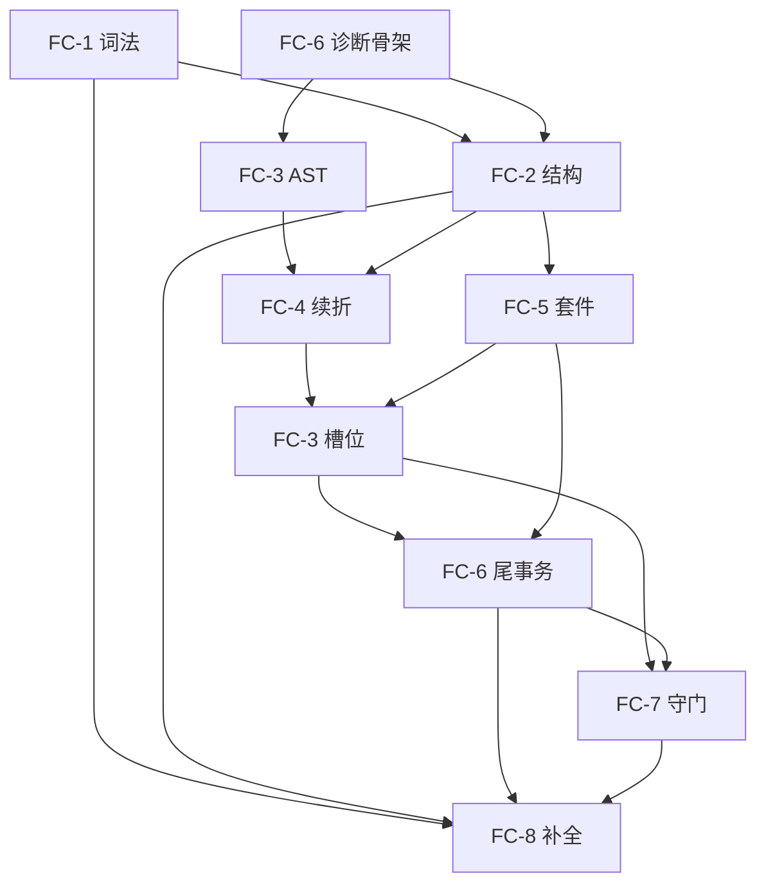

# GDParser 0.7.1：阶段 1–6 方案与执行记录归档

- 归档时间：2026-11-21。
- 基线提交：`9024e36`。阶段 1–6 提交链（由旧到新）：`a489b41` → `54378b43` → `51d477e` → `af14e33` → `8caaf55` → `9024e36`。
- 归档原因：阶段 1–6（`FC-1`–`FC-8`）的主实施已通过双审阅并合入主分支。原方案中包含修复前的行号和 100 条阶段执行/验收记录，不再作为当前实施依据。
- 后续缺口盘点与收口以[新版修复方案](../gdparser-0.7.1-issues-fix-plan.md)为准。以下原文完整保留，保留其中的历史时态、引用和记录。

---

# GDParser 0.7.1：30 项语法、恢复与补全问题统一修复方案

## 1. 背景、设计不变量与问题索引

GDParser 0.7.x 的纯 Java 解析管线由 `GdScriptParserFacade`、`GdTokenizer` 和 `GdScriptParser` 组成，补全管线由 `CompletionTokenStream` 和 `CompletionContextAnalyzer` 组成。旧参考路径 `GdParserFacade`、`CstAdapter` 和 `CstToAstMapper` 与 Java 路径共享 `frontend.ast` 模型。最初的调查覆盖紧贴数字的一元符号、纯注释或空白文件、未闭合容器、重复属性访问器、错闭合符与补全、以及伪装成健康 AST 的损坏槽位六组问题。随后逐项审计现有测试的兼容锁和恢复妥协，扩展为 `L-01` 至 `L-30`，按八项根本性更改实施。本总纲描述拟实施合同，不表示修复或下游升级已经完成。

### 1.1 裁定标准

- **G：Godot 对齐。** 语言真值来自 `vendor/godot` 的固定提交 [`c016f22009aa773f0b2e6fce72baec168746491f`](https://github.com/godotengine/godot/tree/c016f22009aa773f0b2e6fce72baec168746491f)。该目录下的 `gdscript_parser.cpp` 和 `gdscript_tokenizer.cpp` 是本地证据。同一提交的 analyzer/compiler 用来核对语义和降级责任，不将这些检查挪到解析期。
- **R：主动改进恢复。** 包括上游同样存在的缺陷和 Java 自有缺陷，也包括 Godot 不承诺的编辑期分类、结构保留与诊断完整性。各章说明具体来源。恢复 AST 留存不等于接受语法，也不等于允许编译。
- **T：旧路径有意分歧或迁移。** tree-sitter parity 只证明兼容，不能裁定 GDScript 合法性。合法并且双方承诺一致的输入保留 parity；有意分歧建立具名回归，不通过整类放松断言来消除失败。
- **D：下游接入合同。** 同机 `/home/superice/projects/gdcc` 的基线仍依赖 GDParser 0.6.0（`build.gradle.kts:63`），生产解析走旧 CST mapper，补全仍引用 `infra.treesitter`。本次不修改下游，相关检查是升级前的联调门禁。

### 1.2 全局不变量

| 编号 | 约束 |
|---|---|
| `I1` | **无符号数字字面量。** `+`、`-` 在前缀位置归 `UnaryExpression`；绝不产生带前导符号的数字 `LiteralExpression`。二元正负号照常按中缀规则处理。 |
| `I2` | **终止性与线性上界。** 对输入长度 `N`，每个恢复动作必须消费 token、切换有限状态或退出帧。括号预判最多一趟，诊断归属回退、列表前瞻和熔断配平都有可摊销的线性上界。禁止按嵌套层重复扫描相同余段、逐 token 重扫长行，或在线性扫描内遍历无界祖先链。 |
| `I3` | **UTF-8 字节包络。** `parent.startByte <= child.startByte && child.endByte <= parent.endByte`。AST `Range` 使用 `SourceTextIndex` 的物理字节偏移和零基 UTF-8 列；词法 token 行列另有一基、按 code point 计数的公开合同。诊断范围可位于其宿主 AST 范围外。 |
| `I4` | **结构与布局配平。** 解析终止时结构帧栈、多行模式栈与缩进栈回到初始基线，无遗留回放、缩进快照或待归属子帧。覆盖正常、EOF、错闭合、深度熔断和重入。 |
| `I5` | **诊断编码与归属完备。** 纯 Java 路径每条 `ERROR` 都有非空且已注册的稳定 `code`。有存活构造宿主的损伤必须带按对象身份可达的 `RecoveryLink`，`code`、`facet` 和所有者类型必须合法配对。只有显式登记为独立的词法错误，或没有合理宿主的顶层孤立垃圾，才允许 `recovery == null`。不要把旧 CST 路径的诊断纳入本轮 `I5`。 |

### 1.3 全量映射与旧回归入口

以下入口均指修复前行号。缩写：`P` = `GdScriptParserTest.java`，`E` = `GdScriptParserErrorRecoveryTest.java`，`F` = `GdScriptParserFacadeTest.java`，`T` = `GdTokenizerTest.java`，`C` = `GdCompletionContextTest.java`，`V` = `GdScriptParserRangeInvariantTest.java`，`Q` = `GdParserParityTest.java`，`Ref` = `GdParityReferenceTest.java`。均位于 `src/test/java/dev/superice/gdparser/frontend/gdscript/`。表中注明“补测”时，既有位置是相关对照而非对该缺陷已有直接断言。“协同”列的“通用诊断”指下游需要第 10.3 节的统一接入能力，不表示存在独立业务改造。

| 编号 | 问题 | 修复前测试入口 | 主 `FC`；辅 `FC` | 裁定；AST/API 或 GDCC 协同 |
|---|---|---|---|---|
| `L-01`（原 1） | 紧贴一元符号的乘幂绑定有误 | `P:860-900`，`T:205-217`，`Q:234-252` | `FC-7` | G/T/D；调整 AST 绑定，不改变无符号 lexeme |
| `L-02`（原 2） | 非空纯空白、注释、region 被误诊断 | `P:158-174,2549-2572`，`T:428-446`，需补纯 trivia 对照 | `FC-1`；`FC-6` | G；保留原 AST 与范围合同 |
| `L-03` | 错闭合符双弹栈、栈顶误报及 token 丢失 | `T:336-355`，`F:86-94` | `FC-1`；`FC-2`、`FC-8` | R；公开 token 错误语义修订 |
| `L-04`（原 6a） | `return =3` 冒充裸 `return` | `E:891-945` | `FC-3`；`FC-2`、`FC-6` | R/D；值槽形态和下游门禁 |
| `L-05`（原 4） | 属性定长循环及重复、未知项残留 | `P:407-437`，`E:652-674` | `FC-5`；`FC-2`、`FC-6` | R；保住后续成员与属性 owner |
| `L-06`（原 6b） | 坏 `var` 绑定、误用 `..` 丢失模式位置 | `P:2205-2221,2246-2258`，`E:1345-1419`，补数组与顶层模式 | `FC-3`；`FC-2`、`FC-6` | R/D；marker、模式语义门禁 |
| `L-07` | 表达式字典 `{:}` 丢掉双空槽条目 | `E:1037-1091`，补中间条目 | `FC-3`；`FC-4`、`FC-6` | R；保留 `DictEntry` 和双 marker |
| `L-08` | 内嵌非法赋值仅返回右值 | `E:356-409,1552-1575`，`P:1513-1527` | `FC-3`；`FC-2`、`FC-6` | R/D；保留赋值结构，禁止值位置降级 |
| `L-09` | 缺类型、`?` 或 `else` 的表达式冒充健康结果 | `P:1420-1430,1452-1459,1490-1494`，`E:1578`（serde 扩展） | `FC-3`；`FC-4`、`FC-6` | R/D；恢复节点与密封类型扩展 |
| `L-10` | 语句尾垃圾诊断错锚到健康前缀 | `P:213-220,1853-1861`，`E:907-931` | `FC-6`；`FC-2` | R/D；`statement.trailing`、通用诊断 |
| `L-11` | 合法字典 bare key 模式被丢 | `P:2205-2221`，`Ref:255-261,289-298`，`F:67-76` | `FC-3`；`FC-6` | G/T/D；`DictEntry.value()` 可空、存在性分支 |
| `L-12` | 作用域末尾注解静默遗留或被丢 | `P:749-791,1711-1719,1748-1757,2624-2635` | `FC-7`；`FC-5`、`FC-6` | G/R/D；保留源序、归属与去重 |
| `L-13` | 基类槽后写覆盖、顶层重复检查不对称 | `P:187-191,273-289,1730-1745` | `FC-7`；`FC-6` | R/D；First-Wins 影响基类骨架 |
| `L-14` | 必选显式类型槽无上下文诊断 | `P:330-342,386-391,811-850`，补变量、函数和信号参数 | `FC-7`；`FC-3`、`FC-6` | R/D；不把损坏类型当作合法无类型 |
| `L-15` | 混字典风格时多吃一个 token | `P:1063-1080` | `FC-4`；`FC-6` | R；保住值、真正闭合符及兄弟条目 |
| `L-16` | 首键缺分隔符级联并跨行偷键 | `P:1084-1132`，`E:1094-1107` | `FC-4`；`FC-3`、`FC-6` | R；缺值 marker 与条目保留 |
| `L-17` | 分组内损坏时遗漏自己的 `)` | `E:1528-1549`，`P:943-957` | `FC-2`；`FC-3`、`FC-6` | R；稳定分组 marker 与外层实参 |
| `L-18` | 已恢复的外层错误导致健康 lambda 吞外层闭合符 | `E:1278-1288,1494-1515`，`P:2575-2598` | `FC-2`；`FC-6` | R；同步隔离、无假缺括号 |
| `L-19` | 大量合法语句注解误触熔断 | `P:1604-1619,1773-1779`，`E:499-504,1291-1304` | `FC-5`；`FC-7` | R；保住套件与注解顺序 |
| `L-20` | `for` 用类型结果代替是否写过冒号 | `P:2025-2031,2686-2691` | `FC-7`；`FC-2`、`FC-6` | R/D；保住迭代源、体及类型诊断 |
| `L-21` | 损坏 bare key 使整表回退，无逗号时吞分支 | `E:1345-1405` | `FC-3`（载体）；`FC-4`（同步）、`FC-2`、`FC-6` | R/D；存活条目、下游模式门禁 |
| `L-22` | `Damaged` 边界停折并丢句，或吞外层实参 | `E:1429-1455,1482-1525`，`P:1291-1380`，`C:517-538` | `FC-4`；`FC-2`（跨层）、`FC-6` | R/D；部分 AST、补全回退与下游门禁 |
| `L-23` | 坏 lambda 返回类型把外层逗号当体 | `C:396-413,425-449` | `FC-2`；`FC-6`、`FC-8` | R；无体恢复、真实属性链存活 |
| `L-24` | 参数末冒号被误归类型，函数体丢失 | `E:472-496`，`P:554-561,712-721` | `FC-5`；`FC-2`、`FC-6` | R；保住参数和真实套件 |
| `L-25`（a/b/c） | 漏逗号、分支漏冒号、缺名或初始化符整构造丢失 | `P:358-377,590-600,969-980,2271-2283`，`E:1217-1276`，补 `for in arr:` | `FC-5`（b/c）；`FC-4`（a）、`FC-2`、`FC-6` | R/D；恢复体、空名禁注册 |
| `L-26` | 256 层熔断后余段未配平，`match` 提前结束 | `E:630-745,791-825` | `FC-2`；`FC-6` | R；修复分支和内外兄弟归属 |
| `L-27`（a/b） | 公开分词假缩进；物理 token 行列超过 EOF | `F:96-120`，`T:236-248,621-700,774-793,810-833` | `FC-1` | R；公开 `tokenize()` 布局与坐标行为修订 |
| `L-28`（.1/.2/.3） | 泛型续写、八类空槽、健康输入漏检 | `C:211-238,337-360,370-422` | `FC-8`；`FC-1`、`FC-2` | R/D；公开补全枚举扩展和下游映射 |
| `L-29` | 普通错误无稳定码、归属丢失或预读错绑 | `E:1111-1214`，`P:694-709,1622-1628`，`V:109-137` | `FC-6`；其余 `FC` 消费该合同 | R/D；同代诊断身份与编译门禁 |
| `L-30`（a/b/c/d） | 表面形态、带空格推断、裸 `func`、静态初始化签名裁定 | `P:330-342,583-588,1529-1541,1872-1881,2047-2059,2353-2386`；`Q:61-62,148-150,309-311` | `FC-7`；`FC-3`、`FC-6` | G/T/D；a/c/d 改守门，b 保持合法 |
| 原 3 | 未闭合容器跨行吞外层 `func` 或新语句 | `E:217-284,477-496,676-683`，补跨行兄弟 | `FC-2`；`FC-1`、`FC-6` | R；结构恢复 |
| 原 5a/5b/5c | 错闭合诊断、下一句保护、补全帧泄漏 | `T:336-355`，`C:281-347,396-413`，补嵌套错闭合及恢复终点 | `FC-2`（5a/5b）、`FC-8`（5c）；`FC-1`、`FC-6` | R；解析 AST、精确诊断和补全行为 |

原 1、2、4、6 已分别并入 `L-01`、`L-02`、`L-05`、`L-04`/`L-06`，原 3 和原 5 是跨问题验收主题，不另增 `L` 编号。`FC-6` 的编码与归属合同也适用于表中未重复标注它的所有新语法错误。

## 2. `FC-1`：词法器物理坐标、闭合符所有权与双模式布局解耦

**范围：** `L-02`、`L-03`、`L-27a`、`L-27b`，为原 3、5 提供词法基座。

### 2.1 真实闭合符与布局控制各有所有者

`GdTokenizer.java:344-361,1209-1217,1261-1266` 的 `popParen` 先弹出实际不匹配的栈顶，随后 `makeParenError` 读取并弹出下一层。`([)]` 的 `)` 因而错指外层 `(`，之后的 `]` 又被报无 opener；单层 `[)` 也可能错报没有开启者。此机制复刻了 `vendor/godot/gdscript_tokenizer.cpp:340-346,438-444`，不能保留。当前把闭合符替换成 `ERROR` 又夺走了解析和补全恢复所需的 token。

重构为单一 close handler，先读真实栈顶，再执行一次所有权决策。同类栈顶正常闭合；有同类祖先则交给最近祖先并明确标记被越过的 opener；无同类祖先则只替换栈顶；空栈则报告孤立闭合符。最近祖先查询可以按三种闭合符维护最近帧索引。对 `([)]`，若按最近祖先策略，`)` 属于 `(`，应诊断被越过的 `[`，随后的 `]` 确为多余，而不是保留旧错误归因。对同一字节跨度不要默认重复发 `ERROR` 与真实闭合符。

- **独立分词：** `GdScriptParserFacade.tokenize()` 默认按修正后的 `parenStack` 自动抑制括号内的布局，并保留错配 `ERROR` token、准确的位置和消息。`var x = [\n\t\t1\n\t]\n` 以前令 `checkIndent`（`GdTokenizer.java:625-648`）把 8 列误当作语句缩进，再把 4 列误报为非法反缩进。修复后括号内不结算这两级布局，括号后的真实语句缩进仍生效。更新公开 Javadoc：独立分词不承诺识别括号内多行 lambda 套件布局；直接调用公开 `setMultilineMode` 的用户仍可显式覆写，不能把 Facade 的新默认冒充底层所有入口的既有默认。
- **托管分词：** Parser 和 `CompletionTokenStream` 接收 `PARENTHESIS_CLOSE`、`BRACKET_CLOSE`、`BRACE_CLOSE` 原 token，各自按结构帧决定配对和诊断；词法不得在托管路径用配对错误遮蔽 token。托管模式显式 `true`、`false` 均优先于 `parenStack`。禁止 `multiline = explicitMode || !parenStack.isEmpty()`：`GdScriptParser.java:2756-2819` 的 `parseLambdaLike` 要在外层 `foo(` 仍开启时压入 `false`，隔离缩进栈快照并使 `foo(func():\n\tvar a = 1\n\treturn a\n)` 的体得到 `NEWLINE/INDENT/DEDENT`；签名临时开启抑制，退出 lambda 恢复父状态。补全必须先拿到物理布局，再由自身帧屏蔽，不能直接采用 Facade 的自动抑制。

### 2.2 物理游标和 EOF 合成布局分离

`GdTokenizer.java:1242-1254` 的 `advance()` 在消费最后一个字符时先调用 `newline(true)`，`makeToken`、`makeLiteral` 读取到的是已递增的行号与列 1；最后字符为 `\n` 时真实换行路径还会再更新一次。另核对 `GdTokenizer.java:255-275,716-733,1159-1205` 中 layout 和错误 token 的位置。基线示例和目标如下，位置为一基物理半开坐标：

| 源码 | 基线错误 | 目标 |
|---|---|---|
| `var x = 1` | `1` 的结束坐标为 `(2, 1)` | `(1, 10)` |
| `"""a\nb"""` | 字符串结束坐标跳到第 3 行 | `(2, 5)` |
| `pass\n` | EOF 起点为 `(3, 1)` | `(2, 1)` |

只在消耗物理字符时推进 `(physicalLine, physicalColumn)`，行尾 `\n` 只推进一次，CRLF 是一次物理换行。维护 token 起止快照，普通、布局和错误 token 都按自己的物理半开跨度构造；EOF 合成 `NEWLINE` 和尾随 `DEDENT` 统一锚在 `[eofPoint, eofPoint)`，不改变物理游标。tab 算一列，不把 token 的 code-point 列与 AST 的 UTF-8 字节列混用。盘点 `getLine()`、`getColumn()`、注释和续行坐标，以及唯一生产读取 `GdToken.startLine()` 的 `computeStatementStart`（`GdScriptParser.java:1145`）。禁止每枚 token 两次二分定位或在行内反复 `codePointCount`。用 CJK、emoji、CRLF、孤立 `\r`、超长单行、物理 LF、EOF 及错误 token 验证字节与行列一致。

### 2.3 解析入口过滤首部换行

非空纯空白、纯注释或纯 region 文件可因 `advance()` 的 EOF 布局钩子收到首枚 `NEWLINE`。`GdScriptParser.java:227-230,283-290` 只扫描跳过 `ERROR`，导致首部 `NEWLINE` 落入 `parseClassBody`（`:1080`），误报 `Unexpected "Newline" in class body.`。对齐 `vendor/godot/gdscript_parser.cpp:494-502`：入口初始化 `current` 后，在 `current.type() == GdTokenType.NEWLINE` 时循环调用 `scanSkippingErrors()`，保持 `previous = EMPTY`，不吞首部词法错误。上游 DEBUG 的空文件警告不是语法错误。纯空白 `SourceFile` 仍零宽锚在 EOF，注释和 region 由 `parseProgram` 的末尾 drain（`:913`）正常物化。函数体或嵌套类体仅有注释仍按上游报告缺缩进块，不全局过滤布局。

## 3. `FC-2`：显式结构帧栈、作用域同步与双向布局回放

**范围：** 原 3、5a、5b，`L-17`、`L-18`、`L-22` 的跨层症状、`L-23`、`L-26`，并为 `L-24` 提供 `INDENT` 回放。

### 3.1 根因及对旧方案的四项校正

1. **诊断不是跳读请求。** `GdScriptParser.java:378-405` 每次报错都置全局 `panicMode`，即使 `absorbSlot` 已填 marker，或 `scanSkippingErrors` 只是预读。行内 lambda（`:2756-2828`）只隔离布局等状态，不隔离 panic。`foo(1+, func(): pass)` 和 `assert(1+, func(): pass)` 中健康 `pass` 的尾钩（`:1538-1540`）会无界同步并吞外层 `)`。`f(func(): super., 1)` 中 `,` 不被识别为祖先的虚拟语句边界，坏 `super.` 被丢弃，同步再吞 `, 1)`。
2. **分组与类型、签名都须识别边界所有者。** `parseGroupingExpression`（`:3045-3067`）只在内部为 `Ok` 时检查 `)`，故 `var x = ()` 留下 `)` 触发尾部双报，`foo((), 1)` 又把内层 `)` 错当成外层调用闭合。`parseTypeInternalImpl`（`:2179-2197`）没有类型 `[` 帧。`parseLambdaLike`（`:2791-2800`）即使 `signature.hasBody() == false` 也进 `parseSuite`，把 `g(func() -> Array[, node.\n\tpa)` 的祖先逗号当成缺失语句，吞掉 `node.pa`。
3. **只回放反缩进不够。** `func f(a, b:\n\tpass` 的 `pass` 需要回放 `NEWLINE` 与更深的 `INDENT`。旧草案只会产生 `DEDENT`，也没有区分真实逻辑行逃逸与容器内软换行。
4. **熔断不是立刻按物理缩进解毒。** 深度上限为 256。`E:791-801` 在续行 `1` 拒绝递归，255 层在读到自己的闭合符前相继 `popMultiline()`；`GdScriptParser.java:650-680,709-715,1920-1929,1970-2000` 的毒区随后在缩进浅于续行的 `]:` 提前结束。`]` 被误认作新分支，其体的孤立 `DEDENT` 又被外层 `match` 当作整体关闭。

### 3.2 结构帧、闭合决策与惰性括号预判

`StructuralFrame` 记录 opener 身份、期望终止、角色、分隔符阶段、有效布局、缩进基线和待同步状态。帧至少包含 `GROUPING`、`ARRAY`、`DICTIONARY`、`CALL`、`SUBSCRIPT`、`PARAMETER_LIST`、`TYPE_BRACKET`、`LAMBDA`、`SUITE`。注解、`assert`、`preload`、`super` 调用和 `match` 容器复用对应帧机制并保留诊断角色。`TYPE_BRACKET` 继承外层 `multiline`，不主动开启；只有 `Dictionary[K, V]` 当前处于可接受类型分隔符的阶段且边界可信时占有内部逗号。`Array[, node...` 的逗号留给祖先。

统一 `consumeCloser(...)`：

1. **本层同类：** 恢复本层布局状态，再消费真实闭合符。
2. **祖先同类：** 如 `foo([1)`，本层只发零宽的 `parse.missing_closer.*`，结清本层，保留 `)` 给祖先。
3. **没有匹配祖先：** 如 `[1)\nvar x = 1`，先恢复布局模式再单层替换消费，在错闭合符精确区间发一条 `parse.mismatched_closer.*`。恢复替换不等于合法配对。
4. **非闭合符或 EOF：** 缺失诊断使用锚点而不消费前瞻，确认逃逸后才对账布局。无拥有者的多余闭合符单独报告并推进。

分组在 `Missing`、`Failed`、`Damaged` 均先锚定内容 marker，再让本层结清 `)`，不可把 marker 推到 `)` 之后。真实 `()` 只报缺内容；若 `(\n` 同时缺内容和闭合，保留原单条主诊断约定，不由通用收尾再叠泛化错误。

惰性 Bracket-Balance Oracle 在必要的跨行歧义处，最多做一次复用词法注释、字符串、续行规则的线性预判。按 opener 缓存精确闭合、替换、缺失及有效恢复终点；用索引或摊销弹栈避免逐次线性找祖先。结构停靠除未闭合跨出当前套件的反缩进外，还包括外层或同级声明（含 `enum`、具名 `func`）、只能起始语句的词和具有语句头形态的 `if cond:`（不是有匹配 `else` 的三元式）。真实闭合的多行表达式、嵌套 lambda 参数和显式尾逗号后的普通续写不因跨行被截断。`print(1\n\tprint(2)` 中，最后的 `)` 只配内层，缺逗号路径不得把第二条语句续作第一条实参。

### 3.3 局部同步、双向回放与熔断

- **`pendingSync` 由所有者持有。** 已填 marker、缺失分隔符、已结错配等已完成恢复只发诊断；未处理垃圾才在当前帧登记待同步。子 lambda、实参、suite 使用干净的局部状态，退出不污染父帧，也不清除父帧的待办。局部同步在当前/祖先拥有的 `,`、`)`、`]`、`}`、`DEDENT`、硬逻辑行和强同步词前停靠；内嵌垃圾按局部平衡消费。同步集补 `ENUM`（`GdScriptParser.java:685-690`）。行内 lambda 的虚拟语句终点仅限祖先调用/容器真正拥有的逗号或闭合符，不能把所有 `inLambda` 或所有逗号当作边界。`signature.hasBody() == false` 且没有可信缩进块起点时，直接返回受损的无体 `LambdaExpression`，不进入 `parseSuite`。
- **双向布局回放。** 确认前瞻跨到应由外层接管的逻辑行后，以该行真实缩进与 `indentStack` 对账，回放未发出的 `NEWLINE` 以及所需 `INDENT` 或 `DEDENT`，再放回原前瞻。去重已发出的布局并尊重 `\` 续行、注释、CRLF 和 lambda 缩进快照；正常闭合不回放内部软换行。`previous` 与 `extentEnd()` 不动，保留真实换行或等效物理锚点供 `layoutBlockStart` 使用，确保 I3、I4。
- **深度熔断有界配平。** 冻结拒绝点的结构与布局所有者。在结束多行抑制前，迭代扫描被拒分组余段，将尚未入栈的嵌套 opener 也纳入局部配平。有真实闭合符先结清，只有遇到真正外层硬边界才放弃未闭帧；不要逐层再扫或重复报错。随后对账布局、退出毒区，真实 `]:` 的 `:` 留给分支。测试要求 `_:` 仍是同一 `match` 的分支、`local_after` 仍归 `f`、`after` 仍归顶层。

## 4. `FC-3`：AST 槽位表达力及四态保真

**范围：** `L-04`、`L-06`、`L-07`、`L-08`、`L-09`、`L-11`、`L-21` 的无冒号损坏键载体。

### 4.1 槽位语义与字典六态

四态按源码见证区分：**合法未开槽**可为 `null` 或无条目；**已开槽但内容缺失**用零宽 `ErrorExpression(MISSING)`；**已消费坏片段或构造部分损坏**保留 `ErrorExpression(ERROR, slice)` 或含子树的受损节点；**完整**为健康节点。`ParseOutcome` 的 `Missing` 表示零消费，`Failed` 表示有失败片段但无构造值，`Damaged` 表示仍有构造值，`Ok` 不得掩盖已消费的损伤。

`vendor/godot/gdscript_parser.cpp:2675-2694` 的字典模式对键统一走 `parse_expression(false)`，无冒号存 `{key, nullptr}`，不是 `_` 值。`"name"`、`CONST_KEY`、`1 + 2` 都可入语法树；同一提交的 [`gdscript_analyzer.cpp`](https://github.com/godotengine/godot/blob/c016f22009aa773f0b2e6fce72baec168746491f/modules/gdscript/gdscript_analyzer.cpp) 折叠并校验常量键，[`gdscript_compiler.cpp`](https://github.com/godotengine/godot/blob/c016f22009aa773f0b2e6fce72baec168746491f/modules/gdscript/gdscript_compiler.cpp) 的 `PT_DICTIONARY` 先测类型和长度，再检查 `has(key)`，只有存在子模式才取值。仅键条目仍计入关闭模式的精确长度和开放模式的最小长度。

`DictEntry.java:3-9` 当前声明 `Expression value`，`getChildren()` 用 `List.of(key, value)`。因此合法 `{"name"}:` 被丢键（`L-11`），`GdScriptParser.java:2011-2070` 中已消费的坏 bare key 无载体时走 `homelessDamagedKey`，将整表退为 `ErrorExpression` 并连带销毁健康 `2: 3`（`L-21`）。改为 `DictEntry(Expression key, @Nullable Expression value, Range range)`；仅字典模式且源代码未开启冒号值槽允许 `null`。无值时 `getChildren()` 为 `[key]`，否则为 `[key, value]`。record JVM 构造器和访问器描述符不变，语义空值合同改变。普通字面量生产与消费边界继续强制值非空，绝不因共享 DTO 而允许空值。

| 源码形态 | 适用场景 | AST 目标 |
|---|---|---|
| `{}` | 字面量或模式 | `[]` |
| `{"name"}` | 模式，零诊断 | `[Entry("name", null)]` |
| `{"a": }` | 字面量或模式 | `[Entry("a", Error(MISSING))]` |
| `{:}` | 字面量或模式 | `[Entry(Error(MISSING), Error(MISSING))]` |
| `{"a": var }` | 模式 | `[Entry("a", Error(ERROR, "var"))]` |
| `{"k": ..}` | 模式 | `[Entry("k", Error(ERROR, ".."))]`，不将 `..` 当 openEnded |

`AstSexprSerializer/Deserializer` 已能使用显式 `(value nil)`，无需新协议；仍拒绝缺失 `value` 字段。加入紧凑和可读格式往返、非空不可变 children 测试。`CstToAstMapper.java:478-495,584,790-826` 增加显式 `match` 模式路由，递归涵盖数组元素和字典 value 子模式，key、guard 和普通表达式不走模式分支。只有真实 bare key 可建 `null`；不能凭 CST 缺 value 推断未写冒号。更新 `src/test/resources/gdparser-parity/key_only_dict_pattern.sexp`、参考断言和 `parseStrict` 的旧 WARNING 夹具。保留带 `_` 的值模式与 bare key 的形态区别。

### 4.2 已开槽的损伤不得折回健康节点

- **`L-04` 返回值。** `GdScriptParser.java:1348-1355,1417-1446` 把 `return =3` 的零消费 `Missing` 折回 `null`。只有真语句尾（包括行内 lambda 的有效祖先终止）才允许裸 `return`。否则发 `parse.missing_expression.return_value`，用 `return.value` 绑定，并在当前语句内有界消费 `=3` 或孤立 `)`，构造 `ReturnStatement(ErrorExpression(ERROR, slice))`。停在未消费的安全同步点，若没有可消费片段则用该点的零宽 marker。`return 1 2` 不同：值 `1` 保留，`2` 归 `statement.trailing`。对照裸 `return`、`return;`、`call(func(): return, 1)` 与 `return 1+`，不补一条泛化尾错误。
- **`L-06` 模式。** `GdScriptParser.java:1855-1870,1932-1966,1981-1994,2037-2052` 对缺绑定名 `var` 返回 `null`，导致顶层分支假报无模式、数组缩短、字典条目被丢。产出 `ErrorExpression(ERROR, "var")`、`parse.match.bind_missing_name`，不能创建空名绑定。顶层 `..:`、字典值中的 `..` 使用精确 token 范围构造 `ErrorExpression(ERROR, "..")`，发 `parse.match.rest_misplaced`。合法独立 `..` 仍设置开放标志；`{.., "k": 1}` 的位置错误要有精确诊断，`"k": 1` 仍保留。当前 `openEnded` 不编码顺序，应由诊断区分非法顺序，不伪造正常键。
- **`L-07` 和 `L-21`。** `GdScriptParser.java:3116-3185` 已为 `{:}` 建两侧 marker，但因两个 `Missing` 执行 `continue`，忽略冒号已开启条目。`:`、`=` 或真实坏片段都是条目见证；没有见证的 `{}` 和合法尾逗号不能凭空造条目。`{1+, 2: 3}` 保持 `[Entry(Damaged(1+), null), Entry(2, 3)]`，删除 `homelessDamagedKey` 回退；无逗号的同步交 `FC-4`。条目范围囊括已消费分组与两侧 marker，不把下一条目一起吸收。
- **`L-08` 内嵌赋值。** `GdScriptParser.java:3452-3477` 的 `!canAssign` 透传健康 `Ok(right)`，使 `g(a = 1, 2)` 与 `var x = y = 1` 丢左值。保留 `AssignmentExpression(operator, left, right, range)`，结果为 `ParseOutcome.damaged(...)`，在算符处发 `parse.assignment.disallowed_in_expression`。右槽仍按四态处理，父节点不得吞掉损伤位；下游须消费 `RecoveryLink`，因为 `Damaged` 不是导出 AST 的字段。
- **`L-09` 后缀与中缀。** `GdScriptParser.java:3405-3450,3481-3487` 的 `x as`、`x is`、`x is not`、`x ?` 曾发错后返回 `Ok(left)`。采用 `RecoveredInfixExpression(operand, operator, ErrorExpression problem, range)`，覆盖消费过的算符和坏片段，保留 `x` 子树。`as/is/is not` 缺目标用类型槽 marker；`?` 保留其精确错误片段，不伪造有效三元，也不用健康 `x` 或空 `TypeRef("")`。已经诊断的类型失败不再补报通用缺类型。同步更新 `Expression` permits、`ASTWalker`、`ASTNodeHandler`、`AstSexprSchema`，下游穷举分支要识别并阻断编译。真正的 `parseTernaryOperator` 缺 `else` 一律为 `Damaged`；跨行无 `else` 不夺下一句，使用零宽 `MISSING` 假分支。

### 4.3 下游对接要点

`FrontendMatchSupport` 及 `FrontendStatementResolver` 必须照常处理键，只在非空时递归值和收集绑定；`FrontendTypeCheckAnalyzer` 检常量键，按需建值计划；`FrontendCompileCheckAnalyzer` 总遍历键，按需走值。`FrontendCfgGraphBuilder` 留住类型、长度与 `MatchHasKeyItem` 检查，空值从 `has` 真边直连下一项，不读取值、不发元素提取。`1 + 2` 在 Godot 是可折叠的常量键，但 GDCC 目前不对一般 `BinaryExpression` 折叠模式键；常量折叠和 CFG 判据需一起校准，不能将“支持可空 value”称为完整 Godot 模式对齐。新恢复节点以及保留左右值的受损 `AssignmentExpression` 须接编译门禁，保留的子树可供编辑器定位，不代表已生成语义事实。第 10.3 节列出验证位置。

## 5. `FC-4`：部分受损表达式续折与容器分隔状态机

**范围：** `L-15`、`L-16`、`L-21` 的无逗号同步、`L-22` 的非边界整句丢弃、`L-25a`。

### 5.1 续折条件与损伤状态正交

原 0.7.1 为逐 token 保守迁移旧版 `null` 控制流，而不是因为续折有死循环风险，将 `Damaged` 一律停折。`GdScriptParser.java:3004-3007,3566-3595` 停在下一个中缀或后缀上，`:1493-1504` 又在非行尾扔掉已构造语句。`a[1+]+2`、`(1+)+2`、`foo(1+)(2)`、`super(1+)+2`、`super.ba + 1` 因此可整句消失。`(1+)+2` 还依赖 `FC-2` 先结清内层分组。

- 已结清局部边界的受损 `left` 可以按既有 Pratt 优先级继续折叠，外层结果为左侧旧损伤和新增右槽损伤的逻辑或，不能因右侧健康返回 `Ok`。保留 assignment、`lambdaEnded` 和祖先边界限制。`foo(1+)(2)` 在严格语法下还触发 `L-30a` 的直接调用限制，但 AST 仍保留外层调用和两个实参范围；续折不代表放行。
- `super.`、`super.ba` 是编辑器用的受损前缀，不是有效父类属性。同行紧接合法中缀时允许续折，保留 `super` 缺名或缺调用诊断及归属；不跨越未结边界。`self.b.(1)` 的 `MissingAttributeStep` 仍禁止把 `(1)` 折成 `b` 的具名属性调用，保留带缺名链作 callee 的结构；已有主损伤时不重复叠加派生形态错误。
- 同行残留不可续折 token（如 `super. var y = 1`）时，保留 `ExpressionStatement`，交 `FC-6` 有界清理语句尾，不把无分隔符的 `var` 变成静默合法的第二句。祖先 lambda 终止由 `FC-2` 处理，`f(func(): super., 1)` 仍保留外层第二实参。
- `GdCompletionContextTest.java:517-538` 当前借“必须丢掉语句”测试 token fallback。改为直接向包级 `CompletionContextAnalyzer.analyze(source, emptyAst, offset)` 注入受控空 AST；真实解析测试另断言受损语句和补全目标实际存活。补全正确与 fallback 覆盖分开验证。

### 5.2 字典条目与序列共享有界推进协议

`L-15`：`GdScriptParser.java:3145-3167` 混风格分支里的 `match(EQUAL)` 或 `match(COLON)` 已消费分隔符，又额外 `advance()`。`{"a": 1, b = 2}` 因此丢掉 `2`，`{"a": 1, b = }` 甚至吃掉 `}`。删掉两处额外 `advance()`。两方向均保留风格冲突诊断，并按实际后续 token 解析值，键归一化不把坏键变为健康。`vendor/godot/gdscript_parser.cpp:3296-3302,3313-3319` 同样多推进，本项主动修正上游缺陷。

`L-16`：`:3120-3173` 首键缺分隔符就强置 Python 风格，二次报缺 `:`，随后强读值。`{name}` 三连报错；多行 `{"a"\n\t"b": 1}` 偷拿 `"b"` 作值再误报闭合。使用 `Key -> Separator -> Value -> NextItem` 状态机，仅在第一枚真实 `:` 或 `=` 到达时锁定风格。缺分隔符只报一次。遇本层 `,`、`}`、硬边界或下一物理行的可信同层 `key + :/=` 时，为当前条目填零宽 `MISSING`，保持前瞻并转入下一条目，不重复报缺值；不要确认下一键时跨嵌套或反复扫描。同行 `{1 2}` 则可在明确值起点保留 `2`，但仍只报一次缺分隔符。已写 `:` 或 `=` 的健康跨行值不受限。

`L-25a`、`L-21` 无逗号：`parseCallArguments`（`:3639-3662`）、数组、函数/信号形参、`match` 字典模式不能只靠 `while (match(COMMA))` 驱动。每轮按“真结束、真逗号、插入分隔符、同层跳坏项”分流。只有上一项已推进、当前未遇闭合符或外层边界、且为该列表的可信子项起点，并且处于同一逻辑行或 Oracle 已证实 opener 精确配对，才报一条零宽缺逗号并解析下一项。`foo(1 2)` 保留 `1`、`2`，`func f(a b):` 保留两个形参。对于 `{1+ var x: 3}`，`var x` 不是合法键起点，按同层平衡跳至 `,` 或 `}`，保留已构坏键和诊断，不穿越硬布局、祖先边界、深度毒区。若 `}` 真实存在，消费后应保留分支 `: pass`；若还有 `, 2: 3`，健康条目继续解析。此机制不能把 `print(1\n\tprint(2)` 的第二句吸成漏逗号实参。

## 6. `FC-5`：块头短语恢复、套件接管与语句推进三态

**范围：** 原 4、`L-05`、`L-19`、`L-24`、`L-25b`、`L-25c`，含同类成员声明留存。

### 6.1 可变长属性块及错误访问器排空

`GdScriptParser.java:2298-2366` 定长两次迭代且由首项固定引用形式。重复 `get`、`set` 或未知访问器分支不排空当前项：单行遗留 `= b` 引发次生尾错误；多行遗留 `INDENT/DEDENT`，外层 `parseClassBody` 对 `DEDENT` 的分支（`:1074`）提前结束类体。第三项也可能被预先读走却未解析。

- 缩进形式循环到属性自身的 `DEDENT`，单行由列表层按逗号或逻辑行尾循环，各项独立识别 `= fn`、块级 `get:` 或 `set(v):`。容错消费不放宽合法形式，不让单个 `= fn` 的收尾吞掉列表逗号。
- 重复 getter/setter 和未知访问器各发一条主诊断 `parse.property.duplicate_getter`、`parse.property.duplicate_setter`、`parse.property.invalid_accessor`，挂 `RecoveryLink(variableDecl, "variable.property")`。重复项仍完整消费头部与自己的子套件；未知项有可信缩进时用隔离套件配平，否则只清理其逻辑行。不得借外层 `DEDENT`，不得将已排空项再交全局同步。
- 对 `parseVariable` 的全部属性入口保留首个有效访问器判定，变量范围覆盖最后排空部分。现有 AST 不发布实际访问器体，不把重复访问器变成正常语义成员。验证单行重复、三连重复、混排 `get/set`、未知带嵌套块、以及其后的 `var`、`func`、`enum` 均可各自留存。

### 6.2 块头短语恢复和套件接管

- **`L-24` 函数头。** `parseParameter` 经 `parseNameAndType`（`GdScriptParser.java:2417-2427,2465-2473`）吃掉末参数 `b:`；签名找不到 `)` 和 suite 冒号（`:2709-2725`），`parseFunction` 按无体函数（`:2614-2622`）处理，随后吞掉 `\tpass`。仅当参数表确实未闭合、此冒号处在头部末尾、下一硬逻辑行有严格更深的可信套件时，把该冒号认回体引导符，恢复缺 `)`，接管 `FC-2` 回放的 `NEWLINE + INDENT`。不发错误的缺参数类型诊断。与合法无体 `func f(a)\n`、合法跨行参数类型、无更深缩进的外层成员区分。
- **`L-25b` 分支头。** `parseMatchSection`（`:1885-1895`）缺 `:` 时只跳过该行，剩下的孤立 `INDENT ... DEDENT` 误成新分支或结束整个 `match`（`:1781,1835`）。`1\n\t\t\tpass\n\t\t2:\n\t\t\tpass` 的第一项缺 `:` 时，发专用缺冒号诊断；有可信 `NEWLINE + INDENT` 即刻 `parseSuite`，保留当前 `MatchSection` 和 `2:` 分支。没有真实缩进则停在下一分支或外层边界，不跨行找体。旧按行恢复源于 `vendor/godot/gdscript_parser.cpp:2558-2568`。
- **`L-25c` 缺名与缺初始化符。** `parseFor`（`:1637-1682`）已经读到迭代源和完整体，但 `!hasIterator` 直接返回 `null`。`for in arr:` 保留 `ForStatement`、`iterable` 和整个 `body`，缺名使用明确的恢复标记和诊断链接。`const A` 不因为缺必选 `=` 丢掉声明，保留 `VariableDeclaration(CONST, ..., ErrorExpression(MISSING))`。成员 `func ():`、`var = 1` 也应在已有构造见证时留存体或初始化器；类体缺名函数仍是 `FunctionDeclaration` 恢复，不是套件级裸 lambda。当前字段若必须用空字符串表示缺名，仅限带名槽错误和 `RecoveryLink` 的容错 AST，`FrontendVariableAnalyzer` 及下游骨架不得注册空名，也不能因缺名放弃健康体的作用域分析。合法匿名 `enum` 不是同类错误。

### 6.3 明确语句推进结果

`GdScriptParser.java:1286-1303,1370-1381` 中，前置语句注解已成功消费却因 `null` 与 `lastStatementWasNull` 被累计进不清零的失败计数，102 个合法前缀可以触发 `Too many statement errors.`。`vendor/godot/gdscript_parser.cpp:1981-1994,2139-2157` 也有 `nullptr` 复用。用 `Produced`、`ConsumedPrefix`、`Failed` 表示进度，或在入口一次吃尽同语句的合法前缀且向套件暴露等价三态，只有 `Failed` 占用熔断预算。保留同一逻辑行前缀的推进与原来的真实错误预算，不将作用域末尾注解诊断算成前面每次成功消费的失败。验证 100 条以上合法 `@warning_ignore` 有目标的输入、同一行前缀、悬空前缀和真实连续错误。

## 7. `FC-6`：构造事务、统一诊断与语句尾归属

**范围：** `L-10`、`L-29`，并向全部存活受损构造提供 `I5`。

### 7.1 锚点及关联失效的根因

**关键勘误：** `endStatement`（`GdScriptParser.java:820-845`）用 `current` 的类型拼消息，但调用单参 `pushError(message)`（`:366-368`），后者取 **`previous`** 作 origin，并非 `current`。`var q = a..(1)` 的诊断通常落在健康 `a`，`return 1 2` 落在 `1`，不是实际多余的 `..(1)`、`2`；当前 20 处调用发出的尾错全部无稳定 `code`、无 `RecoveryLink`。

普通 `pushError`（`:352-407`）默认 `recovery = null`，只在少量闭合符处通过索引绑定。变量、参数默认值、条件、`match`、枚举等多处先 `popRecoveryOwner` 再 `absorbSlot`，使新发的 `Missing` 错误脱离真实槽位。另一个反向陷阱是词法预读：`advance()` 可在消费当前语句换行时扫到下一行的 `ERROR`（`:283-305`），不能因为上一条语句的事务尚未提交就将它归到健康前句。

### 7.2 发射、提交和回退

1. 统一 `emitError` 接收已注册 `code`、物理诊断 `range`、归属策略和可选目标事务。`DiagnosticCodes` 维护闭集和 `code`/宿主类型/`facet` 合法配对，覆盖缺与错闭合符（含 `match` 数组/字典模式）、表达式/类型槽、缺分隔符、语句尾、签名/头部/顺序、注解、词法、深度与孤立垃圾。禁止从文案动态猜 code，不能用泛用兜底码掩盖类别。词法预读先暂存事件，等实际消费或恢复该位点的事务接管；明确登记的独立词法错例外允许无归属。
2. 构造事务栈（`Provisional Recovery Frame`）覆盖声明、语句、签名、参数、`MatchSection`、表达式槽和各自的局部恢复。进入点早于子规则，`absorbSlot` 在事务内完成，按真实已发布对象身份提交。尤其覆盖变参 `Parameter` 重建、参数顺序、缺闭合/类型、`match` 守卫与分支头、`break/continue` 等无值语句错误。lambda 对内层语句启动自身事务，外层 initializer 不夺走诊断。
3. 被替换或放弃的中间构造使用显式授权的父链，回退到最近真实存活宿主并切换到合法 facet。属性访问器体不发布时回退到 `VariableDeclaration` 的 `variable.property`；不可达且确实无合理宿主的事件保留范围、code、消息和顺序，只有符合 `I5` 例外才设 `null`。禁止按字节距离绑健康兄弟，或把根 `SourceFile` 当万能归宿。最终一次按 `getChildren()` 的身份遍历验证可达，回退使用可摊销缓存，避免按诊断数乘祖先深度。

### 7.3 消费真实垃圾，归属原语句

统一 `finishStatement` 负责实际语句边界和 `statement.trailing`，改造 `GdScriptParser.java` 的全部 20 个 `endStatement` 调用点：`:894,938,940,1072,1217,1391,1445,1453,1461,1466,1477,1491,1500,1727,2290,2360,2455,2542,2592,2616`。先结尾再构造节点的 `class_name`、内部 `extends`、单行属性、无体函数等使用延迟提交尾帧，依实际宿主选择 `ClassNameStatement`、`ClassDeclaration`、`VariableDeclaration`、`FunctionDeclaration` 或 `ConstructorDeclaration` 等。`match` 内直接 `consume` 的布局错误仍要走相应构造事务，不因覆盖这 20 处而省略。

垃圾诊断 `range` 取本次实际未消费的尾部垃圾（允许按有界消费后的精确区间扩展），不得锚回健康子节点。AST `range` 止于已归入本构造的最后合法子节点或 marker；尾垃圾和布局不扩其范围。`RecoveryLink(statementOwner, "statement.trailing")` 表达归属，可位于 AST 范围以外。有界清理停在真实逻辑行尾和祖先布局/分隔符之前，保留行内 lambda 虚拟边界和 `lambdaEnded` 约定。`return =3` 则不同：坏 `=3` 是已开的值槽，marker 自然扩展 AST 范围。

### 7.4 验收 `I5`

在 `GdScriptParserRangeInvariantTest` 校验每条纯 Java `ERROR` 的 `code` 已注册，`0 <= startByte <= endByte <= utf8Length`，行列与 `SourceTextIndex` 一致，非空 link 的 owner 按对象身份可达且 `code`、`facet` 合法。用 `assertSame` 验证必须归属的案例，不能只写“若 link 非空则校验”。控制组包括已建 marker、重建变参、内外 lambda、EOF/UTF-8/CRLF、`return =3` 对 `return 1 2`、下一行词法错不归前句、合法父链回退、显式独立错误及顶层无宿主垃圾。词法错误或无宿主例外也必须有稳定码。

## 8. `FC-7`：前端语法守门与 Godot 语义对齐

**范围：** `L-01`（原 1）、`L-12`、`L-13`、`L-14`、`L-20`、`L-30a/b/c/d`。

### 8.1 `L-01`：仅在 Pratt 前缀绑定紧贴数字的符号

`vendor/godot/gdscript_tokenizer.cpp:177-193,670-847,1521-1543` 在符号后紧贴数字且上一 token 不能成为二元算符左部时，将符号吸收到 numeric token。`gdscript_parser.cpp:2936-2956,2997-3005` 的普通前缀用 `PREC_SIGN`，乘幂仍左结合。Java 为 `I1` 坚持拆 `PLUS`、`MINUS`（`GdTokenizer.java:26-29,384-402`），但 `parseUnaryOperator()`（`GdScriptParser.java:3347-3364`）一律用 `SIGN`，误折紧贴数值。

仅在 Pratt 前缀且 `operator.endByte() == current.startByte()`、后续 `LITERAL` 为 `INTEGER` 或不以 `.` 开头的 `FLOAT` 时，操作数用 `Precedence.PRIMARY`；余下 `PLUS`、`MINUS` 保持 `Precedence.SIGN`，其他前缀规则不变。外层再折后缀、乘幂或类型测试；零诊断。不改变 `1-2`、`x-2`、`a[0]-2`、`f()-2`、`(x)-2` 的二元位置，也不复制 Godot 跨行分组 `(\n 1\n -2\n)` 因换行覆写前 token 而误吸符号的缺陷。

| 算例 | 目标语义或 AST 外形 |
|---|---|
| `-2 ** 2`、`+2 ** 2`、`-0x2 ** 2`、`-0b10 ** 2` | 符号紧贴数字，先构造 `UnaryExpression`，乘幂值为 `4` |
| `- 2 ** 2`、`-n ** 2` | 普通前缀在幂之外，第一项值为 `-4` |
| `-0.5 ** 2` 对 `-.5 ** 2` | 前者为 `0.25`，后者为 `-0.25` |
| `-2.5.abs()` | `(-2.5).abs()`，值为 `2.5`（注：上游 `gdscript_tokenizer.cpp:818-823` 对 `2.5.abs()` 与 `-2.5.abs()` 均在词法层报 `Cannot use a decimal point twice in a number.`，`GdTokenizer.number()` 保持该上游语义不做放宽，由 `-2[0]` 对 `- 2[0]` 承担零诊断紧贴前缀后缀对照） |
| `-2 ** 2 ** 3`、`2 ** -2 ** 3`、`2 ** - 2 ** 3` | `((-2) ** 2) ** 3`、`(2 ** (-2)) ** 3`、`2 ** (-(2 ** 3))` |
| `2 ** 3 ** 2`、`--2 ** 2`、`1-2 ** 2` | 分别为 `64`、`-4`、`-3` |
| `-2 is int` 对 `- 2 is int` | `TypeTest(Unary(-, 2), int)` 对 `Unary(-, TypeTest(2, int))` |

下游 `StringUtil.decomposeGdIntegerLexeme`、`parseGdIntegerLexeme`、`parseGdFloatLexeme` 拒绝带符号 lexeme；一元常量求值（含 `Long.MIN_VALUE`）、导出数值注解、负值模式依赖同一结构，不能改回词法吸收。用 Godot 语义修订 `P:891-900` 不正确的对齐注释；旧路径 AST 不作该优先级的裁判。

### 8.2 `L-12`：按作用域识别目标与悬空注解

现有 `pendingAnnotations` 在作用域收尾被 drain 成普通 siblings，访问器隔离套件则会丢掉 AST（`GdScriptParser.java:607-628,855-919,1064-1100,1318-1327,1372-1381,2099-2134,2393-2409`）。`vendor/godot/gdscript_parser.cpp:146-187,725-801,1931-1936` 区分注解合法级别、目标与可独立指令：

- 文件头 `@tool`、`@icon(...)`、`@static_unload` 作用于隐式根类，单独成文（如 `@tool\n`）合法。仍处脚本前缀的 `@abstract`、`@warning_ignore` 在相应位置也可作用于隐式根类。`@export_category`、`@export_group`、`@export_subgroup` 和 `@warning_ignore_start`、`@warning_ignore_restore` 为允许的独立指令，仍校验级别、参数、换行和配对规则。
- 其它待绑定注解，按根文件、嵌套类、函数、lambda、`if`/循环、访问器等各自收尾，禁止跨块偷绑目标。合法归属保持源序 `AnnotationStatement`，悬空的保留源位置并发 `parse.annotation.dangling`；有自己的节点时链接 `annotation.target`，访问器内链接所属 `VariableDeclaration` 的 `variable.property`。Godot 的清理不是每个 `DEDENT` 都做，Java 的逐作用域收尾是有意强化。位置非法与合法类型缺目标需区分，例如 getter 中的悬空用适用于语句的 `@warning_ignore(...)`，不能以 `@export` 充当同类；不借此引入全量 Godot 名单限制，保留已有自定义注解兼容。
- 访问器没有公开套件节点，但要求保留悬空 `AnnotationStatement`。只为属性保留按源序的恢复注解子节点，不伪造访问器声明或发布整套访问器 AST，也不把注解抬成外层类的 sibling。该特例须明确 AST/serde 兼容：无恢复注解的声明沿用既有构造入口与既有串行形态，缺新增恢复字段按空集合处理，只在有该子节点时写入；GDCC 不将这些恢复子节点收作健康成员注解。普通作用域保持 `CstToAstMapper` 与 `FrontendAnnotationCollector` 的原有序列遍历合同。

### 8.3 `L-13`、`L-14`、`L-20`：显式头部状态

- **单一 extends 槽。** `GdScriptParser.java:873-895,923-942,1189-1217` 顶层仅检查独立 `extends` 分支，嵌套类的重复判断又依赖 `extendsTarget != null` 且后写可覆盖。`vendor/godot/gdscript_parser.cpp:777-797,960-1018` 顶层同样不对称，不能声称 Godot 已拒绝该顺序。根脚本及每个 `ClassDeclaration` 各有 `sawExtends`，一旦见 `extends` 就占槽，不以能否解析出目标代替是否写过。后写报 `parse.class.duplicate_extends`，消费文本但不发布第二个有效目标。`extends A\nclass_name C extends B` 保留 `ExtendsStatement(A)` 和 `ClassNameStatement(C, null)`；反序保留 `ClassNameStatement(C, A)`，不生成第二个有效 `ExtendsStatement`；嵌套头与体首处重复也保留 A。防止 `FrontendClassSkeletonBuilder` 因优先读取 `class_name` 中的目标而静默切换父类。
- **必选类型槽。** `parseNameAndType`（`:2417-2427`，供函数、lambda、信号参数与 `const`）和 `parseVariable`（`:2238-2267`）显式消费类型 `:` 后，`parseType` 可能零消费、零诊断返回 `null`。`func f(x:): pass`、`signal s(x:)`、`var x:;` 因此静默通过，`const X:` 则有初始化器错误但没有专属类型错误。增加上下文 `parse.missing_type.*` 及宿主归属；区分 `Missing` 和已有诊断的损伤，避免 `void`、`Array[]` 二次报错。保留 `)`、`,`、`;` 与布局边界。`:=`、`: =`、类属性 `var x:\n\tget:`、`var x: get = fn` 不是显式类型空槽。上游也有这些 caller 诊断缺口，本项主动补齐。
- **`for` 的冒号。** `parseFor`（`:1642-1654`）及上游 `gdscript_parser.cpp:2323-2334` 用 `iteratorType == null` 决定提示，混淆未写冒号和写过坏类型。记录 `sawColon`，写过 `:` 时若确实缺 `in` 只提示期望 `in`，不再建议冒号；类型失败时有界同步到同行 `in`，找到后保住 `xs:` 与循环体，不再误报缺 `in`。停止于真正套件冒号或布局终点，不吸外层词。

### 8.4 `L-30`：四项裁定

| 子项 | 裁定与方案 |
|---|---|
| `L-30a` 表面左值和直接调用 | `vendor/godot/gdscript_parser.cpp:3128-3139,3495-3516`：赋值左值必须为标识符、末步属性或下标，`1 = 2`、`f() = 2`、`obj.foo() = 2` 属解析错误；`(x) = 2` 展平后合法，`f().x`、`f()[i]` 的可写性仍归语义。直接调用只能是标识符或末步属性，`f(1)(2)`、`a.b(1)(2)`、`table[i](2)` 应写成显式 `.call(2)`，与推断结果是否为 `Callable` 无关。`(f)(1)`、`obj.method()` 仍合法。Pratt 赋值和后缀调用处新增表面形态守门，保留 AST，标 `Damaged` 并发稳定诊断；已有致同一派生错误的 marker 不重复发。`Q:148,150` 转有意分歧，GDCC 按 code 去重且保留语义层访问、实参和可写性检查。 |
| `L-30b` 带空白推断 | `gdscript_tokenizer.cpp:1463` 为独立 `COLON`，`gdscript_parser.cpp:1255-1280` 仅验证后继 `EQUAL`，不检查二者字节距离；变量 `var y : = 2` 是 Godot 合法语法，常量和参数对应分支也按 token 判断。保留 `Q:61-62` 正例和 `TypeRef` 原文/范围，不新增 `COLON_EQUAL`。下游 `FrontendDeclaredTypeSupport.java:28-34` 的 `.trim().equals(":=")` 需接受内部空白。 |
| `L-30c` 套件级裸 `func` | Java `GdScriptParser.java:1472-1477,2749,2829-2834` 把套件裸 `func` 恢复为 `<anonymous>` 或具名 `FunctionDeclaration`，旧 CST 也如此。Godot `gdscript_parser.cpp:2159-2201` 走 lambda 表达式路径，独立 lambda 的具体错误在 `DEBUG_ENABLED` 分支。Java 明确选择统一为 `ExpressionStatement(LambdaExpression)` 并发稳定语法或恢复错误，不能作为健康闭包编译；保留范围、`lambdaEnded` 及后续语句。类体级 `func():` 依旧走缺名 `FunctionDeclaration` 恢复，正常实参和赋值 lambda 不变。`Q:309-311` 转有意分歧，GDCC 的 `FrontendBareLambdaStatementTest` 迁移，过渡期两种裸形态均要拦截。 |
| `L-30d` `_static_init` | `gdscript_parser.cpp:1757-1772`：非 lambda 具名 `_static_init` 必须声明 `static` 且不得有普通或 rest 参数。保留 `FunctionDeclaration`，不能改 `ConstructorDeclaration` 破坏 GDCC 的 `_init` 专用映射。不影响同名 lambda。已有构造器和 `_static_init` 的带值 `return` 继续报错；显式返回类型检查留给 analyzer（同提交 `gdscript_analyzer.cpp:1823-1848`），不新增未经证实的 `static func _init` 禁令。GDCC 将其作为普通静态函数的现有限制不在本轮处理。 |

## 9. `FC-8`：光标槽位感知补全与有效括号边界共享

**范围：** 原 5c、`L-28.1`、`L-28.2`、`L-28.3`。`CompletionContext` 是公开 `record` 和嵌套 `enum Kind`（`CompletionContext.java:17-36`），不是密封接口。严格解析和编辑期槽位推断共用边界事实，不必有相同容忍度。

### 9.1 错闭合符、有效终点与类型续写

`CompletionTokenStream.java:104-113,153-167,422-441` 跳过 `ERROR`，错闭合符原 token 丢失，`frames` 一直保持 `multiline() == true`。接入 `FC-1` 托管通道，`close()` 先交给最近同类祖先，否则弹出一层异类非函数开括号帧，并更新签名角色的后续状态。只有精确同类配对进入 `partners`；被截断或替换的帧仅记录 `effectiveRecoveryEnd`，供 `enclosingParen()` 与 receiver 回扫停靠，不把恢复误当合法主表达式包裹。`[1)\n\ta.\n\tb|`、`[a.)\n\tb|` 恢复硬换行，`b` 为 `IDENTIFIER`；`(a.\n\tb|)` 仍为 `MEMBER_ACCESS`，字符串类词法错误推断不受原始闭合符通道影响。

`L-28.1`：`CompletionTokenStream.java:204-253,288-303` 的 `Role.TYPE` 只继承已有 `multiline`，健康形参内的跨行类型已有 `SIGNATURE` 模式支撑；变量和返回类型没有该模式，硬换行清除未闭类型帧。不要全局开启 `Role.TYPE` 的 multiline，否则复发 `L-23` 外层实参吞没。在明确未闭类型 `[` 槽、光标处于紧邻且更深缩进的可信类型原子续写行时（如 `var x: Array[\n\tIn|ner`、`func f() -> Array[\n    In|ner`），恢复型补全返回 `TYPE_POSITION`。硬声明边界、祖先分隔符、独立语句形态立即收回。对照合法形参跨行、同级 `var x: Outer.In|ner` 的独立来源、不够缩进、显式续行及 CRLF/UTF-8；不得改成严格解析一律接受跨行类型。

### 9.2 八类空槽与枚举迁移

当前 `CompletionContextAnalyzer.java:35-66,112-133` 依次识别 trivia、类型、成员、标识符和调用，只按存在的 token 或 AST 推断，不知道值、签名或套件尚未填的光标间隙。增加 `Cursor-Gap Slot`，记录 owner、入口、位置与退出点，不把任意标点当触发器。范围为 UTF-8 字节零宽 `(cursor, cursor)`，这些槽的 receiver 为 `null`。

- `{"a":|}`、`var x :=|`、`var x : =|`、`func f(x :=|): pass`：四个空表达式值槽返回 `IDENTIFIER`，复用现有值/调用候选，而非 `TYPE_POSITION`、`CALL_ARGUMENT` 或 `UNKNOWN`。
- `func f(|): pass`、`signal s(|)`：两个签名首项为空时返回新增 `PARAMETER_NAME`，签名逗号后同样生效。这里是新绑定，不推荐已有变量；类型冒号和默认值随后切换到相应槽。`x = target(|)` 的内层仍为 `CALL_ARGUMENT`，真正非法的换行签名仍为 `UNKNOWN`。
- `func f():|`：套件入口返回新增 `SUITE_START`，由产品层供应 `pass` 等语句候选。
- `x not |`：中缀 `not` 只接受 `in`，返回新增 `EXPECTED_KEYWORD`；本轮该槽只预期 `in`，保持 record 组件不变。对照前缀 `not |` 的空操作数和 `x is not |` 的 `TYPE_POSITION`，不能误给表达式候选。

`FrontendSnapshotCompletionService` 的旧五枚举映射和候选 `switch` 必须升级。`MEMBER_ACCESS`、`IDENTIFIER`、`TYPE_POSITION` 继续现有路由，`CALL_ARGUMENT`、`UNKNOWN` 继续原兼容行为（当前无候选）；新增三类在新 GDCC 接口映射到同义分类，`PARAMETER_NAME` 默认空候选，`SUITE_START` 走语句关键字供应器，`EXPECTED_KEYWORD` 仅建议 `in`。若旧公开客户端暂不能接新枚举，新三类在旧接口保守映射 `UNKNOWN` 且不伪造旧候选；保持范围净化、字节零宽、receiver 与同代快照匹配。具体接点见第 10.3 节。

### 9.3 健康、恢复及独立 fallback 分开测试

`GdCompletionContextTest.java:370-387,416-422` 混合 15 条健康/编辑中输入，再以 `.limit(7)` 仅对碰巧排在前面的样本做零诊断检查，漏掉后面的健康 `extends` 变体。拆成独立健康样本流和恢复样本流，健康流 100% 去光标后做零诊断自检，恢复流单独验证预期损伤、上下文、替换范围及存活节点。组内每例显式断言候选类别，保持独立无 AST 的 token fallback 测试，不用 Parser 丢句验证补全器。

## 10. 实施阶段、文件批次与全量验证

### 10.1 依赖与分段交付

每批最多修改 5 个文件。下表的切分是实现与定向验证的边界，不是一次修改全阶段文件的许可。涉及密封接口、分派或新节点时，同一批保持编译闭合，测试和参考夹具可以使用后续小批次收口。

| 阶段 | 内容与批次建议 | 出口条件 |
|---|---|---|
| 1 | `FC-1`。先改词法游标、EOF 和闭合分流；再接 Facade、托管入口和布局测试；分别处理首部 `NEWLINE` 与注释对照。 | 公开独立分词不报括号内假缩进，词法位置精确，托管 lambda 体保持布局，首部 trivia 严格解析。 |
| 2 | `FC-6` 基础加 `FC-3` AST 演进。诊断注册和 provisional frame 单批；`DictEntry`、模式 mapper 和 nil 往返分批；恢复节点与密封 permits、walker、handler、schema 同一批（5 文件），夹具另批。 | 旧和新模式可读，普通字面量非空，恢复节点可遍历与序列化，诊断归属骨架可独立验收。 |
| 3 | `FC-2`。按结构帧/统一闭合、`pendingSync`/虚拟边界、Oracle/回放、毒区熔断拆小批。 | `L-17/18/23/26` 和原 3、5a/5b 的保护条件通过；显式验证 `I2`、`I3`、`I4`。 |
| 4 | `FC-4`、`FC-5`。Pratt 损伤位与列表状态机分批；属性排空、头部套件接管、前缀进度三态各用独立批次。 | 部分 AST 继续折叠，保留所有健康兄弟、真实套件与正例；完成丢句反向锁的 fallback 拆分。 |
| 5 | `FC-3` 槽位落地，`FC-6` 全部尾事务和 `I5`，再上 `FC-7`。按槽位组、诊断归属、签名/类型/注解、赋值/调用守门及 parity 夹具分批。 | 30 项中属解析管线的回归全部具备直接断言；合法输入零错误，`parseStrict` 拒绝受损构造，`I5` 无未登记例外。 |
| 6 | `FC-8`。先接共享边界和有效闭合终点；再接类型续写及光标间隙；最后拆健康与恢复参数源并完成下游兼容核对。 | 独立 fallback、补全类别/范围、边界局部性、全部健康输入自检，以及 GDCC 枚举映射均有验证。 |

### 10.2 旧单测改造与验收矩阵

具体测试文件及修复前行号见第 1.3 节。下面逐项说明应撤销的旧断言以及新断言；无旧直接断言的条目增加独立用例。原 3、5 的跨项场景最后另列。

| 编号 | 必改或新增的回归断言 |
|---|---|
| `L-01` | 按第 8.1 节逐例断言 AST、零诊断、一元与二元区分，保留 unsigned token；覆盖负最小整数下游解码。 |
| `L-02` | 裸空串、LF、CRLF、纯空白、纯注释、region 在有无尾换行时均可 `parseStrict`，注释与 region 留存；仅注释的 suite 仍报缺块，外层兄弟存活。 |
| `L-03` | 改 `closingBracketsMustMatchOpeners`，覆盖 `[)`、`([)]`、空栈闭合和正常嵌套，分别断言公开 `ERROR`、托管真实 closer 和诊断所指 opener。 |
| `L-04` | `return =3`、孤立 `return )` 产生 `ERROR` marker，校验 `return.value`；裸 `return`、行内外层逗号前的裸返回、`return 1+`、`return 1 2` 用不同断言。 |
| `L-05` | 单行引用重复、三个 `get`、重复 `set`、未知访问器带体均排空；每个坏项仅有主诊断且变量为 owner；后续类成员和布局存活。 |
| `L-06` | `{"a": var }`、`[1, var , 3]`、顶层 `var :` 与 `..:`、`{"k": ..}` 明确保原片段或下标；`{.., "k": 1}` 保后置条目，禁止次生无模式错误。 |
| `L-07` | 将字面量 `{:}` 的空条目断言改为双 marker；`{"a":1,:, "b":2}` 保住中间项，`{}` 和合法尾逗号无伪条目，检测 I3。 |
| `L-08` | `g(a = 1, 2)`、`g((a=1), 2)`、`var x = y = 1`、`a = b = 1` 保左右及兄弟，非法赋值链接可达，`parseStrict` 拒绝且下游不尝试值求值。 |
| `L-09` | 不再断言 `Ok(left)` 形态；测试缺类型、已报错坏类型、`x ?`、同行/跨行缺 `else`、范围、稳定码和恢复节点 serde。 |
| `L-10` | `var q = a..(1)`、`return 1 2`、`pass 2`、`class_name` 多余尾部精确锚垃圾，健康节点范围未扩展，诊断按身份绑定 `statement.trailing`。 |
| `L-11` | 改纯 Java、旧 mapper、`Ref` 和 `key_only_dict_pattern.sexp` 的丢键锁；补 `CONST_KEY`、`1 + 2`、nil serde、children 与下游长度/有键/不取值。`F` 的 strict 夹具换成另一真实警告来源，仍测试跳过 WARNING 并抛首 ERROR。 |
| `L-12` | 脚本级/独立指令、合法目标、作用域悬空/错目标分开；套件末尾 `AnnotationStatement` 不外泄，访问器中的恢复注解和属性链接可达。 |
| `L-13` | 顶层两方向、嵌套头和体首处、首写有关键字但坏目标、跨作用域合法独立；首个目标不被切换，次生目标无有效 AST 槽。 |
| `L-14` | `func f(x:): pass`、`signal s(x:)`、`var x:;`、`const X:` 的上下文码和归属；`Array[]`、非许可 `void` 不重复报；`: =` 和两种合法属性写法不误报。 |
| `L-15` | 两方向风格冲突只消费一次分隔符，检查有效值 `2`、缺值时保留 `}`、健康后置条目。 |
| `L-16` | `{name}` 只报一次，`{1 2}` 保值，`{"a"\n\t"b": 1}` 前项值缺失，下一键和值独立存活；分组键范围仍覆盖真实括号。 |
| `L-17` | `var x = ()` 仅内容错误、`foo((), 1)` 保第二实参；`(1+)` 正常结本层 `)`，`(\n` 保留单主诊断。 |
| `L-18` | `foo(1+, func(): pass)`、`assert(1+, func(): pass)` 保两槽，不报假缺 `)`；坏 lambda 体和外层已登记同步相互隔离。 |
| `L-19` | 超过 100 条合法注解不占失败预算，同行合法前缀推进；真实失败仍触发独立熔断，尾部悬空计归属诊断。 |
| `L-20` | 写过 `:` 的坏类型只建议 `in`；同行找到 `in xs:` 则保迭代源/套件且不误报缺 `in`。未写冒号的原提示保持。 |
| `L-21` | `{1+, 2: 3}` 及 `{1+ var x: 3, 2: 3}` 保住后置条目；无逗号坏尾部不吞实际 `}`、分支冒号、`pass`，没有真实 `}` 时保护外层。 |
| `L-22` | 反向改造停折/丢句断言：分组、下标、调用、`super` 保留受损树和续折，`super. var y = 1` 留当前句并清垃圾，`f(func(): super., 1)` 保第二实参；`self.b.(1)` 不折成具名调用，fallback 用空 AST 单测。 |
| `L-23` | 同行和跨行坏 `Array[`、嵌套 `Dictionary[...]` 测试外层逗号归属、无体 lambda、`node.pa` 属性链真实存活，正例不失合法类型逗号。 |
| `L-24` | 把签名兜底空体断言替换为参数与 `pass` 留存；分别覆盖合法无体签名、合法跨行类型与健康外层成员，检查真实块起点。 |
| `L-25a` | `foo(1 2)`、数组及函数/信号形参漏逗号各报一次并保后项；未闭合跨行 `print` 不套用缺逗号。 |
| `L-25b` | 缺 `:` 的 `match` 分支带体和后续 `2:` 同时存活；缺体时不抢下一分支或祖先 `DEDENT`。 |
| `L-25c` | `for in arr:`、`const A`、`func ():`、`var = 1` 保可用构造；诊断链接明确，空名不注册，GDCC 不跳健康体或进入内部失败。 |
| `L-26` | 在 256 层预算触发处验证深层容器有界配平、单段无诊断洪泛，以及 `_:`、`local_after`、`after` 分别位于正确作用域。 |
| `L-27a` | 改 Facade 假反缩进锁和旧 raw layout 断言；括号内抑制，闭合后真实缩进，Parser/补全的括号内多行 lambda 仍得到其真实 suite。 |
| `L-27b` | 改双增行和末 token 偏移断言，覆盖末尾数字、三引号、LF/CRLF、孤立 CR、CJK、emoji、tab、EOF 锚定布局、各类 ERROR 和超长行。 |
| `L-28.1` | 将可信更深类型续写从 `IDENTIFIER` 改为 `TYPE_POSITION`；对照同级新语句、硬声明、祖先逗号、合法签名多行、续行和 CRLF。 |
| `L-28.2` | 八个槽各自断言枚举、UTF-8 零宽和空 receiver；补签名逗号后、前缀 `not` 对中缀 `not`、`is not`、正常调用及非法签名。 |
| `L-28.3` | 移除 `.limit(7)`，健康流所有成员去光标后零诊断，恢复流独立比较诊断和补全，不靠输入排序。 |
| `L-29` | `V` 的所有 `ERROR` 均校验注册、物理范围、身份可达与 code/facet 配对；测试重建和丢弃对象、Missing 吸收、预读下一句、明确 null 例外。 |
| `L-30a` | 左值/直接调用合法和非法的表面对照，错误 AST 仍可遍历；`Q:148,150` 改有意分歧，GDCC 语义不双报。 |
| `L-30b` | 保持带空白 `: =` 为零诊断 parity 正例，下游推断器支持内部空格和 tab，原字节范围不变。 |
| `L-30c` | 套件内具名/匿名裸 `func` 新形态、诊断和后续兄弟，类体缺名和合法 lambda 对照；旧 parity 迁移，下游新旧两种都拒绝放行。 |
| `L-30d` | `_static_init` 普通函数 AST、缺 static、普通/变长非法参数、同名 lambda、裸或带值返回分开测；显式返回类型仍归 analyzer。 |
| 原 3、5a/5b | 未闭合 `[`, `{`, `(`、尾逗号、外层 `func`、同级 `enum`、`print(2)`、语句形态 `if cond:`；配对对照和合法 lambda 不截断；`foo([1)` 祖先优先、`[1)` 单层替换。 |
| 原 5c | 两种错闭合后光标的 `IDENTIFIER`、合法多行成员访问仍为 `MEMBER_ACCESS`；过期帧不泄漏，替换不进入 `partners`。 |

验证执行分层：

1. **定向类。** Linux 使用 `script/run-gradle-targeted-tests.sh --tests GdTokenizerTest,GdScriptParserFacadeTest`；结构和槽位用 `--tests GdScriptParserTest,GdScriptParserErrorRecoveryTest,GdScriptParserRangeInvariantTest`；参考和补全用 `--tests GdParserParityTest,GdParityReferenceTest,GdCompletionContextTest`；独立运行 `CstToAstMapperTest`、`AstSexprSerdeTest`、`NodeChildrenTest` 及受影响的参考夹具。保留并发共享 facade、重复解析、合法 fixture 和所有截断样本。
2. **线性/栈门禁。** 用递增长行和短行总量、连续错配、超深 `match`/分组、未闭合尾逗号和逐截断输入测终止与扫描量，检查不是每帧再读剩余文件。逐一覆盖 I1 至 I5，记录操作数或调用计数和三栈终止状态，计时只作补证。
3. **发布前全量。** 仅在定向全通过且准备发布或开 PR 时执行 `./gradlew clean build --no-daemon --info --console=plain`，沿现有跨平台 CI 流程验证。不以全量测试替代逐项 AST、诊断、补全和复杂度断言；纯方案整编阶段不运行实现测试。

### 10.3 GDCC 迁移与联调核对单

以下路径相对于 `/home/superice/projects/gdcc`。除验证基线外，均为升级后的动作，不把现有 0.6.0 路径误称为已支持。发布检查将 parser AST 保留、编辑期语义可用性和编译可执行性作为三个不同标准。

| 契约 | 接点与验收 |
|---|---|
| 纯 Java 解析与诊断传输 | `src/main/java/gd/script/gdcc/frontend/parse/GdScriptParserService.java:44-59` 当前走旧 `GdParserFacade.parseCstRoot`、`CstToAstMapper.map`，把诊断扁平化为 `parse.lowering`。升级时保留 `code`、范围、同代 `RecoveryLink` 和对应 AST，在同代分析结果或 side table 暴露；对象身份不可跨代持久化。对相同因果码去重，但保留独立语义错误。 |
| 受损语义与编译门禁 | `FrontendErrorSubtreeAnnotator.java:19-36,71-102` 当前侧重 `ErrorExpression`、未知节点、空绑定并向最近语句抬升；`FrontendBodyOwnerProcedures`、`FrontendAssignmentSemanticSupport.java:345-385`、`FrontendExpressionSemanticSupport.java:490-560` 及 `FrontendCfgGraphBuilder.java:2050-2054` 接各类恢复节点和链接。`RecoveredInfixExpression` 不进入正常求值；有完整左右子的内嵌赋值仍禁止值位置降级；`super.ba` 虽无 marker，仍须按缺调用 code 拦截。仅坏头或尾时按 facet 阻断坏绑定/类型/codegen，但允许遍历健康套件，不笼统抬升整树使补全失效。 |
| 可空字典模式值 | `FrontendMatchSupport.java:68-79,215-237`、`FrontendStatementResolver.java:205-223`、`FrontendTypeCheckAnalyzer.java:848-875`、`FrontendCompileCheckAnalyzer.java:546-565` 必须始终处理键，只在值非空时访问或递归。`FrontendCfgGraphBuilder.java:970-1010,1108-1155` 保持类型和长度检查，`MatchHasKeyItem` 真边直连下一项，无 `MatchElementFetchItem`。测试关闭/开放模式、缺键、额外键、混合键值及健康兄弟；语义检查与 CFG 使用同一判据。 |
| 常量二元键与字面量非空 | `FrontendMatchSupport.java:120-157`、`FrontendTypeCheckAnalyzer.java:894-898` 的常量检测尚不含一般二元键折叠。`1 + 2` 的完整 Godot 对齐需复用常量求值并将折叠结果交 CFG；更新 `FrontendMatchParseBehaviorTest.java:263-284` 的丢键锁。普通字面量经 `FrontendContainerLiteralSemanticSupport.java:166-185`、`FrontendCallableLiteralArgumentSupport.java:76-94`、`FrontendTypeCheckAnalyzer.java:503-507`、`FrontendCfgGraphBuilder.java:2667-2695` 时仍必须 fail closed，不跳过空值，保留 `key0,value0,...` 和 `2*N` 布局。 |
| 声明、基类和缺名 | `FrontendClassSkeletonBuilder.java:258-279,398-429` 复核 First-Wins、不注册缺名成员、`_static_init` 不冒充 `_init`。`FrontendVariableAnalyzer.java:783-818` 为缺迭代名设置门禁，与接口阶段、结构完整性检查和 CFG 约定不要求损坏符号计划，同时仍访问健康 `body`；不得产生虚假 local 或 `INTERNAL_FAILED`。 |
| 注解与推断类型 | `FrontendAnnotationCollector.java:94-164` 消费源序，`FrontendAnnotationUsageAnalyzer.java:105-173` 与 parser 的悬空/非法位置诊断协调，保留脚本级与独立指令语义；属性恢复注解不当作健康修饰。`FrontendDeclaredTypeSupport.java:28-34` 同时识别 `:=`、`: =`、中间含 tab 的推断标记，保留 `TypeRef` 原文。 |
| 裸 lambda 与数值 | `FrontendBareLambdaStatementTest.java:39,169,373,427` 和 `FrontendBodyOwnerProcedures.java:1018-1053` 验证旧声明形态、新 `ExpressionStatement(LambdaExpression)` 均被拒绝，后续正常 lambda 仍可编译。`StringUtil`、`FrontendConstantEvaluator`、`FrontendExportAnnotationSupport`、`FrontendMatchSupport` 按 I1 验证正负号、基数和 `Long.MIN_VALUE`。 |
| 补全入口与枚举 | `src/main/java/gd/script/gdcc/api/analysis/FrontendSnapshotCompletionService.java:10-11,89,103-108,171-184,212-239,808-815` 从旧 `infra.treesitter` 补全入口迁移，升级 `CompletionContextKind`、`CompletionLookupResult` 与两个 switch，采用第 9.2 节映射。实测损坏头部旁的健康体仍有候选、成员 receiver 同代、UTF-8/CRLF 零宽替换范围，以及旧接口的 `UNKNOWN` 后备。 |

GDCC 联调先独立验证 API/serde 编译和快照诊断传递，再验证 parse、sema、CFG 和 LSP 端到端。必须分别记录已通过和仍未支持的能力，尤其不能把 key-only 已接通与常量二元键已折叠混为一谈。

## 11. 实施进度

| 阶段 | 任务 | 状态 | 说明 |
|---|---|---|---|
| 1 (`FC-1`) | 1.1 `GdTokenizer` 物理游标、闭合所有权与双模式布局 | 已完成 | `GdTokenizer.java`、`GdToken.java` 已重构并通过 `./gradlew classes`、`./gradlew testClasses` 编译验证。 |
| 1 (`FC-1`) | 1.2 `GdScriptParserFacade`、`GdScriptParser`、`CompletionTokenStream` 接线与首部 `NEWLINE` 过滤 | 已完成 | 已接入托管模式与入口 `NEWLINE` 过滤；除既定旧锁断言（15 项）外，其余 773 项定向测试（含 `GdScriptParserErrorRecoveryTest`、`GdCompletionContextTest`、`GdParserParityTest`、`GdScriptParserRangeInvariantTest`）全部通过。 |
| 1 (`FC-1`) | 1.3 正反例单元测试更新与扩充 | 已完成 | 已更新 `GdTokenizerTest`、`GdScriptParserFacadeTest`、`GdScriptParserTest` 并补齐 `L-02`/`L-03`/`L-27a`/`L-27b` 正反例矩阵；`script/run-gradle-targeted-tests.sh --tests GdTokenizerTest,GdScriptParserFacadeTest,GdScriptParserTest,GdScriptParserErrorRecoveryTest,GdCompletionContextTest,GdParserParityTest,GdScriptParserRangeInvariantTest,SourceTextIndexTest` 共 797 项全部通过（0 失败，0 跳过）。 |
| 1 (`FC-1`) | 1.4 Stage 1 审查问题修复轮（8 项） | 已完成 | 已分两批修复 `GdTokenizer.java`、`GdScriptParser.java`、`CompletionTokenStream.java` 并补齐 `GdTokenizerTest`（75）、`GdScriptParserFacadeTest`（11）、`GdScriptParserTest`（239）、`GdCompletionContextTest`（336）等定向用例：1) `checkIndent()` 末尾 `isAtEnd()` 不再提前消费 `indentStack`，由 `settleEof()` 统一保证 `NEWLINE -> DEDENT -> EOF` 顺序；2) `GdScriptParser.parse(String)` 丢弃首部 `NEWLINE` 时重置 `panicMode`，避免同步丢失 `enum`/`pass` 等声明；3) 独立模式 `handleCloser` 实现 4 态匹配（无祖先仅弹出栈顶，有祖先回退到最近祖先并报 `"skips unclosed"`）并引入按括号类型索引的 O(1) 查找栈，托管模式完全跳过 `parenStack`；4) 字符串中转义 LF 在 `isAtEnd()` 前立即计入物理行；5) 统一 `NEWLINE`、中段 `DEDENT`、`makeIndentError`、`number()` 与 `string()` 子跨度错误的字节范围与 1-based 行列坐标，移除 `makeErrorAtColumn`；6) `CompletionTokenStream` 对分隔符闭合并用 O(1) 栈查找且 `isCalleeEnd` 要求 `)`/`]` 必须有配对开括号；7) `scan()` 排空错误队列不再调用 `emitContent()` 避免尾部含 `\r` 空行多出合成 `NEWLINE`。定向套件 804 项全部通过（`GdTokenizerTest` 75、`GdScriptParserFacadeTest` 11、`GdScriptParserTest` 239、`GdScriptParserErrorRecoveryTest` 81、`GdCompletionContextTest` 336、`GdParserParityTest` 48、`GdScriptParserRangeInvariantTest` 2、`SourceTextIndexTest` 12；0 失败，0 跳过）。 |
| 1 (`FC-1`) | 1.5 Stage 1 第二轮审查边界修复（4 项） | 已完成 | 已分两批修复 `GdTokenizer.java`、`CompletionTokenStream.java`、`CompletionContextAnalyzer.java` 并补齐正反例单测：1) `GdTokenizer.UNTERMINATED_STRING_ERROR` 常量取代 `CompletionTokenStream` 字节嗅探，避免闭合但含非法转义的字符串（如 `var x = f("\u123"` + `"`）误屏蔽 `CALL_ARGUMENT` 补全；2) `CompletionTokenStream.isPrimaryEnd(int position)` 要求 `)`/`]`/`}` 具备有效配对开括号，修复 `CompletionContextAnalyzer` 中 `var x = ).` 与 `var x = ][0].` 误将孤立闭合符当成接收器/下标基底的问题；3) `GdTokenizer.checkIndent()` 消费尾部孤立 `\r` 后若已到 EOF 立即返回，消除 `func f():\n\tpass\n\t\t\r` 的幽灵 `INDENT` 与双 `DEDENT`；4) `GdTokenizer.handleCloser()` 回退最近匹配祖先时按开括号顺序列出所有被跳过且未闭合的开括号（如 `([{)` 报 `Closing ")" skips unclosed "[", "{".`）。定向套件 807 项全部通过（`GdTokenizerTest` 75、`GdScriptParserFacadeTest` 11、`GdScriptParserTest` 240、`GdScriptParserErrorRecoveryTest` 81、`GdCompletionContextTest` 338、`GdParserParityTest` 48、`GdScriptParserRangeInvariantTest` 2、`SourceTextIndexTest` 12；0 失败，0 跳过）。 |
| 1 (`FC-1`) | 1.6 `checkIndent()` 尾部孤立 CR 后续空白清理与全量验收 | 已完成 | 已修复 `GdTokenizer.checkIndent()` 前导空白循环，统一消费空格、制表符与孤立 `\r` 并单独记录首个实际缩进字符 `lineIndentChar`（仅在 `indentCount > 0` 时更新/校验全局 `indentChar`），消除 `func f():\n\tpass\n\t\t\r ` / `func f():\n\tpass\n\t\t\r \n` 的幽灵 `INDENT`/双 `DEDENT` 及 `if a:\n\tpass\n\rpass` 的缩进字符污染；扩展 `GdTokenizerTest` 与 `GdScriptParserTest` 回归用例。定向测试套件（807 项：0 失败，0 跳过）与 `./gradlew clean build --no-daemon --info --console=plain`（全量 1018 项：0 失败，0 跳过）均一次通过。 |
| 1 (`FC-1`) | 1.7 `GdScriptParser.parse(String)` 前导畸形空白行跨行 `panicMode` 清理 | 已完成 | `GdScriptParser.parse(String)` 合并前导错误/换行扫描循环，记录 `lastLeadingErrorLine` 并在首个后续非换行/非错误 token 位于更晚物理行（`token.startLine() > lastLeadingErrorLine`）时清除 `panicMode`，避免被 `checkIndent()` 跳过的含孤立 `\r` 首部空行（如 `"\r \nenum E { A }\n"`、`"\r \npass\n"`）导致后续健康声明被 `synchronize()` 吞掉，同时保留同行错误恢复（`"\ra\n"`）。`GdScriptParserTest` 已补齐回归用例；定向测试套件（807 项：0 失败，0 跳过）与 `./gradlew clean build --no-daemon --info --console=plain`（全量 1018 项：0 失败，0 跳过）全部通过。 |
| 1 (`FC-1`) | 1.8 `GdScriptParser.parse(String)` 前导错栈 LIFO 行号覆盖修复 | 已完成 | `GdScriptParser.parse(String)` 记录前导词法错误最大行号时改为 `Math.max(lastLeadingErrorLine, token.endLine())`，并在丢弃前导 `NEWLINE` 时清零 `lastLeadingErrorLine = 0`，避免多行连续队列错误（如 `"\r \n\ra\n"`）按 LIFO 出栈时低行号覆盖高行号从而提前解除同行 `panicMode`。`GdScriptParserTest` 已补齐 `"\r \n\ra\n"` 回归用例；定向 `GdScriptParserTest`（240 项：0 失败，0 跳过）与 `./gradlew clean build --no-daemon --info --console=plain`（全量 1018 项：0 失败，0 跳过）均通过。 |
| 1 (`FC-1`) | 阶段 1 出口验收与双审阅签核 | 已通过 | `review-expert-a` 与 `review-expert-c` 并行独立审阅与多轮复核均已返回 `APPROVE`（无剩余阻塞/高/中风险问题，无须延迟的架构变更项）；全量 `./gradlew clean build` 1018 项测试全部通过（0 失败，0 跳过），`L-02`、`L-03`、`L-27a`、`L-27b` 均满足第 10.2 节验收标准。 |
| 2 (`FC-6` 基础 / `FC-3` AST) | 2.1 `DiagnosticCodes` 闭集注册、配对验证与 `RecoveryTransactionTracker` 骨架 | 已完成 | 已扩展 `DiagnosticCodes` 闭集词汇与 `(code, ownerType, facet)` 配对验证，新建 `RecoveryTransactionTracker`（稳定条目句柄、授权父链与 facet 切换、词法前瞻暂存、一次性身份可达遍历与线性备忘回退）并接入 `GdScriptParser`（`I4` 栈平衡校验）；新增 `DiagnosticRecoveryFoundationTest`（12 项）与 `GdScriptParserErrorRecoveryTest`（81 项）、`GdScriptParserRangeInvariantTest`（2 项）共 95 项全部通过（0 失败，0 跳过）。 |
| 2 (`FC-6` 基础 / `FC-3` AST) | 2.2 `DictEntry` 可空值、`CstToAstMapper` 模式路由、`GdScriptParser` key-only 支持与 `requireStrict` 提取 | 已完成 | 已更新 `DictEntry` 允许模式空值（仅 `key-only` 字典模式无 `:` 时可为 `null`，`getChildren()` 省略 `null`）、`CstToAstMapper` 增加显式 `mapMatchPattern` 路由（仅模式路由允许 `null` value，破坏性 `pair` 与字面量/guard 仍强制非空）、`GdScriptParser` 保留健康 bare key（零诊断）并移除死代码 `pushWarning`/`patternKeyNodeType`、`GdScriptParserFacade` 提取包级 `requireStrict`；`./gradlew classes` 编译通过。 |
| 2 (`FC-6` 基础 / `FC-3` AST) | 2.3 `RecoveredInfixExpression` 编译闭合批 | 已完成 | 已新增 `RecoveredInfixExpression` 记录（全部字段非空、`getChildren()` 返回 `[operand, problem]`）并同步更新 `Expression` permits、`ASTNodeHandler`、`ASTWalker` 与 `AstSexprSchema`；`./gradlew classes testClasses` 全量主测试与单测编译通过。 |
| 2 (`FC-6` 基础 / `FC-3` AST) | 2.4 语料快照与核心 AST/Serde/Walker/CST Mapper 回归测试 | 已完成 | 已更新 `key_only_dict_pattern.sexp` 快照为 `(value nil)` 规范形式，并扩充 `AstSexprSerdeTest`（22 项）、`NodeChildrenTest`（4 项）、`ASTWalkerTest`（4 项）、`CstToAstMapperTest`（26 项）正反例契约（涵盖 `DictEntry` 可空值往返与缺失 `(value ...)` 严格拒绝、`RecoveredInfixExpression` 序列化与畸形输入拒绝、模式/字面量/guard 路由隔离）。 |
| 2 (`FC-6` 基础 / `FC-3` AST) | 2.5 Parser/Facade/Parity/Reference 测试迁移与全量回归 | 已完成 | 已更新 `GdParityReferenceTest`（25 项，移除 `key_only_dict_pattern` 例外并断言零诊断与 `null` value）、`GdScriptParserTest`（240 项，验证 key-only 字典模式零诊断保留及嵌套/`{"a": _}`/`{"a": }` 边界）、`GdScriptParserFacadeTest`（12 项，改用 `requireStrict` 测 warning 跳过与首个 error 抛出，并校验 `{"name"}` 严格解析零诊断通过）与 `GdParserParityTest`（48 项）。全套 16 个定向测试类共 539 项全部通过（0 失败，0 跳过）。 |
| 2 (`FC-6` 基础 / `FC-3` AST) | 2.6 Stage 2 审查问题修复轮（9 项） | 已完成 | 已分两批（Batch A/B）修复全部 9 项审查发现：1) `GdScriptParser` 12 处槽位均将 `absorbSlot` 提前到 `popRecoveryOwner()` 之前并改走 `CURRENT_FRAME`（含 `SLOT_GROUPING`），`RecoveryTransactionTracker.emitError` 对空栈非白名单码抛出 `IllegalStateException`；2) `RecoveryTransactionTracker` 回退链解析按 `(ProvisionalFrame, code)` 备忘并逐跳校验 `isValidPairing`；3) `DiagnosticCodes` 为 `variable.property` 补齐属性访问器体可用诊断配对（排除类级错误）；4) `claimStagedLexicalErrors(targetFrame, minStartByte, maxEndByte)` 按字节范围精确认领并新增 `flushStagedLexicalErrorsBefore`；5) `finalizeDiagnostics` 通过 `try/finally` 调用 `reset()` 释放 AST 持有；6) 清理 `src/` 内计划文档引用注释；7) `CstToAstMapper` 跳过容器 trivia 并以 `{`/`,`...`,`/`}` 段正证据门控 key-only `DictEntry`；8) `pattern_open_ending`（`..`）在非模式上下文报错且不置位 `openEnded`；9) 修复 `AstSexprSerdeTest` 负例契约校验（从合法序列化文本变异）与匹配模式正例。16 个定向测试类共 546 项全部通过（0 失败，0 跳过）。 |
| 2 (`FC-6` 基础 / `FC-3` AST) | 2.7 Stage 2 线性复杂度修复（`I2` 两项） | 已完成 | 已消除审查指出的两处 `Θ(n²)` 路径：1) `CstToAstMapper.collectHealthyKeyOnlyPatternKeys(dictionaryNode)` 对 `dictionaryNode.children()` 单遍扫描收集所有健康 key-only 候选并存入身份集合（`IdentityHashMap`），取代逐候选重扫分段；2) `RecoveryTransactionTracker` 引入由追踪器持有的 `LexicalBatch` 句柄（`openLexicalBatch`、`stageLexicalError(batch, ...)`、`claimLexicalBatch`、`flushLexicalBatchAsStandalone`、`flushAllLexicalBatchesAsStandalone`），对含 $k$ 条词法错误的批次以 $O(k)$（单条均摊 $O(1)$）完成暂存、认领与独立释放并移除共享 `ArrayList` 删除循环。已补充 `CstToAstMapperTest`（120 项混合多键模式单遍无诊断通过）与 `DiagnosticRecoveryFoundationTest`（flush-then-claim、已结算/跨追踪器拒绝及 5,000 条目/1,000 批次规模验证）；7 个定向测试类共 467 项全部通过（0 失败，0 跳过）。 |
| 2 (`FC-6` 基础 / `FC-3` AST) | 阶段 2 出口验收与双审阅签核 | 已通过 | `review-expert-a` 与 `review-expert-c` 并行独立审阅与两轮复核均已返回 `APPROVE`（无剩余阻塞/高/中风险问题，无须延迟的架构变更项）；全量 `./gradlew clean build --no-daemon --info --console=plain` 25 个测试类共 1045 项全部通过（0 失败，0 跳过），满足阶段 2 全部出口条件（旧/新模式可读、普通字面量非空、恢复节点可遍历与序列化、诊断归属骨架独立可验收且满足 `I2`–`I4`）。 |
| 3 (`FC-2`) | 3.1 `StructuralFrame` 显式结构帧栈、统一 `consumeCloser(...)` 与 `L-17`/5a/5b 闭合修复 | 已完成 | 新增 `StructuralFrame`（16 种结构角色、分隔符阶段、有效多行、缩进基线、`pendingSync`）；`DiagnosticCodes` 补齐 `MISSING_CLOSER_ENUM`/`MISMATCHED_CLOSER_ENUM` 与 `enum.body` 配对；`GdScriptParser` 为全部分隔符/套件/类体/lambda 接入显式帧栈与 4 路统一 `consumeCloser(...)`（本层同类、祖先同类零宽缺失、单层替换错配、非闭合零宽），孤立闭合符统一走 `UNEXPECTED_CLOSER`，并修复 `parseGroupingExpression` 错序问题（`var x = ()` 仅报 `SLOT_GROUPING`、`foo((), 1)` 保第二实参）。 |
| 3 (`FC-2`) | 3.2 `pendingSync` 局部同步、行内 lambda 祖先边界（`L-18`/`L-22`）与 `TYPE_BRACKET`/无体 lambda 防护（`L-23`） | 已完成 | 移除全局 `panicMode` 污染，改由当前 `StructuralFrame.pendingSync` 持有同步状态；`synchronize()` 补入 `ENUM` 并在平衡局部括号/缩进时尊重祖先拥有的 `,`/闭合符/`DEDENT`/硬逻辑行；`hasCommaOwningAncestor` 与 `isVirtualLambdaBoundary` 区分 lambda 直属体与嵌套控制流套件及 `TYPE_BRACKET` 分隔阶段（仅 `Dictionary[K, V]` 双元期自有逗号）；`parseLambdaLike` 在 `signature.hasBody() == false` 且无 `INDENT`/同行语句时直接返回受损无体 `LambdaExpression`。定向 6 类 726 项运行 721 通过，5 项为第 10.2 节待 3.5 迁锁的既有缺陷断言（`damagedSuperInsideLambdaArgumentStopsFold`、`recoveryExpectationsMatchSurvivingParserNodes`、`groupingPureMissingDoesNotConsumeCloser`、`lambdaBoundariesIsolateDamage`、`garbageStatementThenSiblingRecovers`）。 |
| 3 (`FC-2`) | 3.3 惰性 Bracket-Balance Oracle 与双向布局回放（`GdTokenizer` + `GdScriptParser`） | 已完成 | 新增 `BracketBalanceOracle`（复刻词法注释/字符串/原始字符串/三引号/`\` 续行规则，最多单遍 `O(N)` 扫描按 opener 缓存 `MATCHED`/`REPLACED`/`MISSING` 与最早结构停靠终点，覆盖外部/同级声明、具名 `func`、语句级 `@annotation`、语句专用关键字与非三元 `if <cond>:`）；`GdTokenizer` 新增 `suppressedNewline`、`reconcileLayoutForReplay`、`isLineContinuation` 与 `hasBalancedLayoutState`/`hasBalancedPersistentState`，在跨行逃逸出最外层多行抑制时按目标行物理缩进对账回放 `NEWLINE` 与所需 `INDENT`/`DEDENT`，不改动 `previous`/`extentEnd()` 并避免正常闭合回放或吞掉外部注释；`GdScriptParser.parse()` 接入 `I4` 出口栈平衡门禁。定向 8 类 813 项运行 808 通过，仅余上述 5 项待 3.5 迁锁断言。 |
| 3 (`FC-2`) | 3.4 深度 256 熔断有界配平与 `I4` 栈平衡门禁（`L-26`） | 已完成 | `enterNestingLevel()` 改为发射已注册独立/当前宿主容错码 `DiagnosticCodes.NESTING_DEPTH_EXCEEDED` 并冻结最外层已开多行括弧所有者的缩进基线；`consumeCloser` 在 `nestingBudgetExceeded` 时触发单遍迭代有界扫描 `unwindPoisonedBracketChain`，把尚未入栈的嵌套 opener 纳入局部配平，优先结清真实闭合符并保留外层健康祖先闭合符与真实 `]:` 分支冒号，仅在遇到外层硬边界时放弃未闭帧（无逐层再扫与 255 次级联缺失闭合报错）并调用 `replayLayoutIfExitedMultiline()` 对账布局；所有括弧循环与 `parsePrecedence` 中缀循环检查 `frame.settled`/`nestingBudgetExceeded`。定向 8 类 813 项运行 807 通过，6 项为待 3.5 更新的旧断言（含 `matchPatternDepthTripWithMultilineBodyKeepsSibling`）。 |
| 3 (`FC-2`) | 3.5 迁锁既有缺陷断言、补齐 Stage 3 与 `I2`/`I3`/`I4` 回归测试并全量验证 | 已完成 | 已按第 10.2 节更新 6 项既有旧锁断言（`GdCompletionContextTest.recoveryExpectationsMatchSurvivingParserNodes`、`GdScriptParserTest.damagedSuperInsideLambdaArgumentStopsFold`、`GdScriptParserErrorRecoveryTest` 中的 `garbageStatementThenSiblingRecovers`/`matchPatternDepthTripWithMultilineBodyKeepsSibling`/`multilinePoisonedPatternTerminatesWithDiagnostics`/`lambdaBoundariesIsolateDamage`/`groupingPureMissingDoesNotConsumeCloser`/`survivingAssertAbsorbsSyncKeywordIntoMessageSlot`），为 `isAtUnclosedMultilineStop()` 补充 `O(1)` 预筛（健康多行表达式 `bracketOracleScanCount() == 0`），并在 `parseClassBody` 仅允许嵌套类（`bodyIndent > 0`）因 `DEDENT` 结束以避免顶层孤立 `DEDENT` 提前截断文件。新增 `GdTokenizerTest`（双向布局回放正反例）、`GdScriptParserErrorRecoveryTest`（外部声明/语句头停靠、嵌套 `print`/祖先优先/单层替换、双向 `NEWLINE+INDENT`/`NEWLINE+DEDENT`+CRLF+注释+`\` 续行+lambda 快照、`TYPE_BRACKET` 边界、未闭合/类型括弧深度 256 有界熔断、`I2` 扫描上界与 `I4` 复用意图测试）及 `GdScriptParserRangeInvariantTest`（`I3` UTF-8 语料）。定向 8 类共 821 项全部通过（0 失败，0 跳过），全量 `./gradlew clean build --no-daemon --info --console=plain` 25 类共 1053 项全部通过（0 失败，0 跳过）；待 Stage 3 独立双审阅。 |
| 3 (`FC-2`) | 3.6 Stage 3 审查问题修复轮（9 项） | 已完成 | 已分两批完成 `review-expert-c` 8 项与 `review-expert-a` 1 项续行注释边界修复并补齐正反例测试：1) `GdTokenizer.drainRestoredEofDedents()` 与 `GdScriptParser.parseLambdaLike` 在 EOF 后恢复非空外层缩进栈时补发零宽 `NEWLINE`/`DEDENT` 并清空 `indentStack`，消除缩进体中截断 lambda（含嵌套 lambda）在出口处因 `I4` 崩溃；2) `unwindPoisonedBracketChain` 先查询最外层开括弧 `BracketBalanceOracle` 事实，若其合法配对且游标仍在 `pairedCloserByte` 内则不在同缩进/更深续行处误断链（`match`/数组 260 层深度熔断仅报 1 条 `NESTING_DEPTH_EXCEEDED` 并保住后续分支与声明）；3) `parseSuffixChain` 在 `PERIOD` 缺失成员与后缀循环继续前检查 `isAtUnclosedMultilineStop()`，防止未闭合容器吞食逃逸 `var` 或折叠外部 `[2]`；4) `StructuralRole.MATCH_BODY` 接入 `parseMatch`（全栈 `indentBaseline` 统一按 `lineIndentOf` 宽度计量）并在数组/字典匹配模式循环前检查逃逸，保住后续 `local_after` 与外层 `var after`；5) `hasEnclosingCommaOwner` + `shouldContinueDictionaryTypeComma` 要求外层共有逗号且无配对 `]` 时不吞外层调用逗号；6) `endStatement` 在行内 lambda 遇到外层容器持有闭合权时让位给外层帧完成单次 `MISMATCHED_CLOSER_CALL`；7) `GdTokenizer.applyIndentationStep` 共享实时与回放缩进校验并在逃逸时经 `stageLexicalError` 上报 `LEXICAL_ERROR`（正常多行续行免检）；8) `GdScriptParser` 为 `lineIndentOf`/`isLineStartToken` 增加按物理行单遍懒缓存（`O(1)` 均摊、`lineIndentScanSteps()` 线性验证）；9) 移除 `BracketBalanceOracle` `\n` 处无条件清空 `lineContinuation`，保留跨整行注释续行与 `a.\\n# note\\nmatch`。定向 8 类共 832 项（`DiagnosticRecoveryFoundationTest` 16、`GdTokenizerTest` 79、`GdScriptParserFacadeTest` 12、`GdScriptParserTest` 240、`GdScriptParserErrorRecoveryTest` 97、`GdScriptParserRangeInvariantTest` 2、`GdParserParityTest` 48、`GdCompletionContextTest` 338）及全量 `./gradlew clean build --no-daemon --info --console=plain`（25 类共 1064 项）全部通过（0 失败，0 跳过）。 |
| 3 (`FC-2`) | 3.7 Stage 3 第二轮复核阻塞修复（2 项） | 已完成 | 已完成 `review-expert-c` 复核指出的 2 项阻塞问题修复并补充回归与范围测试：1) `unwindPoisonedBracketChain` 将 `indent < suiteBaseline` 缩进截断收敛至 `!outermostIsMissing` 不命中的场景（即仅对确无合法配对的 `MISSING` 链或越过 `pairedCloserByte()` 后的行生效），确保 `match` 分支内含浅缩进续行（如 `indent = 4 < suiteBaseline = 8` 的 `260` 层合法配对 `[[...]]`）完整结清闭合符、仅报 1 条 `NESTING_DEPTH_EXCEEDED` 并保留 `_:`、`local_after` 与顶层 `after`；2) 以 `canDeferReplacementCloserToEnclosingDelimiter()` 替换 `hasEnclosingBracketedDelimiter()` 并同时接入 `isVirtualLambdaBoundary()` 与 `endStatement()`，沿着结构帧栈向上遇 `CLASS_BODY`/`MATCH_BODY` 或 `SUITE(effectiveMultiline == true)` 即停并返回 `false`，而行内 lambda 与其内联套件（`SUITE(effectiveMultiline == false)`）透传外层闭合符让位权，从而使 `var x = g(func(): super.]` 仅产 `SUPER_MISSING_NAME` + `MISMATCHED_CLOSER_CALL`、使缩进体 `var x = g(func():\n\tpass]\n\treturn 1\n)` 与嵌套行内回调 `var x = g(func():\n\tvar cb = func(): pass]\n\treturn 1\n)` 在 `]` 处按 `UNEXPECTED_CLOSER` 收敛并保住 `return 1` 与外层 `)`。定向 8 类共 832 项及全量 `./gradlew clean build --no-daemon --info --console=plain`（25 类共 1064 项）全部通过（0 失败，0 跳过）。 |
| 3 (`FC-2`) | 阶段 3 出口验收与双审阅签核 | 已通过 | `review-expert-a` 与 `review-expert-c` 并行独立审阅与两轮复核均已返回 `APPROVE`（无剩余阻塞/高/中风险问题，无须延迟的架构变更项）；全量 `./gradlew clean build --no-daemon --info --console=plain` 25 个测试类共 1064 项全部通过（0 失败，0 跳过），满足阶段 3 全部出口条件（`L-17`/`L-18`/`L-22` 跨层/`L-23`/`L-26`、原 3、原 5a/5b 及双向布局回放全部通过，且显式验证 `I2`/`I3`/`I4`）。 |
| 4 (`FC-4`) | 4.1 Pratt 损伤位续折与 `L-22` 非边界受损语句留存 | 已完成 | `GdScriptParser.parsePrecedence` 放行已结算局部边界的 `Damaged` 左操作数按 Pratt 优先级继续折叠，按“旧左损 \|\| 新右损”合成外层结果（绝不回退为 `Ok`），`parseSuffixChain` 保持单链扁平后缀拼接（同时保持 `MissingAttributeStep` 对 `self.b.(1)` 具名属性调用的阻断并尊重帧结算/嵌套预算/`lambdaEnded`/未闭合多行边界）；`parseStatement` 表达式分支的 `Damaged` 分支不再按行尾与否整句丢弃，统一保留 `ExpressionStatement` 并交 `endStatement` 有界清理语句尾（如 `super. var y = 1` 报缺句尾分隔而不静默放行，`f(func(): super., 1)` 保留外层第二实参）。定向 4 类共 677 项中 671 项通过，仅余 6 项第 10.2 节明文待 4.5 迁锁的既有旧断言失败（`damagedSuperPrefixDiscardsStatementOffBoundary`、`damagedSuperInsideLambdaArgumentStopsFold`、`damagedSubscriptOrGroupingDoesNotFoldFollowingOperators`、`damagedArgumentsStopTheSuffixChain`、`superCallWithDamagedArgumentStopsFold`、`pathFallbackTestsActuallyDiscardTheTargetChain`）。 |
| 4 (`FC-4`) | 4.2 字典状态机（`L-15`/`L-16`）与列表无逗号同步（`L-21`/`L-25a`） | 已完成 | `GdScriptParser.parseDictionaryExpression` 删去混风格 `match(EQUAL)`/`match(COLON)` 后的多余 `advance()`（双向保留冲突诊断并按实参解析值），并引入 `NONE -> PYTHON_DICT/LUA_TABLE` 显式状态机：仅首个真实 `:`/`=` 锁风格，缺分隔符仅报 1 次 `MISSING_SEPARATOR_DICTIONARY`，遇逗号/闭合符/外层边界/硬边界或跨物理行时填零宽 `MISSING` 值并保留前瞻（同行 `{1 2}` 保留值 `2`、健康跨行值不受限）；抽取共享有界列表推进协议 `advanceSeparatedList` 覆盖调用实参、数组、字典、函数/信号形参、`match` 数组/字典模式（同逻辑行或 Oracle `MATCHED` 且上一项已推进且下 token 为可信子项起点时发零宽 `MISSING_SEPARATOR_COMMA`，未闭合跨行如 `print(1\n\tprint(2)` 绝不误吸第二句，同层平衡跳坏项保护 `}` 与外层声明），移除 `parseSignal` 重复缺名诊断，移除 `parseDictionaryMatchPattern` 的 `homelessDamagedKey` 回退并接入 `RecoveryTransactionTracker.diagnosticCount()`。定向 4 类 677 项中 662 项通过，仅余 15 项第 10.2 节明文待 4.5 迁锁的既有旧断言（含 4.1 遗留 6 项及 `mixedDictionaryStylesAreRejected`、`dictionaryRecovery`、`dictionaryMissingSeparatorKeepsKeyAndValue`、`dictionaryMissingValueEntrySpansGroupedKey`、`callArgumentRecovery`、`signalRejectsRestParameter`、`dictionaryPatternHomelessKeyFallsBackToErrorFragment`、`dictionaryPatternMixedEntriesFallBackTogether`、`dictionaryPatternNoCommaTailStopsLoopAndReportsCloser`）。 |
| 4 (`FC-5`) | 4.3 可变长属性块排空（`L-05`）与块头/缺名恢复（`L-24`/`L-25b`/`L-25c`） | 已完成 | `GdScriptParser.parseProperty` 改写为可变长循环（缩进块直到自身 `DEDENT`，单行引用列表按逗号或行尾推进），重复 `get`/`set` 与未知访问器各发 1 条归属 `VariableDeclaration`（`variable.property`）的 `PROPERTY_DUPLICATE_GETTER`/`PROPERTY_DUPLICATE_SETTER`/`PROPERTY_INVALID_ACCESSOR` 并局部排空自身头/隔离嵌套套件（绝不借用外层 `DEDENT` 或调用全局 `synchronize()`）；`parseNameAndType` 新增无状态副作用的源码字节前瞻 `shouldYieldColonToEnclosingSuite`，仅在参数表未闭合且 `:` 居头部行尾且下一逻辑行缩进严格更深时放回 `:` 接管函数体并仅发 `MISSING_CLOSER_PARAMETER_LIST`；`parseMatchSection` 缺冒号发 `MISSING_SEPARATOR_MATCH_COLON`（归属 `MatchSection`）并在 `NEWLINE + INDENT` 时即刻 `parseSuite`，否则不偷拿下一分支或 `DEDENT`；`parseFor`/`parseConstant`/`parseVariable`/`parseFunction` 按见证保留 `for in arr:`（`FOR_MISSING_ITERATOR`）、`const A`（`SLOT_CONSTANT_VALUE`）、`var = 1` 与类体 `func ():`（`DECLARATION_MISSING_NAME`）完整声明节点，并同步调整 `advanceSeparatedList` 让未闭合形参表向 `:`/`->` 让位。定向 4 类 677 项中 659 项通过，新增 3 项旧锁失败均为预期迁锁项（`missingClosingParenInFunctionParametersRecovers`、`circuitBreakerCountsAnnotatedFailuresLikeGodot`、`circuitBreakerCountsNullStatementsWithoutHealthyReset`）。 |
| 4 (`FC-5`) | 4.4 明确语句推进三态与熔断计数修正（`L-19`） | 已完成 | `GdScriptParser` 新增密封三态 `StatementProgress`（`Produced`、`ConsumedPrefix`、`Failed`）替换 `lastStatementWasNull`：合法语句级前导注解返回 `ConsumedPrefix` 且在非换行结束时允许同一行内继续推进，不再消耗 `parseSuiteImpl` 的熔断预算 `errorCount`；内部 `lambdaEnded` 边界停靠亦返回 `ConsumedPrefix`，仅真正 `Failed`（`result == null`）累加 `errorCount` 并在 `errorCount++ > 100` 时通过 `DiagnosticCodes.STATEMENT_TOO_MANY_ERRORS` 发射独立熔断诊断并退出套件循环。定向 4 类 677 项中 659 项通过（`tooManyStatementErrorsCircuitBreakerTerminates` 通过），仅余 18 项待 4.5 迁移的旧锁断言。 |
| 4 (`FC-4` / `FC-5`) | 4.5 迁锁既有断言、补齐正反例与不变量单测并全量验证 | 已完成 | 修复 `GdScriptParser.endStatement` 对同行无分隔残留关键字（如 `super. var y = 1`）的消费以免 `synchronize()` 立即停在 `var` 并把无分隔 `var` 变成合法第二句；按第 10.2 节迁锁 18 项既有断言（`GdScriptParserTest` 9 项、`GdScriptParserErrorRecoveryTest` 8 项，其中 `circuitBreakerCountsNullStatementsWithoutHealthyReset` 改用真正返回 `null` 的 `var` 空句，并拆分 `GdCompletionContextTest` 为独立空 AST `CompletionContextAnalyzer.analyze` fallback 测试与真实解析链存活测试）；补齐 `L-22`、`L-15`/`L-16`、`L-21`/`L-25a`、`L-05`（含代码与 `variable.property` 身份归属）、`L-24`、`L-25b`（含 `MatchSection` 身份归属）、`L-25c`、`L-19` 正反例及 `I2`/`I3`/`I4` 线性扫描与字节包络回归测试（`GdScriptParserErrorRecoveryTest` +9 用例、`GdScriptParserRangeInvariantTest.RECOVERY_CORPUS` +16 语料）。定向 4 类共 687 项（`GdScriptParserTest` 240、`GdScriptParserErrorRecoveryTest` 106、`GdScriptParserRangeInvariantTest` 2、`GdCompletionContextTest` 339）与全量 `./gradlew clean build --no-daemon --info --console=plain`（25 类共 1074 项）全部通过（0 失败，0 跳过）。 |
| 4 (`FC-4` / `FC-5`) | 4.6 Stage 4 审查问题修复轮（11 项） | 已完成 | 已分批完成 `review-expert-a` 与 `review-expert-c` 全部 11 项问题修复（`RecoveryTransactionTracker.java`、`GdScriptParser.java`）并补齐全部复现正反例与包络回归测试（`GdScriptParserErrorRecoveryTest` +8 用例、`GdScriptParserRangeInvariantTest.RECOVERY_CORPUS` +10 语料）：1) `drainUnexpectedPropertyAccessor` 首轮停于 `SEMICOLON` 时消费分号且 `parseProperty` 增加迭代推进守卫，修复 `var x:\n\t;\n` 死循环；2) `parseProperty` 区分 `firstReferenceForm` 与缩进块循环推进（单行 `, + NEWLINE` 即时止损、缩进块跨 `= fn`/块访问器/未知项直抵自身 `DEDENT` 且混用仍报错），`drainUnexpectedPropertyAccessor` 追踪 `localIndents` 并使 `localIndents == 0` 的 `NEWLINE`/`DEDENT` 无条件终止未闭括号吞并；3) `advanceSeparatedList` 跳读将布局/换行为止界提至局部括弧守卫外，并在自身局部括弧计数为 0 时于本层/祖先期望闭合符即刻止步；4) `shouldYieldColonToEnclosingSuite` 与 `advanceSeparatedList` 对被外层未闭合 `(` 误配 `)` 的内层参数表检查外层未闭合 `(` 帧且 `pairedCloserByte` 后非 `:`/`->` 时仍让位；5) `parseMatchSection` 缺冒号路径在 `NEWLINE`/`DEDENT`/`lambdaEnded`/跨行后不再续吞下一 `match` 分支（含 `NEWLINE + INDENT` 孤立缩进接管）；6) `endStatement` 以有界同行排空替代单 token `advance()` 并尊重布局/列表逗号/祖先闭合边界；7) `isArrayPatternStarter` 补入 `UNDERSCORE`；8) `synchronize()` 继承 `previous == INDENT`（若为回放 `INDENT` 或非同步关键字起首，消费整段更深缩进至配对 `DEDENT`，兼顾混用缩进换行 `return 1` 延续）；9) `parseDictionaryExpression` 无分隔符值判定改按 `keyStartLine` 并增设下一 `key:`/`key=` 前瞻保护；10) 新增 `isolatedFallbackFrame` 与 `pushParameterSlotOwner` 将属性隔离套件及被丢弃重复形参诊断经授权链回落外层宿主，`parseSuperExpression` 经 `CURRENT_FRAME` 归属 `ExpressionStatement`，`parseSignal`/`parseFunctionSignature` 的 `declaredNames` 改为 `HashSet`；11) 清理测试与 `parseFor` 注释违规与过时表述。定向 4 类共 695 项（`GdScriptParserTest` 240、`GdScriptParserErrorRecoveryTest` 114、`GdScriptParserRangeInvariantTest` 2、`GdCompletionContextTest` 339）及全量 `./gradlew clean build --no-daemon --info --console=plain`（25 类共 1082 项）全部通过（0 失败，0 跳过）。 |
| 4 (`FC-4` / `FC-5`) | 4.7 Stage 4 二轮复核阻塞修复（6 项） | 已完成 | 已分批完成 `review-expert-a`（1 项）与 `review-expert-c`（6 项）二轮复核阻塞修复（`StructuralFrame.java`、`GdScriptParser.java`）并补齐全部复现正反例、`I2` 步数断言与字节包络语料（`GdScriptParserErrorRecoveryTest` +4 用例并更正 `deeperCall`/`deeperArray` 保句断言、`GdScriptParserRangeInvariantTest.RECOVERY_CORPUS` +9 语料）：1) 彻底移除 `lastReplayedIndentToken` 及 `synchronize()` 中基于 `previous == INDENT` / `!isSynchronizeBoundaryKeyword` 的 `inheritedIndent` 猜测，改由 `parseSuiteImpl` 与 `parseClassBody`（`multiline`）维护局部 `unexpectedIndentDepth` 显式消费成对孤立 `INDENT`/`DEDENT`（含 `mixedIndentationReportedButParsingContinues` 平衡与 `parseSuiteImpl` 熔断计数），保留 `print(1\n\t\t1 + 2\n\tprint(2)` 全部 3 句、保住 `func f()` 内同缩进兄弟并隔离顶层；2) `drainUnexpectedPropertyAccessor` 在嵌套 `DEDENT` 使 `localIndents` 归零后立即 `break` 不再续吞下条 `get = g2`，`parseProperty` 缩进引用列表缺逗号时经 `CURRENT_FRAME` 发射 `MISSING_SEPARATOR_COMMA`（保留合法含逗号正例零诊断）；3) `StructuralFrame` 新增 `unclosedParamListCache` 与 `GdScriptParser.signatureContinuationScanSteps()`，抽取 `isParameterListUnclosed` 单次缓存 `->`/尾随 `:` 判定，将 `shouldYieldColonToEnclosingSuite` 的 $O(1)$ 行尾/缩进检查前置使 `a: int` 扫描步数为 0，并在 `advanceSeparatedList` 两处边界以 `isParameterListUnclosed` 统一让位（修复 `func(a -> int:\n\tpass\n)` 与 `func f(a = 1: pass`）；4) `endStatement` 入口纳入 `currentFollowedContinuation` 并在每次 `advance()` 后刷新 `drainLine = previous.endLine()`，完整排空 `super. \\\n\tvar y = 1` 与 `super. \\\n\t0 var y = 1` 逻辑行尾而不误吞下一句；5) 引入 `QueuedToken(token, followedContinuation)` 与 `currentFollowedContinuation`，以队列化方式保存 `\` 续行标志，修复 `peekAfterCurrent()` 覆写当前 token 续行状态导致的 `var d = {1 \\\n\t2}` 多报错/丢值问题。定向 4 类共 699 项（`GdScriptParserTest` 240、`GdScriptParserErrorRecoveryTest` 118、`GdScriptParserRangeInvariantTest` 2、`GdCompletionContextTest` 339）与全量 `./gradlew clean build --no-daemon --info --console=plain`（25 类共 1086 项）全部通过（0 失败，0 跳过）。 |
| 4 (`FC-4` / `FC-5`) | 4.8 Stage 4 三轮复核阻塞修复（4 项） | 已完成 | 已完成 `review-expert-c` 三轮扩展攻防指出的 4 项局部边界阻塞修复（`GdScriptParser.java`）并补齐全部复现正反例与 `I3` 字节包络语料（`GdScriptParserErrorRecoveryTest` +4 用例、`GdScriptParserRangeInvariantTest.RECOVERY_CORPUS` +4 语料）：1) `parseDictionaryExpression` 先完成闭合符/外层界/逃逸停靠（`isAtUnclosedMultilineStop()`）/逻辑行与 `isExpressionStarter()` 校验，仅候选值成立时再调用 `peekAfterCurrent()` 判重名 `key:`/`key=`，防止 `func f():\n\tif true:\n\t\tvar d = {1\n\tprint(2)` 提前抹除 `tokenizer.suppressedNewline` 导致丢句；2) `isFollowedBySignatureContinuation` 追踪 `inLineContinuation`，在有效 `\` 续行后越过水平空白、空行与仅含 `# ...` 注释行再检查 `:`/`->`（非续行注释仍在 `#` 立即 `break`），并在 `parseSuiteImpl` 跳过严格早于 `blockStart` 的头部注释避免 `var x = g(func(a:\n\tint) \\\n\t# comment\n\t: pass\n` 违背 `Block` 包络或污染语句序列；3) `parseSuiteImpl` 记录 `trippedCircuitBreaker`，并在 `multiline` 出口按 `remainingDepth = unexpectedIndentDepth + 1` 有界排空自身 `DEDENT` 与已认领额外缩进（替代遗留消费），使嵌套 102 次错误熔断不吞父类 `DEDENT` 也不泄漏 `extra`/`ok`/`inner`；4) `parseProperty` 缩进引用分支记录 `commaToken`，当 `,` + 可选 `NEWLINE` 直接终止于 `DEDENT`/EOF 时在 `tokenRange(commaToken)` 发射 `PROPERTY_INVALID_ACCESSOR`（归属 `variable.property`），保持合法 `get = g,\n\tset = s` 零诊断。定向 4 类共 703 项（`GdScriptParserTest` 240、`GdScriptParserErrorRecoveryTest` 122、`GdScriptParserRangeInvariantTest` 2、`GdCompletionContextTest` 339）与全量 `./gradlew clean build --no-daemon --info --console=plain`（25 类共 1090 项）全部通过（0 失败，0 跳过）。 |
| 4 (`FC-4` / `FC-5`) | 4.9 Stage 4 终轮复核阻塞与警告修复（4 项） | 已完成 | 已一次性完成 `review-expert-c` 复核指出的 2 项阻塞与 2 项警告修复（`GdScriptParser.java`）并补齐全部正反例与 `I3` 字节包络语料（`GdScriptParserErrorRecoveryTest` +4 用例、`GdScriptParserRangeInvariantTest.RECOVERY_CORPUS` +5 语料）：1) `parseSuiteImpl` 的 `trippedCircuitBreaker` 排空循环同步追踪 `localParens`/`localBrackets`/`localBraces`，当 `inLambda` 且局部括弧归零时若遇祖先 `,` 或归属外层容器的闭合符即刻置 `lambdaEnded = true; break;`，交由 `parseLambdaLike` 恢复外层调用（保留 `g(func(): ... , 2)` 第二实参与后续 `var after=1`，不误报 `MISSING_CLOSER_CALL` 且满足 `I4`）；2) `parseProperty` 返回 `end` 前推进 `commentCursor` 越过全部 `startByte < end` 的内部注释，防止 `class A:\n\tvar z:\n\t\tget = g # c\n\t\t\tpass\n` 将 `# c` 泄漏到类体并破坏 `Block` 包络，同时完整保留 `startByte >= end` 的外层注释与行尾注释；3) `isFollowedBySignatureContinuation` 的 `\` 续行严格对齐 `GdTokenizer`（仅允许紧跟 `\n` 或 `\r\n`），拒绝 `\` 后带空格或同行注释的伪续行（反例均将首处 `pass` 留于 lambda 内、报 `MISSING_CLOSER_PARAMETER_LIST` 且保住 `var after=1`）；4) `parseProperty` 引入可空 `lockedReferenceForm` 仅在首次遇到有效 `get`/`set` 时锁定写法并保留单行内联检查，使前导 `oops = g` / `oops:` 不再误锁后续合法 `get:` 或 `get = g, set = s`。定向 4 类共 707 项（`GdScriptParserTest` 240、`GdScriptParserErrorRecoveryTest` 126、`GdScriptParserRangeInvariantTest` 2、`GdCompletionContextTest` 339）与全量 `./gradlew clean build --no-daemon --info --console=plain`（25 类共 1094 项）全部通过（0 失败，0 跳过）。 |
| 4 (`FC-4` / `FC-5`) | 4.10 Stage 4 熔断分隔归属与属性头锁定修复（3 项） | 已完成 | 已精准修复 `review-expert-c` 扩展边界验证指出的 2 项阻塞与 1 项警告（`GdScriptParser.java`）并补齐全部正反例与 `I3` 字节包络语料（`GdScriptParserErrorRecoveryTest` +2 用例、`GdScriptParserRangeInvariantTest.RECOVERY_CORPUS` +4 语料）：1) `parseSuiteImpl` 的 `trippedCircuitBreaker` 排空循环引入 `sawMatchOnLine`/`matchAwaitingIndent`/`matchBodyDepths`/`inMatchBranchHeader`，仅在 `!inMatchBranchHeader` 且局部括弧归零时把逗号让给 `hasCommaOwningAncestor()`，避免把 `match` 分支头多模式逗号（如 `match 1:\n\t\t1, 2: pass\n, 3)`）误让给外层调用；2) 排空循环的闭合符让位改按闭合符类型取对应 `matchingLocalOpeners`（`) -> localParens`、`]-> localBrackets`、`}` -> `localBraces`），使熔断体中未闭合局部 `[` 不再阻挡外层 `)` 归属 `g(...)`，同时 `canDeferReplacementCloserToEnclosingDelimiter()` 仍要求三类局部括弧均为 0；3) 新增 `PropertyAccessorOutcome(endByte, completeHeader)`，`parseProperty` 仅当 `outcome.completeHeader()` 为真时才锁定 `lockedReferenceForm`（如 `get =` 缺函数名、`set(v` 未闭合均不锁定），避免后续合法 `set(v):` 或 `get = g, set = s` 被误lock成错误写法。定向 4 类共 709 项（`GdScriptParserTest` 240、`GdScriptParserErrorRecoveryTest` 128、`GdScriptParserRangeInvariantTest` 2、`GdCompletionContextTest` 339）与全量 `./gradlew clean build --no-daemon --info --console=plain`（25 类共 1096 项）全部通过（0 失败，0 跳过）。 |
| 4 (`FC-4` / `FC-5`) | 4.11 Stage 4 熔断排空语句起首与未闭括号结算修复（2 项） | 已完成 | 已精准修复 `review-expert-c` 在 `parseSuiteImpl` `trippedCircuitBreaker` 排空循环中指出的 2 项阻塞边界（`GdScriptParser.java`）并补齐全部正反例与 `I3` 字节包络语料（`GdScriptParserErrorRecoveryTest` +1 用例、`GdScriptParserRangeInvariantTest.RECOVERY_CORPUS` +4 语料）：1) 维护 `atStatementStart`（`NEWLINE`/`INDENT`/`DEDENT`/`SEMICOLON` 后为真、内容 token 后清零）与 `matchSawColon`，仅当 `atStatementStart && localOpeners.isEmpty()` 遇 `MATCH` 才置 `sawMatchOnLine = true` 且必须在其后 `localOpeners.isEmpty()` 遇 `:` 后直抵 `NEWLINE`（若 `:` 后同行再见其他内容 token 则清 `matchSawColon`）才触发 `matchAwaitingIndent`（同时在 `INDENT` 非 `matchAwaitingIndent` 分支刷新 `inMatchBranchHeader`），彻底杜绝 `if obj.match():\n\t\tpass, 2)` 误判为 `match` 分支头；2) 以轻量栈 `ArrayDeque<LocalBracketOpener(openerType, depth)>` 替换三计数器，在 `atLineStart && !currentFollowedContinuation && !localOpeners.isEmpty()` 且遇硬语句头（`CLASS`..`ASSERT` 及经 `isStatementHeadIfLineOnSourceBytes` 同物理行 `:` 检测确认的非三元 `IF`）时从栈顶结算全部 `opener.depth() >= remainingDepth` 的未闭局部括号，解决 `var z = (1\n\tpass, 2)` 与 `var z = [1\n\tpass, 2)` 吞外层 `, 2)` 问题且保住合法多行分组 `(\n\t\t1,\n\t\t2\n\t), 3)`。定向 4 类共 710 项（`GdScriptParserTest` 240、`GdScriptParserErrorRecoveryTest` 129、`GdScriptParserRangeInvariantTest` 2、`GdCompletionContextTest` 339）与全量 `./gradlew clean build --no-daemon --info --console=plain`（25 类共 1097 项）全部通过（0 失败，0 跳过）。 |
| 4 (`FC-4` / `FC-5`) | 4.12 Stage 4 熔断排空完备性、`O(1)` 栈查询与属性坏项续读修复（5 项） | 已完成 | 已完成 `review-expert-c` 复核指出的 4 项阻塞与 1 项 `I2` 警告修复（`GdScriptParser.java`）并补齐正反例、`I2` 线性步数断言与 `I3` 语料（`GdScriptParserErrorRecoveryTest` +3 用例、`GdScriptParserRangeInvariantTest.RECOVERY_CORPUS` +12 语料）：1) 将 `sawMatchOnLine` 升级为 `int matchHeaderDepth = -1`，在 `!localOpenersEmpty` 时跨 `NEWLINE`/`INDENT`/`DEDENT`（`remainingDepth >= matchHeaderDepth`）保留候选 `match` 头状态并于硬语句边界或已退出子套件结算清空括弧时重置，修复多行 `match (\n\t\t1\n\t):\n\t\t1, 2: pass\n, 3)` 漏判与 `Unexpected ":"` 误报；2) `LocalBracketOpener` 记录 `startByte`，在 `inLambda` 潜在外层 `,`/闭合符前检查已退出子套件的栈顶（`depth > remainingDepth`），当栈顶自身或 lambda 最近定界符祖先在 `BracketBalanceOracle` 中为 `MISSING` 时弹出结算，修复 `if true:\n\t\tvar z = (1\n\t, 2)` 与 `[1\n\t, 2)` 并保住跨缩进配对正例 `(\n\t1\n\t), 2)` 与 `f(\n\t1\n\t, 2\n\t), 3)`；3) `skipStringBytes` 允许非三引号字符串跨行至闭合引号/EOF，且 `isStatementHeadIfLineOnSourceBytes` 对齐 `GdTokenizer` 严格 `\` + `\n`/`\r\n` 续行与多行空白/注释行跳过（拒绝 `\ # bad` 伪续行）；4) `parseProperty` 在 `!match(IDENTIFIER)` 与未知标识符分支修复 `stopAtComma` 并在 `!needIndent` 停于 `,` 且 `(singleLineReferenceList \|\| !firstKeyword)` 时续读后续访问器（同步验证 `var p: get = g, 123, get = h`、`var p: int: 123, get = g, get = h`、`var p:\n\toops = f, get = g, get = h` 与正例 `oops = f\n\tget:`）；5) 以三类独立 `ArrayDeque`（`localParens`/`localBrackets`/`localBraces`）替换单栈并用 `circuitBreakerStackOps()` 实测 `n = 2_000` `"(".repeat(n) + "1" + "]".repeat(n)` 步数 `<= 4 * n`。定向 4 类共 713 项（`GdScriptParserTest` 240、`GdScriptParserErrorRecoveryTest` 132、`GdScriptParserRangeInvariantTest` 2、`GdCompletionContextTest` 339）与全量 `./gradlew clean build --no-daemon --info --console=plain`（25 类共 1100 项）全部通过（0 失败，0 跳过）。 |
| 4 (`FC-4` / `FC-5`) | 4.13 Stage 4 熔断多行 `match`/异类局部括号与裸未知属性续读修复（3 项） | 已完成 | 已精准修复 `review-expert-c` 复核指出的 3 项扩展边界阻塞问题（`GdScriptParser.java`）并补齐全部正反例与 `I3` 语料（`GdScriptParserErrorRecoveryTest` +2 用例、`GdScriptParserRangeInvariantTest.RECOVERY_CORPUS` +7 语料）：1) 新增 `matchJustEnteredAtContinuation`，在 `COLON` 将 `matchHeaderDepth` 放宽至 `>= 0 && remainingDepth >= matchHeaderDepth`，在 `NEWLINE` 处对 `remainingDepth > matchHeaderDepth` 立即入栈 `matchBodyDepths` 并置 `matchJustEnteredAtContinuation = true`（并在后续若紧跟 `INDENT` 时更新 `matchBodyDepths` 栈顶为新 `remainingDepth`，否则在任何非 `INDENT` token 或 `DEDENT` 清零），修复 `match (\n\t\t1):\n\t\t1, 2: pass\n, 3)` 与 `match (\n\t\t1):\n\t\t\t1, 2: pass\n, 3)`；2) 按 `enclosingDelimiter.openerType` 仅将 `ancestorCloserMissing` 传给同种类的局部括号栈（其余两类仅凭自身 `isOracleCloserMissing(top.startByte())` 结算），修复外层 `g(` 缺 `)` 时误拆局部已配对 `[1\n\t, 2]` 并误报 `MISMATCHED_CLOSER_CALL` 的问题；3) `parseProperty` 未知标识符分支统一改用与 `!match(IDENTIFIER)` 相同的 `stopAtComma` 与单行逗号续读规则（不以未知标识符锁定 `lockedReferenceForm`），修复 `var p: int: oops, get = g, get = h` 与 `var p:\n\toops, get = g, get = h` 并保持 `oops:\n\t\tpass` 与 `get:\n\t\treturn 1` 块级恢复对照。定向 4 类共 715 项（`GdScriptParserTest` 240、`GdScriptParserErrorRecoveryTest` 134、`GdScriptParserRangeInvariantTest` 2、`GdCompletionContextTest` 339）与全量 `./gradlew clean build --no-daemon --info --console=plain`（25 类共 1102 项）全部通过（0 失败，0 跳过）。 |
| 4 (`FC-4` / `FC-5`) | 4.14 Stage 4 熔断 `match` 通用分支深度与同型局部配对保护修复（2 项） | 已完成 | 已完成 `review-expert-c` 扩展复核指出的 2 项通用不变量修正（`GdScriptParser.java`）并补齐全部正反例与 `I3` 语料（`GdScriptParserErrorRecoveryTest` +1 用例、`GdScriptParserRangeInvariantTest.RECOVERY_CORPUS` +5 语料）：1) 删除 `matchAwaitingIndent` 与 `matchJustEnteredAtContinuation`，改用单一 `pendingMatchBaseDepth` 在 `NEWLINE`（`localOpenersEmpty && matchHeaderDepth >= 0 && matchSawColon`）记录 `match` 起首行深度、于 `DEDENT` 跌回 `<= pendingMatchBaseDepth` 时清零，并在循环顶部任意非布局 token 处（`inLambda` 让位判定之前）若 `remainingDepth > pendingMatchBaseDepth` 则登记 `matchBodyDepths` 且清零，彻底覆盖阶梯续行闭合 `match (\n\t\t(\n\t\t\t1)):\n\t\t1, 2: pass\n, 3)` 与空 `match (\n\t\t1):\n, 3)`；2) `settleExitedSubsuiteOpeners` 对已有 Oracle `pairedCloserByte` 的局部 opener 在 `ancestorSameKindCloserMissing` 时额外校验 `closerIndent < openerIndent` 且（`current.startByte() < closerByte && closerLine == current.startLine()` 或 `suiteIndentBaseline > 0 && closerIndent < suiteIndentBaseline`），既保住 `var z = f(\n\t\t\t1\n\t, 2\n\t\t)\n\tpass` 与 `var z = f(\n\t\t\t1\n\t, 2\n\t)\n\tpass` 的局部配对及 `MISSING_CLOSER_CALL`，又使 `var z = (1\n\t, 2)` 与 `var z = (1\n\t, 2\n)` 正确让出外层 `, 2` 与闭合符。定向 4 类共 716 项（`GdScriptParserTest` 240、`GdScriptParserErrorRecoveryTest` 135、`GdScriptParserRangeInvariantTest` 2、`GdCompletionContextTest` 339）与全量 `./gradlew clean build --no-daemon --info --console=plain`（25 类共 1103 项）全部通过（0 失败，0 跳过）。 |
| 4 (`FC-4` / `FC-5`) | 4.15 Stage 4 熔断多行模式/调用括号保护、属性逗号与 O(1) 行号缓存修复（4 项） | 已完成 | 已精准修复 `review-expert-c` 复核指出的 2 项阻塞与 2 项警告（`BracketBalanceOracle.java`、`GdScriptParser.java`）并补齐全部正反例、`I2` 常数分辨率断言与 `I3` 语料（`GdScriptParserErrorRecoveryTest` +3 用例、`GdScriptParserRangeInvariantTest.RECOVERY_CORPUS` +7 语料）：1) 排空循环的 `INDENT` 与 `DEDENT` 仅在 `localOpenersEmpty` 时弹栈/刷新 `inMatchBranchHeader`（`!localOpenersEmpty` 保持不变，待硬语句或已退出子套件结算清空括弧时同步清理 `matchBodyDepths` 并刷新），覆盖多行模式 `match 1:\n\t\t[\n\t\t\t1\n\t\t\t], 2: pass\n, 3)` 及未闭 `[1\n, 3)`；2) 为 `LocalBracketOpener` 增加 `allowsComma`（`[`/`{` 恒为真，`(` 经 `isCommaOwningParenPredecessor(previous)` 仅在 `IDENTIFIER`/`FUNC`/`ANNOTATION`/`PRELOAD`/`ASSERT`/`SUPER`/`PARENTHESIS_CLOSE`/`BRACKET_CLOSE` 后为真），使 `settleExitedSubsuiteOpeners` 对非缺失且 `current == COMMA && top.allowsComma()` 的已配对调用 `f(1\n\t, 2)` 绝不结算，同时保留分组 `(1\n\t, 2)` 让出外层实参；3) `parseProperty` 在 `needIndent == true` 的 `!match(IDENTIFIER)` 与未知标识符两分支均令 `stopAtComma = true`（不解锁 `lockedReferenceForm`），使 `get:\n\t\tpass\n\toops, get:\n\t\tpass` 与 `123, get:` 报出 `PROPERTY_INVALID_ACCESSOR` + `PROPERTY_DUPLICATE_GETTER` 且不切分 `oops(1, 2):` 括号内逗号；4) `BracketBalanceOracle.OpenerFact` 增记录 `pairedCloserLine`（在单遍扫描所有 `\n`/续行/跨行字符串处同步维护 `scanLine`），`GdScriptParser` 新增 `lineIndentForOneBasedLine` 直接查缓存、在可变 `LocalBracketOpener` 内懒缓存 Oracle 事实与缩进并设 `circuitBreakerOracleResolutions()` 计数器，实测 `n = 2_000` 重复逗号（`f(1, ...)` 与 `(1, ...)`）均仅触发 `<= 4` 次解析且零 `pointAt` 二分。定向 4 类共 719 项（`GdScriptParserTest` 240、`GdScriptParserErrorRecoveryTest` 138、`GdScriptParserRangeInvariantTest` 2、`GdCompletionContextTest` 339）与全量 `./gradlew clean build --no-daemon --info --console=plain`（25 类共 1106 项）全部通过（0 失败，0 跳过）。 |
| 4 (`FC-4` / `FC-5`) | 4.16 Stage 4 熔断下标括号与关键字成员调用判别修复（2 项） | 已完成 | 已精准修复 `review-expert-c` 复核指出的 2 项 `allowsComma` 前驱判别阻塞（`GdScriptParser.java`）并补齐成对正反例与 `I3` 语料（`GdScriptParserErrorRecoveryTest` +1 用例、`GdScriptParserRangeInvariantTest.RECOVERY_CORPUS` +7 语料）：1) 排空循环维护 `prevTokenWasPeriod`/`previousWasMemberName`/`prevTokenWasTypeIntroducer`/`previousWasAfterTypeIntroducer`/`previousWasStatementStart` 并新增 `isSubscriptBracketPredecessor(...)`（识别 `IDENTIFIER`/`WHEN`/常量/`SELF`/`LITERAL`/闭合符、成员名 `wasMemberName && isNodeName(token)` 以及非语句头 `MATCH` 作为后缀下标设为 `allowsComma = false`，同时对前缀数组/语句头 `match [...]` 与 `:`/`->` 后的泛型 `Dictionary[K, V]` 保持 `allowsComma = true`），使 `var x = [func(): ... var z = a[1\n\t, 2]` 与 `obj.match[1\n\t, 2]` 正确让出外层 `[LambdaExpression, 2]` 并消除 `MISSING_CLOSER_ARRAY` 误报，而 `[1\n\t, 2]` 与 `Dictionary[String\n\t, int]` 继续保留局部配对；2) 扩展 `isCommaOwningParenPredecessor(token, wasMemberName)`，对 `wasMemberName && isNodeName(token)` 与 `WHEN` 返回 `true`（同时不放开语句头 `MATCH`/`IF`），使 `obj.match(1\n\t, 2)` 与 `obj.if(1\n\t, 2)` 保护调用逗号并报 `MISSING_CLOSER_CALL`、而语句头 `match (1\n\t, 2)` 仍作为分组向 `g(...)` 让出 `[LambdaExpression, 2]`。定向 4 类共 720 项（`GdScriptParserTest` 240、`GdScriptParserErrorRecoveryTest` 139、`GdScriptParserRangeInvariantTest` 2、`GdCompletionContextTest` 339）与全量 `./gradlew clean build --no-daemon --info --console=plain`（25 类共 1107 项）全部通过（0 失败，0 跳过）。 |
| 4 (`FC-4` / `FC-5`) | 4.17 Stage 4 熔断表达式位 `match` 调用与类型冒号限定修复（2 项） | 已完成 | 已精准修复 `review-expert-c` 复核指出的 2 项对称前驱判别遗漏（`GdScriptParser.java`）并补齐成对正反例与 `I3` 语料（`GdScriptParserErrorRecoveryTest` +1 用例、`GdScriptParserRangeInvariantTest.RECOVERY_CORPUS` +5 语料）：1) 将 `previousWasStatementStart` 传入 `isCommaOwningParenPredecessor(token, wasMemberName, wasStatementStart)` 并增加 `case MATCH -> !wasStatementStart`（与 `isSubscriptBracketPredecessor` 对称），且在套件冒号（`localOpenersEmpty && !isTypeColon`）后置 `atStatementStart = true`，使 `var z = match(1\n\t, 2)\n\tpass` 保护调用逗号并报 `MISSING_CLOSER_CALL`，同时语句头 `match (1\n\t, 2)` 与 `if true: match (1\n\t, 2)` 保持分组并向外让出 `[LambdaExpression, 2]`；2) 排空循环维护 `declTypeColonEligible`（仅在 `atStatementStart && localOpenersEmpty` 的 `VAR`/`CONST`/`FOR` 置 `true`，于 `IN`/`EQUAL`/`COLON`/`NEWLINE`/`INDENT`/`DEDENT`/`SEMICOLON` 清零），仅在 `FORWARD_ARROW`/`AS`/`IS` 及合法类型冒号（`isIdentifier(previous)` 且声明头或仅括号形参列表内）将 `prevTokenWasTypeIntroducer` 置 `true`，排除 `if true: Dictionary[1\n\t, 2]`、`if cond: Dictionary[1\n\t, 2]` 等套件冒号误判并保留 `var d: Dictionary[String\n\t, int]` 与 `func h() -> Dictionary[String\n\t, int]:` 局部泛型配对。定向 4 类共 721 项（`GdScriptParserTest` 240、`GdScriptParserErrorRecoveryTest` 140、`GdScriptParserRangeInvariantTest` 2、`GdCompletionContextTest` 339）与全量 `./gradlew clean build --no-daemon --info --console=plain`（25 类共 1108 项）全部通过（0 失败，0 跳过）。 |
| 4 (`FC-4` / `FC-5`) | 4.18 Stage 4 match 缺冒号推进保底、熔断上下文补齐与属性重逗号修复（5 项） | 已完成 | 已完成 `review-expert-c` 复核指出的 4 项阻塞与 1 项警告修复（`GdScriptParser.java`）并补齐全部正反例与 `I3` 语料（`GdScriptParserErrorRecoveryTest` +3 用例、`GdScriptParserRangeInvariantTest.RECOVERY_CORPUS` +11 语料）：1) `parseMatchSection` 缺冒号分支改以 `sectionConsumedAny = (current != sectionStartToken)` 门控 `alreadyAtLineBoundary` 避免上一句末 `NEWLINE`/`DEDENT` 伪边界跳过排空，且 `parseMatch` 主循环末尾增加 `current == loopStart` 保底 `advance()`，消除 `match 0:\n\t\t1: pass\n\t\t= 1` 无限循环与 `I2` OOM 并保住后续 `2: pass` 与 `var after = 1`；2) 将 `isStatementHeadIfLineOnSourceBytes` 泛化为 `isStatementHeadColonLineOnSourceBytes(pos, stopAtElse)`，对 `IF` 传 `stopAtElse = true`、对 `MATCH` 传 `stopAtElse = false`，使行首表达式调用 `match(1), 2)` 不再误触发硬语句结算而语句头 `match 1:` 仍正常结算未闭局部括号；3) 熔断排空循环新增 `annotationPrefixState`/`annotationParenDepth` 追踪同行 `@annotation` 及 `@annotation(...)` 前缀并在闭合 `)` 退回外层后恢复 `atStatementStart = true`（支持 `@warning_ignore("unused_variable") match 1:` 与 `@export var d: Dictionary[String\n\t, int]`，同时 `ANNOTATION`、`NEWLINE`/`INDENT`/`DEDENT`/`SEMICOLON` 及硬边界/子套件结算均清零）；4) 排空循环新增 `prevTokenWasIs`，将 `IS` 后的 `NOT`（即 `is not`）纳入 `prevTokenWasTypeIntroducer` 传递链，使 `v is not Dictionary[String\n\t, int]` 保持类型泛型上下文而裸 `not Dictionary[1\n\t, 2]` 仍按下标让出；5) `parseProperty` 缩进块维护 `prevConsumedComma` 记录 `!match(IDENTIFIER)` 兜底步进所消费的多余 `,`，阻止后续 `get = g,, set = s` 与 `get = g,,` 重复发射 `MISSING_SEPARATOR_COMMA` 或双 `PROPERTY_INVALID_ACCESSOR`，并保留 `get = g\n\tset = s` 缺逗号报错。定向 4 类共 724 项（`GdScriptParserTest` 240、`GdScriptParserErrorRecoveryTest` 143、`GdScriptParserRangeInvariantTest` 2、`GdCompletionContextTest` 339）与全量 `./gradlew clean build --no-daemon --info --console=plain`（25 类共 1111 项）全部通过（0 失败，0 跳过）。 |
| 4 (`FC-4` / `FC-5`) | 4.19 Stage 4 熔断字典 `match` 键与跨行注解参数状态修复（2 项） | 已完成 | 已精准修复 `review-expert-c` 复核指出的 2 项熔断排空边界（`GdScriptParser.java`）并补齐全部正反例与 `I3` 语料（`GdScriptParserErrorRecoveryTest` +1 用例、`GdScriptParserRangeInvariantTest.RECOVERY_CORPUS` +5 语料）：1) `isCircuitBreakerHardStatementStarter(type, localBraces)` 在 `MATCH` 分支检查 `localBraces.peekLast()` 的缓存 Oracle 事实，若 `!oracleMissing && pairedCloserByte >= 0 && current.startByte() < pairedCloserByte` 则直接返回 `false`，且 `isStatementHeadColonLineOnSourceBytes(pos, stopAtElse)` 在 `!stopAtElse` 找到深度 0 的 `:` 后额外要求行尾仅含水平空白或 `#...` 注释，防止已配对字典内的 `match(1): 2` 与跨行值 `match(1):\n\t\t2` 误触发硬语句结算并保持未闭 `{1\n\tmatch 1:` 对真实 `match` 语句头的结算；2) 熔断排空循环在 `NEWLINE`/`INDENT`/`DEDENT` 仅当 `annotationPrefixState != 2` 时清零、在 `SEMICOLON` 仅当 `localOpenersEmpty` 时清零，且在 `settleHardStatementOpeners`/`settleExitedSubsuiteOpeners` 弹出 `localParens` 使 `localParens.size() < annotationParenDepth` 时同步清 `annotationPrefixState = 0`，使跨行注解参数 `@warning_ignore(\n\t"unused_variable") match 1:` 与 `@warning_ignore(\n\t\t"unused_variable"\n\t) match 1:` 闭合 `)` 后正常恢复 `atStatementStart = true` 并外传 `[LambdaExpression, 3]`。定向 4 类共 725 项（`GdScriptParserTest` 240、`GdScriptParserErrorRecoveryTest` 144、`GdScriptParserRangeInvariantTest` 2、`GdCompletionContextTest` 339）与全量 `./gradlew clean build --no-daemon --info --console=plain`（25 类共 1112 项）全部通过（0 失败，0 跳过）。 |
| 4 (`FC-4` / `FC-5`) | 4.20 Stage 4 熔断字典保护严格限定 Oracle `MATCHED` 修复（1 项） | 已完成 | 已完成 `review-expert-c` 复核指出的 1 项阻塞修正（`GdScriptParser.java`）并补齐成对正反例与 `I3` 语料（`GdScriptParserErrorRecoveryTest` +1 用例、`GdScriptParserRangeInvariantTest.RECOVERY_CORPUS` +1 语料）：在 `LocalBracketOpener` 上补充缓存可空字段 `oracleStatus`（于 `ensureLocalOpenerOracleResolved` 记录 `fact != null ? fact.status() : null`，不改变既有 `oracleMissing` 及其他路径对 `REPLACED` 的行为），并将 `isCircuitBreakerHardStatementStarter` 的 `MATCH` 字典保护条件严格收紧为 `brace.oracleStatus == BracketBalanceOracle.OpenerStatus.MATCHED && brace.pairedCloserByte >= 0 && current.startByte() < brace.pairedCloserByte`，从而使遭遇 `]` 错闭合（`REPLACED`）的 `var z = {1\n\tmatch 1:\n\t\t1, 2: pass\n\t, 3])` 仍由 `match 1:` 正常结算 `{1` 并保住外层 `[LambdaExpression, 3]` 与 `var after = 1`，同时保持真实 `}` 字典内 `match(1): 2` 与跨行值对照。定向 4 类共 726 项（`GdScriptParserTest` 240、`GdScriptParserErrorRecoveryTest` 145、`GdScriptParserRangeInvariantTest` 2、`GdCompletionContextTest` 339）与全量 `./gradlew clean build --no-daemon --info --console=plain`（25 类共 1113 项）全部通过（0 失败，0 跳过）。 |
| 4 (`FC-4` / `FC-5`) | 4.21 Stage 4 熔断多行头前瞻跳转、注解语句深度与局部 `REPLACED` 出栈修复（3 项） | 已完成 | 已完成 `review-expert-c` 复核指出的 3 项熔断排空阻塞修复（`GdScriptParser.java`）并补齐全部正反例与 `I3` 语料（`GdScriptParserErrorRecoveryTest` +1 用例、`GdScriptParserRangeInvariantTest.RECOVERY_CORPUS` +9 语料）：1) `isStatementHeadColonLineOnSourceBytes` 遇 `depth == 0` 的 `(`/`[`/`{` 查询 `bracketOracle().factFor(pos)`，若为 `MATCHED` 且 `pairedCloserByte > pos` 则以 $O(1)$ 直接跳转至 `pairedCloserByte + 1`，使跨行头部 `match (\n\t\t1\n\t):` 与 `if (\n\t\ttrue\n\t):` 正常结算未闭合 `(1` 并保住 `[LambdaExpression, 3]`；2) 排空循环维护 `annotationStartDepth` 在注解起首行记录 `remainingDepth`，跨多行注解参数 `(...)` 保留起首深度并在闭合 `)` 后传给同行首个 `match` 语句的 `matchHeaderDepth`（同时在非注解内容 token、分号、换行或放弃注解 `(` 时清零），修复 `@warning_ignore(\n\t\t"x") match 1:` 分支深度漏登记；3) 新增 $O(1)$ `popReplacedLocalOpenerAt` 在局部同种类栈空且未命中真实祖先闭合符时弹出被 `REPLACED` 错闭合替代的另类局部 opener（同步清理低于 `annotationParenDepth` 的注解状态），并移除多行熔断排空循环因 `suiteFrame` 先行出栈导致的误用 `canDeferReplacementCloserToEnclosingDelimiter()` 退让，使 `var z = {1: 2]\n\t, 3)`、`var z = {\n\t\tmatch(1):\n\t\t\t2, 4: 5]\n\t, 3)` 与 `var z = {\n\tmatch(1):\n\t\t2, 4: 5]\n\t, 3)` 均保留 `[LambdaExpression, 3]` 且无 `MISMATCHED_CLOSER_CALL` 误报。定向 4 类共 727 项（`GdScriptParserTest` 240、`GdScriptParserErrorRecoveryTest` 146、`GdScriptParserRangeInvariantTest` 2、`GdCompletionContextTest` 339）与全量 `./gradlew clean build --no-daemon --info --console=plain`（25 类共 1114 项）全部通过（0 失败，0 跳过）。 |
| 4 (`FC-4` / `FC-5`) | 4.22 Stage 4 熔断注解内 match 与局部闭合越层 opener 出栈修复（2 项） | 已完成 | 已精准修复 `review-expert-c` 复核指出的 2 项边界问题（`GdScriptParser.java`）并补齐全部正反例与 `I3` 语料（`GdScriptParserErrorRecoveryTest` +1 用例、`GdScriptParserRangeInvariantTest.RECOVERY_CORPUS` +5 语料）：1) 核对排空循环 `switch` 全部分支，`case MATCH` 与 `case ANNOTATION` 均限定仅在 `annotationPrefixState != 2` 时清除 `annotationStartDepth`（确保跨行注解参数 `(...)` 期间仅在注解 `(` 被放弃或退栈时清理），使 `@warning_ignore(\n\t\twarnings.match) match 1:` 与 `@warning_ignore(\n\t\tmatch("x")) match 1:` 保留外层 `[LambdaExpression, 3]`、无 `Unexpected ":"` 且保住 `var after = 1`；2) 将 `popReplacedLocalOpenerAt` 改为返回被弹出的 `@Nullable LocalBracketOpener` 并新增均摊 $O(1)$ 辅助 `unwindSkippedInnerLocalOpeners(closedOpenerStartByte, deque)`，在 `PARENTHESIS_CLOSE`/`BRACKET_CLOSE`/`BRACE_CLOSE` 保持真实祖先闭合符优先的同时，于弹出局部 opener 后按 `startByte` 从三类局部栈弹出被其越过的较新内层 `oracleMissing` opener（并同步检查注解 `(` 退栈），使 `var z = [{1: 2]\n\t, 3)`、`var z = [({1: 2]\n\t, 3)` 与正例对照 `var z = [{1: 2}]\n\t, 3)` 均保住 `[LambdaExpression, 3]` 与 `var after = 1`。定向 4 类共 728 项（`GdScriptParserTest` 240、`GdScriptParserErrorRecoveryTest` 147、`GdScriptParserRangeInvariantTest` 2、`GdCompletionContextTest` 339）与全量 `./gradlew clean build --no-daemon --info --console=plain`（25 类共 1115 项）全部通过（0 失败，0 跳过）。 |
| 4 (`FC-4` / `FC-5`) | 阶段 4 出口验收与双审阅签核 | 已通过 | `review-expert-a` 与 `review-expert-c` 并行独立审阅及多轮复核均已返回 `APPROVE`（无剩余阻塞/高/中风险问题，无须延迟的架构变更项）；全量 `./gradlew clean build --no-daemon --info --console=plain` 25 个测试类共 1115 项全部通过（0 失败，0 跳过），满足阶段 4 全部出口条件（`FC-4` 的 `L-15`/`L-16`/`L-21`/`L-22`/`L-25a` 与 `FC-5` 的 `L-05`/`L-19`/`L-24`/`L-25b`/`L-25c` 均按第 10.2 节锚定正反例与 `I2`/`I3`/`I4` 回归；`L-06`/`L-07`/`L-12`/`FC-6` 完整 `I5`/`L-30a` 按计划留待阶段 5）。 |
| 5 (`FC-3`) | 5.1 槽位组 1：`L-04`（`return`）、`L-06`（`match` 模式）、`L-07`（`{:}`）及 `L-21` 载体核验 | 已完成 | `GdScriptParser.java`：1) 新增 `isGenuineReturnStatementEnd()`（仅 `NEWLINE`/`SEMICOLON`/`DEDENT`/`EOF`、已结束 lambda 或行内 lambda 合法祖先边界才产生裸 `ReturnStatement(null)`）与 `recoverMissingReturnValue()`（在当前语句内有界消费 `=3`/孤立 `)` 等畸形片段并发 `DiagnosticCodes.SLOT_RETURN_VALUE` 绑定 `return.value`，保留 `return 1 2` 尾部、`return 1+`、`return;` 与 `call(func(): return, 1)` 对照）；2) `MatchPattern` 改持 `@Nullable GdToken restToken`，`var` 缺绑定名发 `MATCH_BIND_MISSING_NAME` 并构造 `ErrorExpression(ERROR, "var")` 保留分支/数组/字典槽位，顶层 `..:` 与字典值 `{"k": ..}` 发 `MATCH_REST_MISPLACED` 并构造 `ErrorExpression(ERROR, "..")`（不置 `openEnded`），非末位及重复 `..` 发 `MATCH_REST_NOT_LAST`（含 key-only 后置项）并保留后置条目；3) `parseDictionaryExpression` 以 `hasSeparator` 见证 `{:}` 及 `{"a": 1, :, "b": 2}` 生成双 `MISSING` `DictEntry`（`{}` 与尾逗号 `,}` 不生成伪条目），并确认 `{1+ var x: 3, 2: 3}: pass` 保留全部存活条目。定向 4 类共 406 项（`GdScriptParserTest` 240、`GdScriptParserErrorRecoveryTest` 148、`GdScriptParserRangeInvariantTest` 2、`DiagnosticRecoveryFoundationTest` 16）全部通过（0 失败，0 跳过）。 |
| 5 (`FC-3`) | 5.2 槽位组 2：`L-08`（嵌入式赋值）与 `L-09`（`RecoveredInfixExpression` 及三元 `else`） | 已完成 | `GdScriptParser.java`：1) `parseAssignment` 在 `!canAssign` 时于操作符发 `DiagnosticCodes.ASSIGNMENT_DISALLOWED_IN_EXPRESSION`（`CURRENT_FRAME`），仍经完整四态 `absorbSlot("assignment.value")` 解析右操作数并保留受损 `AssignmentExpression(left, right)`（如 `a = b = 1`、`g(a = 1, 2)`、`g((a = 1), 2)`、`var x = y = 1`、`return a =`、`var x = a =`），父宿主透传 `Damaged` 不回退；2) `parseCast`（`as`）与 `parseTypeTest`（`is`/`is not`）在 `parseType` 返回 `null` 时返回受损 `RecoveredInfixExpression`，仅在零消费且内部未发诊断时补发 `MISSING_TYPE_CAST`/`MISSING_TYPE_TYPE_TEST` 与零宽 `MISSING` 标记（`Array[]`/`void` 等已报损伤类型改用消费片段 `ERROR` 标记且不重报）；3) `parseInvalidToken` 对 `?` 发射 `SYNTAX_UNEXPECTED_TOKEN` 并返回受损 `RecoveredInfixExpression(left, "?", ERROR "?")`；4) `parseTernaryOperator` 要求显式 `match(ELSE)` 才可返回 `Ok` 并通过 `isTernaryMissingElseStop` 对跨行缺 `else` 填入零宽 `MISSING` `ternary.else` 标记而不窃取下一行表达式；同步迁锁 `GdScriptParserTest`（`castAndTypeTestMissingType`、`ternaryErrors`、`questionMarkReportsTernaryHint`）与 `GdScriptParserErrorRecoveryTest`（`chainedAssignmentKeepsOuterAssignment`、`assignmentInsideCallArgument`、`assignmentInsideVariableInitializer`、`nestedAssignmentDegradationKeepsSingleDiagnostic` 及新增 `recoveredInfixAndTernaryElseRecovery`）。定向 4 类共 407 项（`GdScriptParserTest` 240、`GdScriptParserErrorRecoveryTest` 149、`GdScriptParserRangeInvariantTest` 2、`DiagnosticRecoveryFoundationTest` 16）全部通过（0 失败，0 跳过）。 |
| 5 (`FC-6`) | 5.3 语句尾事务化（`L-10`）：全量 20 处 `endStatement` 迁移至 `finishStatement` | 已完成 | `GdScriptParser.java`：以 `finishStatement(owner, context)` 与延迟提交 `finishStatementProvisional(context)`（及 `PropertyParseResult` 载体）替换全部 20 处 `endStatement` 调用（涵盖 `extends`、`class_name`/`class_name ... extends`、嵌套 `extends`、`pass`、`return`、`break`、`continue`、`breakpoint`、`func` lambda、正常/受损表达式语句、`assert`、普通/单行属性 `var`、`const`、`signal`、`enum` 与无体函数）；尾垃圾诊断精确锚定实际未消费并有界排空后的尾部垃圾区间（`var q = a..(1)` 覆盖 `..(1)`、`return 1 2` 覆盖 `2`），发 `DiagnosticCodes.STATEMENT_TRAILING` 并以 `RecoveryLink(statementOwner, "statement.trailing")` 按身份归属，不扩展 AST 节点范围；同步维持行内 lambda 虚拟边界隔离。`GdScriptParserErrorRecoveryTest` 新增 `statementTrailingDiagnosticsAnchorGarbageAndBindOwner` 覆盖全部 20 处宿主与延迟提交场景；定向 4 类共 408 项（`GdScriptParserTest` 240、`GdScriptParserErrorRecoveryTest` 150、`GdScriptParserRangeInvariantTest` 2、`DiagnosticRecoveryFoundationTest` 16）全部通过（0 失败，0 跳过）。 |
| 5 (`FC-6`) | 5.4 全量 `I5` 编码与身份归属完备（`L-29`） | 已完成 | `DiagnosticCodes.java` & `GdScriptParser.java`：1) 为全部纯 Java `ERROR` 诊断补齐已注册 `DiagnosticCodes` 稳定码（新增 `SIGNATURE_DUPLICATE_PARAMETER`、`SIGNATURE_SIGNAL_PARAMETER_DEFAULT`、`DICTIONARY_MIXED_STYLE`、`DICTIONARY_INVALID_LUA_KEY`、`NODE_PATH_INVALID`，扩展 `function.signature`/`signal.parameter`/`statement.control`/`class.body`/`suite.body` 及 `SLOT_PARAMETER_DEFAULT`/`MISSING_TYPE_*`/`MISSING_SEPARATOR_SUITE_COLON`/`DECLARATION_MISSING_NAME` 配对）；2) 引入基于 `RecoveryTransactionTracker.LexicalBatch` 的 `QueuedToken.precedingErrors`/`currentPrecedingErrors` 预读暂存，避免跨行词法错误误归健康前句并在活跃构造及回放/跳读处精准认领或独立释放；3) 补充 `scriptExtendsFrame`、`lambdaBodyFallbackFrame`、`SuiteResult`、`match.section` 布局帧、`statement.control` 及局部 `var x:\n` 节点保留以完成身份归属，并消除 `parseNestedClassImpl` 重复解析分支；4) 迁锁 `GdScriptParserErrorRecoveryTest.isolatedPropertySuiteAndDuplicateParameterDiagnosticsAttributeToOuterOwners` 丢弃重复参数默认槽回落至 `function.signature`，并在 `GdScriptParserRangeInvariantTest` 升级全量语料/夹具 `I5` 门禁及 `mandatoryIdentityAttributionAndStandaloneExceptions`（`assertSame` 涵盖标记、重建变参、内外 lambda、UTF-8/CRLF、预读词法错、回落链与显式孤立例外）。定向 4 类共 409 项（`GdScriptParserTest` 240、`GdScriptParserErrorRecoveryTest` 150、`GdScriptParserRangeInvariantTest` 3、`DiagnosticRecoveryFoundationTest` 16）全部通过（0 失败，0 跳过）。 |
| 5 (`FC-7`) | 5.5 语法守门组 1：`L-01`（紧贴符号）、`L-13`（单一 `extends`）、`L-14`（必选类型槽）、`L-20`（`for` 冒号） | 已完成 | `GdScriptParser.java`：1) `parseUnaryOperator` 仅在 Pratt 前缀且 `operator.endByte() == current.startByte()`、后续为 `INTEGER` 或不以 `.` 开头的 `FLOAT` 时将操作数优先级设为 `Precedence.PRIMARY`，其余 `+`/`-` 保持 `Precedence.SIGN` 且保留无符号词法原文（含 `Long.MIN_VALUE` 负数字面量），并同步修正 `GdScriptParserTest` 注释与完整第 8.1 节正反对照表（同时锚定 `-2.5.abs()` 紧贴属性折叠与 Godot 词法双点报错对照及 `-2[0]`/`- 2[0]` 无诊断后缀对照）；2) `parseProgram`/`parseClassName`/`parseNestedClassImpl` 统一由 `scriptExtendsUsed`/`sawExtends` 占槽先写为胜，重复 `extends` 均消费目标与语句尾并发 `CLASS_DUPLICATE_EXTENDS` 而不发布第二个有效目标（迁锁 `singleExtendsSlotUsesFirstWinsAcrossDirectionsAndNestedClasses`）；3) `parseVariable`/`parseNameAndType`/`parseConstant`/`parseParameter`/`parseSignal`/`parseFunctionSignature`/`parseTypeInternalImpl` 对零消费零诊断显式类型槽按上下文补齐 `MISSING_TYPE_*` 并避免 `Array[]`/`void` 二次报错，同时保持 `: =` 与属性块零误报；4) `parseFor` 以 `sawColon` 替代 `iteratorType == null` 决定缺 `in` 提示，并在写过 `:` 的类型失败时进行同行有界同步至 `in`（停止于套件冒号或布局边界，迁锁 `forLoopTypeParseFailureSyncsToSameLineInAndOnlySuggestsInWhenMissing`）。定向 5 类共 458 项（`GdScriptParserTest` 240、`GdScriptParserErrorRecoveryTest` 151、`GdScriptParserRangeInvariantTest` 3、`DiagnosticRecoveryFoundationTest` 16、`GdParserParityTest` 48）全部通过（0 失败，0 跳过）。 |
| 5 (`FC-7`) | 5.6 语法守门组 2：`L-12`（按作用域识别注解与 `VariableDeclaration.recoveryAnnotations`） | 已完成 | `VariableDeclaration.java`、`AstSexprSerializer.java`、`AstSexprDeserializer.java` & `GdScriptParser.java`：1) 为 `VariableDeclaration` 新增 `List<AnnotationStatement> recoveryAnnotations`（紧凑构造器 `List.copyOf`、保留 7 参便利构造器委托 `List.of()` 并纳入 `getChildren()`），`AstSexprSerializer` 在空集合时省略输出、`AstSexprDeserializer` 在字段缺失时默认 `List.of()`（无恢复注解节点维持既有序列化形态，非空时稳定往返）；2) 引入 `PendingAnnotation`/`ParsedAnnotation`/`knownAnnotationKinds` 按 `SCRIPT_PREFIX`、`CLASS_BODY`（根类与嵌套类隔离）及 `SUITE`（含 `parseIsolatedSuite` 访问器）分域校验，保留 `@custom` 等未注册自定义注解兼容；3) 支持 `@tool`/`@icon`/`@static_unload` 与脚本前缀 `@abstract`/`@warning_ignore` 作用于隐式根类，支持 `@export_category`/`@export_group`/`@export_subgroup` 与 `@warning_ignore_start`/`@warning_ignore_restore` 独立指令的级别/参数/换行/配对校验；4) 区分 `ANNOTATION_INVALID_LEVEL`（如套间内 `@export`、成员后 `@tool`、嵌套类 `@static_unload`）、`ANNOTATION_INVALID_TARGET`（如 `@rpc var`、`@export func`、`@abstract var`）与 `ANNOTATION_DANGLING`（作用域尾/失败局部语句不偷绑后继兄弟），普通作用域链接 `annotation.target`，访问器内保留源序 `recoveryAnnotations` 并链接 `variable.property`（嵌套参数错保留 `annotation.arguments`）；5) 迁锁 `GdParserParityTest.annotationParity`（`@rpc` 移至 `func`，保留多行 `@export_enum` 对 `var`）、`GdScriptParserTest`（`multipleSameLineAnnotationsExtendStatementStart`、`danglingAnnotationInsideAccessorSuiteIsRetainedAsRecoveryChild`、`trailingAnnotationStaysInItsOwnScope`）并补齐 `AstSexprSerdeTest`/`GdScriptParserErrorRecoveryTest`/`GdScriptParserRangeInvariantTest`。定向 9 类共 519 项（`GdScriptParserTest` 240、`GdScriptParserErrorRecoveryTest` 152、`GdScriptParserRangeInvariantTest` 3、`DiagnosticRecoveryFoundationTest` 16、`GdParserParityTest` 48、`AstSexprSerdeTest` 23、`NodeChildrenTest` 4、`CstToAstMapperTest` 29、`ASTWalkerTest` 4）全部通过（0 失败，0 跳过）。 |
| 5 (`FC-7`) | 5.7 语法守门组 3：`L-30a`（表面左值与直接调用）、`L-30b`（`: =`）、`L-30c`（套件裸 `func`）、`L-30d`（`_static_init`） | 已完成 | `GdScriptParser.java`：1) `parseAssignment` 对合法赋值位置新增表面左值守门（仅 `IdentifierExpression`/`SubscriptExpression`/末步为 `AttributePropertyStep` 或 `AttributeSubscriptStep` 的 `AttributeExpression` 合法；非合法如 `1 = 2`/`f() = 2`/`obj.foo() = 2` 发 `ASSIGNMENT_INVALID_TARGET` 并保持 `Damaged(AssignmentExpression)`；对 `() = 2`/`self. = 2`/`g(1 = 2)` 等已有 marker 或内嵌赋值禁止重复报错）；2) `parseSuffixChain` 对直接调用新增 callee 守门（仅 `IdentifierExpression` 与 `AttributePropertyStep` 折叠合法；`f(1)(2)`/`a.b(1)(2)`/`table[i](2)`/`obj.arr[i](2)`/`1(2)` 保留 `CallExpression` 并发 `CALL_INVALID_CALLEE` 置 `damaged`；对 `()(2)`/`self.b.(1)` 已有 marker 不重复发）；3) 验证 `inferredTypeRef` 保留 `: =`/`:\t=` 原文与字节范围并零诊断（`var`/`const`/形参）；4) 套件级裸 `func` 改由 `parseStatement` 统一包装为 `ExpressionStatement(LambdaExpression)` 并发 `LAMBDA_BARE_STATEMENT`（归属 `expression`），`parseLambdaLike` 保持构造 `LambdaExpression`（且不将 lambda 名写入构造器检查用 `currentFunctionName`），类体级 `func():` 维持 `FunctionDeclaration` 缺名恢复；5) `parseFunction` 为非 lambda `_static_init` 校验 `isStatic` 与空参数（含 rest），保留 `FunctionDeclaration` 并发 `FUNCTION_INVALID_STATIC_INIT`（归属 `function.signature`），同名 lambda 不受影响；6) 迁锁 `GdParserParityTest`（`f(1)(2)`/`a.b(1)(2)` 转 AST 形态 parity + `CALL_INVALID_CALLEE`，`Q:311-313` 裸套件 `func` 转有意分歧）、`GdScriptParserTest`（`callWrapsNonPropertyChainEndAndRejectsInvalidDirectCallee`、`assignmentTargetCheckRejectsInvalidTargetWhileRetainingAst`、`lambdaAtStatementLevelBecomesExpressionStatementWithDiagnostic`、`staticInitIsAPlainFunctionDeclarationAndEnforcesSignatureRules`、`spacedInferredTypeMarkersPreserveSourceTextAndRange`）、`GdScriptParserErrorRecoveryTest`（`surfaceAssignmentTargetAndDirectCallGuards`、`damagedArgumentsStopTheSuffixChain`）及 `GdScriptParserRangeInvariantTest`。定向 6 类共 485 项（`GdScriptParserTest` 241、`GdScriptParserErrorRecoveryTest` 152、`GdScriptParserRangeInvariantTest` 3、`DiagnosticRecoveryFoundationTest` 16、`GdParserParityTest` 50、`AstSexprSerdeTest` 23）全部通过（0 失败，0 跳过）。 |
| 5 (`FC-3`/`FC-6`/`FC-7`) | 5.8 全量测试矩阵迁移、`I1`–`I5` 验证与 clean build 收口 | 已完成 | 完成阶段 5 全量测试矩阵迁移、正反对照与 `I1`–`I5`（含 `GdScriptParserRangeInvariantTest` 与 `AstSexprSerdeTest`）核验，确认 `src/main/java` 无任何规划文档或阶段代号引用；全量 `./gradlew clean build --no-daemon --info --console=plain` 25 个测试类共 1125 项全部通过（0 失败，0 错误，0 跳过；其中 `GdScriptParserTest` 241、`GdScriptParserErrorRecoveryTest` 152、`GdScriptParserRangeInvariantTest` 3、`DiagnosticRecoveryFoundationTest` 16、`GdParserParityTest` 50、`AstSexprSerdeTest` 23、`GdCompletionContextTest` 339、`GdTokenizerTest` 79、`CstToAstMapperTest` 29 等均全绿）。 |
| 5 (`FC-3`/`FC-6`/`FC-7`) | 5.9 阶段 5 复核问题修复（8 项）与 `-2.5.abs()` 上游词法注记 | 已完成 | 完成 `review-expert-a` 与 `review-expert-c` 复核指出的全部 8 项问题修复：1) `parseSuffixChain` 改由 `isValidDirectCallee`/`isMissingDirectCalleeMarker` 按已完成 callee 分类，`IdentifierExpression` 及末步为 `AttributePropertyStep` 的 `AttributeExpression`（含 `(obj.method)(1)`、`((obj.method))(1)`、`(a.b().c)(1)`）直接合法调用，抑制 `(self.)(1)`/marker 二次报错并保留 `(f(1))(2)`/`(a.b(1))(2)`/`(table[i])(2)`/`(1)(2)` 拒绝；2) `recoverMissingReturnValue`、`finishStatementProvisional` 尾部排空及 `parseFor` 同行类型同步引入 `LocalDelimiterStack` 与 `BracketBalanceOracle` 校验的 `hasVerifiedCommaShield` + `isAtAncestorOwnedCloser()`/`isVirtualLambdaBoundary()` 边界，防止 `g(func(): return =[, 1)`/`={1, 2)`/`for x: 3, 1)` 越界吞并外层 `,`/`)`（保住 `=(1, 2), 3)` 与 `in xs: pass, 1)` 对照）；3) `RecoveryTransactionTracker.LexicalBatch` 记录字节与行号范围，`GdScriptParser` 新增 `hasCurrentLogicalLineLexicalErrors()`/`claimLexicalErrorSlotValue()`/`claimedLexicalEndByte`，使 `return "oops`/`var x = §`/`return $§`/`(§` 认领同逻辑行词法错并保住 `ReturnStatement(ErrorExpression)` 与 `I3`/`I5` 归属（下换行 `var x = 1\n§`/`return\n\t§`/`return 1\n\t§` 保持独立）；4) `parseSuiteImpl` 锚定 `suiteBodyFallbackFrame`、`parseMatch` 锚定 `match.section` 布局帧并收紧 `DiagnosticCodes` 配对、访问器 `match` 内非法级/悬空注解同步录入 `VariableDeclaration.recoveryAnnotations`，确保 `$foo//`、`match` 内 `@warning_ignore(,)` 及访问器 `match` 诊断均具备有效存活归属；5) 严格将 `@static_unload` 限定在脚本头（移除根类体例外并修复 `Sample11_Annotations.gd` 至 `@icon` 后、`@static_unload` 独享 `ANNOTATION_INVALID_LEVEL`）；6) `isStatementEnd` 限定行内 lambda 仅在 `isVirtualLambdaBoundary()` 视作虚拟语句结束，`g(func(): return 1 2, 3)` 将 `2` 报 `STATEMENT_TRAILING` 归属 `ReturnStatement(1)` 并保住外层全部实参（同时更新 `lambdaBoundariesIsolateDamage` 与 `statementTrailingDiagnosticsAnchorGarbageAndBindOwner` 预期）；7) `unquotedStringLiteral` 对非 `r"..."` 字面量按 Godot 转义规则（含 `\uXXXX`/`\UXXXXXX` 与代理对）解码用于 `@warning_ignore_start`/`@warning_ignore_restore` 配对及 `@icon` 空路径校验，并保留 `LiteralExpression` 原始 lexeme；8) 保留 `GdTokenizer.number()` 上游双小数点行为并于第 8.1 节注记 `-2.5.abs()` 对照。定向 6 类及全量 `./gradlew clean build --no-daemon --info --console=plain`（25 类共 1132 项：其中 `GdScriptParserTest` 244、`GdScriptParserErrorRecoveryTest` 156、`GdScriptParserRangeInvariantTest` 3、`DiagnosticRecoveryFoundationTest` 16、`GdParserParityTest` 50、`AstSexprSerdeTest` 23）全部通过（0 失败，0 错误，0 跳过）。 |
| 5 (`FC-3`/`FC-6`/`FC-7`) | 5.10 二轮复核边界加固（5 项）：词法槽包络、末项词法容器、尾部 `return` 词法认领、访问器注解源序与 $O(1)$ 逗号屏蔽 | 已完成 | 完成 `review-expert-c` 指出的全部 5 项相邻边界加固（`GdScriptParser.java`）：1) 为 `parseMatch` 早期缺缩进返回、正常返回、`parseMatchSection`、`parseIf`/`ElifClause`、`parseWhile`、`parseFor`、`parseAssert`、`parseVariable`、`parseConstant`、`parseParameter`、`parseEnum`、`parseArrayExpression`、`parseDictionaryExpression`、`parseScopedAnnotation` 及各缀饰/中缀表达式节点统一施加子节点 `endByte()` 下界保护，确保 `func f(): g(func(): match §, 1)`、`if §, 1`、`while §, 1` 等词法槽认领严格满足 `I3` 包络与 `I5` 归属；2) 在 `parseCallArguments`、`parseArrayExpression`、`parseDictionaryExpression`（含 `claimedKeyLexical` 保留 `DictEntry`）、`parseArrayMatchPattern`、`parseDictionaryMatchPattern`、`parseScopedAnnotation` 及 `parseAssert` 实参/消息槽中区分空表/尾随逗号与同项位置未结算词法错（含跨行容器 `[\n\t1,\n\t§\n]`），保住 `f(1, §)`、`f(§)`、`[1, §]`、`[§]`、`{1: 2, §}`、`assert(1, §)`、`@warning_ignore("a", §)` 与匹配模式末项节点，同时确保 `f()`/`[]`/`{}`/`@ann()`/`f(1,)`/`[1,]`/`{"a": 1,}`/`[\n\t1,\n]`/`f(\n\t1,\n)` 保持零诊断与原数量；3) `recoverMissingReturnValue()` 在消耗畸形片段停止于 `,`/`EOF` 等同逻辑行边界前认领停靠 token 上暂存的同逻辑行词法错（不跨 `\n`），使 `func f(): g(func(): return =3 §, 1)` 与 `func f(): return =3 §` 的 `return.value` 完整覆盖 `=3 §` 并归属 `ReturnStatement/return.value`（对照 `return =3\n\t§\n` 保持 `recovery == null`）；4) `parseProperty()` 对 `collectedRecoveryAnnotations` 按 `range().startByte()` 排序输出并在 `parseIsolatedSuite()` 取全部保留注解 `endByte()` 最大值，保证 getter `match` 内先 `@warning_ignore` 后 `@export` 及反序均按严格源序保存且满足 `I3`；5) `LocalDelimiterStack` 改用 `ArrayList<LocalDelimiterEntry>` 延迟前缀求值与前缀最大合法闭合字节缓存（含 `fact.openerByte() == entry.startByte && fact.openerType() == entry.openerType` 精确校验与 `localDelimiterOracleResolutions()` 计数器），保证深层未闭合 opener + 1000 个逗号的 `I2` 均摊 $O(1)$ 上界（实测 `<= 1005`）。定向 6 类及全量 `./gradlew clean build --no-daemon --info --console=plain`（25 类共 1137 项：其中 `GdScriptParserErrorRecoveryTest` 161、`GdScriptParserTest` 244、`GdScriptParserRangeInvariantTest` 3 含 +18 条 `RECOVERY_CORPUS`、`DiagnosticRecoveryFoundationTest` 16、`GdParserParityTest` 50、`AstSexprSerdeTest` 23）全部通过（0 失败，0 错误，0 跳过）。 |
| 5 (`FC-3`/`FC-6`/`FC-7`) | 5.11 显式 `\` 续行词法归属与隔离访问器注解线性扫尾（2 项） | 已完成 | 完成 `review-expert-c` 三轮复核指出的剩余 2 项问题修复（`GdTokenizer.java`、`RecoveryTransactionTracker.java`、`GdScriptParser.java`）：1) 在 `GdTokenizer.returnScannedToken()` 单独记录 `ERROR` token 的 `lastErrorFollowedContinuation`（供 `isErrorLineContinuation()` 读取）并在 `RecoveryTransactionTracker.LexicalBatch` 新增 `followedContinuation` 标志（由 `scanSkippingErrors()` 在批次首个错误 token 捕获），同步放行 `hasCurrentLogicalLineLexicalErrors()`（移除过宽的 `previous.endByte() <= minStartByte()` 兜底）及 `recoverMissingReturnValue()` 对 `currentPrecedingErrors.followedContinuation()` 的排空与尾部认领，使 `func f(): g(func(): return =3 \\\n §, 1)`、`func f():\n\treturn \\\n\t§\n` 与 `var x = \\\n\t§\n` 的词法错误按同逻辑行归属 `ReturnStatement/return.value` 或 `VariableDeclaration/variable.initializer` 并保住外层逗号与实参，同时确保硬换行对照 `return =3\n\t§\n`、`return\n\t§\n` 与 `var x = 1\n§\n` 保持独立（`recovery == null`）；2) `parseIsolatedSuite()` 在调用 `parseSuite(context)` 前记录 `startIndex = activePropertyRecoveryAnnotations.size()`，结束后仅遍历本次访问器新增片段 `[startIndex, size)` 计算包络右界，将多重复访问器回收注解扫描由 $\Theta(n^2)$ 降为均摊 $O(1)$ 并新增 200 个重复 getter 的源序、`I3` 与 `I5` 回归测试。定向 6 类及全量 `./gradlew clean build --no-daemon --info --console=plain`（25 类共 1139 项：其中 `GdScriptParserErrorRecoveryTest` 163、`GdScriptParserTest` 244、`GdScriptParserRangeInvariantTest` 3 含 +5 条 `RECOVERY_CORPUS`、`DiagnosticRecoveryFoundationTest` 16、`GdParserParityTest` 50、`AstSexprSerdeTest` 23）全部通过（0 失败，0 错误，0 跳过）。 |
| 5 (`FC-3`/`FC-6`/`FC-7`) | 5.12 队列错误/畸形反斜杠续行、跨跳过错误续行传导与词法语句尾归属（3 项） | 已完成 | 完成 `review-expert-c` 四轮复核指出的剩余 3 项紧密相关问题（`GdTokenizer.java`、`GdScriptParser.java`）：1) `GdTokenizer` 新增 `QueuedError(token, followedContinuation)` 在 `pushError()` 捕获 `lineContinuation` 并由 `popError()` 恢复 `lastErrorFollowedContinuation`（不提前清 `lineContinuation`），将畸形 `\` 错误路由经 `returnScannedToken(emitContent(...), tokenStart, followedContinuation)` 并清零 `lineContinuation`，且在 `checkIndent()` 遇 `pushedStrayCr && lineContinuation` 终止于换行/注释/EOF 时关闭续行并标内容，使 `return \\\n\t\\ \n\tvar x = 1` 与 `return \\\n\t\r \n\tvar x = 1` 保住 `var x = 1` 且 `return \\\n\t\r§\n` 的双词法错均归属 `ReturnStatement/return.value`（保持无续行 `a\n\r \n` 与 `pass\n\r \n` 原行为不变）；2) `scanSkippingErrors()` 在 `batch != null && batch.followedContinuation()` 且后继非布局/EOF 的解析器可见 token 与 `batch.lastEndLine()` 同物理行时将 `followedContinuation` 传导至 `QueuedToken`，使 `finishStatementProvisional()` 的入口检查与排空循环完整吞并 `pass 0\\\n\t§ var local = 1` 与 `pass \\\n\t§ var local = 1` 并将 `STATEMENT_TRAILING`/`LEXICAL_ERROR` 同归 `PassStatement/statement.trailing`（反例 `pass 0\\\n\t§\n\tvar local = 1` 保住 `var local = 1`）；3) `finishStatementProvisional()` 通过 `claimTrailingLexicalBatch()` 在消费终止符、让出 lambda 边界、EOF 及尾排空前/中/后按 `hasCurrentLogicalLineLexicalErrors()` 认领同逻辑行词法尾至 `statement.trailing`（与已有 `STATEMENT_TRAILING` 复用同一帧且不延伸 AST 字节范围、不补发多余 `STATEMENT_TRAILING`），修复 `return 1 §`、`return 1 §`（EOF）、`g(func(): return 1 §, 2)` 与 `return 1 \\\n\t§` 的 `LEXICAL_ERROR` 归属并保持硬换行 `return 1\n\t§` 为 `recovery == null`。定向 7 类及全量 `./gradlew clean build --no-daemon --info --console=plain`（25 类共 1142 项：其中 `GdScriptParserErrorRecoveryTest` 166、`GdScriptParserTest` 244、`GdScriptParserRangeInvariantTest` 3 含 +11 条 `RECOVERY_CORPUS`、`GdTokenizerTest` 79、`DiagnosticRecoveryFoundationTest` 16、`GdParserParityTest` 50、`AstSexprSerdeTest` 23）全部通过（0 失败，0 错误，0 跳过）。 |
| 5 (`FC-3`/`FC-6`/`FC-7`) | 5.13 跳过多错误批次内后继 `\` 续行向可见 token 传导（1 项） | 已完成 | 完成 `review-expert-c` 五轮复核指出的剩余 1 项阻塞边缘场景（`GdScriptParser.java`）：`scanSkippingErrors()` 保持 `LexicalBatch.followedContinuation()` 仅记录首批错误 token 的续行状态（供批次自身归属判断），另设 `latestErrorLineContinued` 与 `previousErrorEndLine` 遍历整批所有跳过错误：遇 `tokenizer.isErrorLineContinuation()` 为真时置 `latestErrorLineContinued = true`，遇跨物理硬换行（`previousErrorEndLine >= 0 && token.startLine() > previousErrorEndLine` 且无续行）时重置为 `false`（含多行抑制模式下的跨行硬换行），仅在 `latestErrorLineContinued` 为真且后续非布局/EOF 可见 token 位于 `previousErrorEndLine` 同行时向 `QueuedToken` 传导 `followedContinuation = true`。同步补齐 `pass 0 §\\\n\t§ var local = 1`（合并尾随并同归 `PassStatement/statement.trailing`）、`pass 0 §\\\n\t§\n\tvar local = 1`（硬换行保留后续语句）以及 `{ 1 §\\\n\t§ 2 }` / `{ 1 §\\\n\t§\n\t§ 2 }`（多行抑制下硬换行重置对照）测试与 `RECOVERY_CORPUS` 语料。定向 7 类及全量 `./gradlew clean build --no-daemon --info --console=plain`（25 类共 1143 项：其中 `GdScriptParserErrorRecoveryTest` 167、`GdScriptParserTest` 244、`GdScriptParserRangeInvariantTest` 3 含 +4 条 `RECOVERY_CORPUS`、`GdTokenizerTest` 79、`DiagnosticRecoveryFoundationTest` 16、`GdParserParityTest` 50、`AstSexprSerdeTest` 23）全部通过（0 失败，0 错误，0 跳过）。 |
| 5 (`FC-3`/`FC-6`/`FC-7`) | 5.14 只读硬换行单调计数器门控多行抑制前导硬换行（1 项） | 已完成 | 完成 `review-expert-c` 最终阻塞边缘修复（`GdTokenizer.java`、`GdScriptParser.java`）：1) `GdTokenizer` 新增只读单调计数器 `hardNewlineCount`（由 `hardNewlineCount()` 只读暴露，绝不干扰 `suppressedNewline` 状态），经 `newline(makeToken, hardBreak)` 仅在非字符串、非 `\` 续行路径消耗真实物理换行时自增（含 `skipWhitespace()` 换行/注释尾换行及 `checkIndent()` 非 `\` 续行下的空行/注释行，`\` 续行空行/注释行与多行字符串内部换行均不自增）；2) `GdScriptParser.scanSkippingErrors()` 在扫描前采样 `hardNewlinesAtStart = tokenizer.hardNewlineCount()`，仅当 `tokenizer.hardNewlineCount() == hardNewlinesAtStart` 时才将首/后续错误记为有效续行，并在 `crossedHardNewline = (tokenizer.hardNewlineCount() != hardNewlinesAtStart)` 为真时同时抑制 `tokenizer.isLineContinuation()` 与错误批续行传导，确保 `{\n\t1\n\t§\\\n\t§ 2\n}`、`{\n\t1\n\t\\\n\t2\n}` 与 `{\n\t1\n\t# comment\n\t§\\\n\t§ 2\n}` 均保留双字典条目（键 `1` 与键 `2` 各持缺失值），而全续行 `{\n\t1 \\\n\t§\\\n\t§ 2\n}`、`{\n\t1 \\\n\t# comment\n\t§\\\n\t§ 2\n}` 及 `var x = 1 \\\n\t"""a\nb"""` 正确合并为单条逻辑行。定向 7 类及全量 `./gradlew clean build --no-daemon --info --console=plain`（25 类共 1144 项：其中 `GdScriptParserErrorRecoveryTest` 168、`GdScriptParserTest` 244、`GdScriptParserRangeInvariantTest` 3 含 +6 条 `RECOVERY_CORPUS`、`GdTokenizerTest` 79、`DiagnosticRecoveryFoundationTest` 16、`GdParserParityTest` 50、`AstSexprSerdeTest` 23）全部通过（0 失败，0 错误，0 跳过）。 |
| 5 (`FC-3`/`FC-6`/`FC-7`) | 5.15 布局回放拆分换行前后词法批以保留跨行 `I5` 归属（1 项） | 已完成 | 完成 `review-expert-c` 复核指出的布局回放词法归属缺陷修复（`GdScriptParser.java`）：1) 在 `QueuedToken` 与解析器游标同步维护 `precedingErrors`（首硬换行前同逻辑行词法批）与 `postNewlineErrors`（越过被抑制硬换行后的词法批），`scanSkippingErrors()` 按 `tokenizer.hardNewlineCount() == hardNewlinesAtStart` 将跳过词法错误拆分入 `sameLineBatch` 与 `postNewlineBatch`；2) `replayLayoutIfExitedMultiline()`（及 EOF `DEDENT` 恢复路径）将 `currentPrecedingErrors` 保留在首个回放的 `NEWLINE` 上供 `finishStatementProvisional()` 认领为语句尾，同时仅将 `currentPostNewlineErrors` 转挂至后移的原 lookahead token 并随回放的 `NEWLINE`/`DEDENT` 落入独立诊断；`advance()` 与布局丢弃循环同步结算双批确保无泄漏；3) 保持语句级 `hasCurrentLogicalLineLexicalErrors()` 仅读取 `currentPrecedingErrors`，另设 `hasCurrentSlotLexicalErrors()` 在 `currentEffectiveMultiline() && !isAtUnclosedMultilineStop()` 下允许容器/括号槽认领 `currentPostNewlineErrors`（保住 `[\n\t1,\n\t§\n]` 等跨行容器槽位而不误吞未闭合逃逸点之后的错误）。补齐 LF 与 CRLF 双端测试（`var x = (1 §\n§\nvar after = 3`、`var x = (1 §\nvar after = 3`、`var x = (1\n§\nvar after = 3`、`var x = (1 §\n§\n2)` 与无回放对照 `var x = (1 + §\n§\n2)`）及全部 10 条 `RECOVERY_CORPUS` 语料。定向 7 类及全量 `./gradlew clean build --no-daemon --info --console=plain`（25 类共 1145 项：其中 `GdScriptParserErrorRecoveryTest` 169、`GdScriptParserTest` 244、`GdScriptParserRangeInvariantTest` 3 含 +10 条 `RECOVERY_CORPUS`、`GdTokenizerTest` 79、`DiagnosticRecoveryFoundationTest` 16、`GdParserParityTest` 50、`AstSexprSerdeTest` 23）全部通过（0 失败，0 错误，0 跳过）。 |
| 5 (`FC-3`/`FC-6`/`FC-7`) | 5.16 未闭合多行槽位按单条词法项前缀边界认领跨行词法损伤（1 项） | 已完成 | 完成 `review-expert-c` 复核指出的未闭合多行槽位词法归属修复（`RecoveryTransactionTracker.java`、`GdScriptParser.java`）：1) `RecoveryTransactionTracker.LexicalBatch` 新增项计数与起点查询（`entryCount`/`entryStartByte`/`entryStartLine`）及 `claimLexicalBatchPrefix(batch, count, targetFrame)`，按原序将前 `count` 条诊断绑定至目标帧并返回精确 `[startByte, endByte]` 跨度，同时对未认领尾缀重算边界并保持 `!settled`；2) `GdScriptParser.inScopePostNewlineSlotErrorCount()` 不再因下一可见 token（如 `var after = 3`）触发 `isAtUnclosedMultilineStop()` 而整体拒收 `currentPostNewlineErrors`，而是基于当前多行框架的 `BracketBalanceOracle` 事实逐项截断至首条越过 `effectiveRecoveryEnd()` 或低缩进逃逸线的边界前；`canClaimPostNewlineSlotErrors()` 判 `inScopePostNewlineSlotErrorCount() > 0`，`claimLexicalErrorSlotValue()` 通过 `claimLexicalBatchPrefix()` 仅认领域内前缀（同 `currentPrecedingErrors` 合并跨度为 `ErrorExpression(ERROR)`），保留域外尾缀于 `currentPostNewlineErrors` 随 `replayLayoutIfExitedMultiline()` 落入独立诊断。补齐 LF 与 CRLF 6 组场景（`(1 +\n\t\t§\n§\nvar after = 3`、`(1 +\n§\nvar after = 3`、`(1 +\n\t\t§\n\t\t§\n§\nvar after = 3`、`(1 + §\n\t\t§\n§\nvar after = 3`、`(1 +\n\t\t§\n§\n2)` 与 `(1\n\t§\n\tvar after = 3`）及全部 12 条 `RECOVERY_CORPUS` 语料。定向 7 类及全量 `./gradlew clean build --no-daemon --info --console=plain`（25 类共 1146 项：其中 `GdScriptParserErrorRecoveryTest` 170、`GdScriptParserTest` 244、`GdScriptParserRangeInvariantTest` 3 含 +12 条 `RECOVERY_CORPUS`、`GdTokenizerTest` 79、`DiagnosticRecoveryFoundationTest` 16、`GdParserParityTest` 50、`AstSexprSerdeTest` 23）全部通过（0 失败，0 错误，0 跳过）。 |
| 5 (`FC-3`/`FC-6`/`FC-7`) | 5.17 未闭合容器逃逸前末项认领、每项 `\` 续行来源保留与物理序子集截断（3 项） | 已完成 | 完成 `review-expert-c` 复核指出的 3 项关联阻塞缺陷修复（`RecoveryTransactionTracker.java`、`GdScriptParser.java`）：1) 在 `parseArrayExpression`、`parseDictionaryExpression`、`parseCallArguments`、`parseScopedAnnotation`、`parseAssert`、`parseArrayMatchPattern` 与 `parseDictionaryMatchPattern` 遇到 `isAtUnclosedMultilineStop()` 时，若存在 `hasCurrentSlotLexicalErrors()`，先以 `claimLexicalErrorSlotValue(previous.endByte(), false)` 认领当前悬空槽位并保留对应节点（其中字典匹配 `{1: 2, §}` 不误报 `MISSING_SEPARATOR_DICTIONARY`、补零宽 `dictionary.value` 缺失节点；`assert` 放行消息槽）后立即退出列表且绝不吞吃逃逸 token（如 `print(1)`）；2) `RecoveryTransactionTracker.DiagnosticEntry` 记录每条诊断自身的 `followedContinuation`（由 `GdScriptParser.scanSkippingErrors()` 直接传入未受 `!crossedHardNewline` 掩码的 `tokenizer.isErrorLineContinuation()`），且 `LexicalBatch` 暴露 `entryEndLine`/`entryFollowedContinuation` 以便连续跨物理行识别；3) `RecoveryTransactionTracker` 以 `claimLexicalBatchSubset(batch, claimMask, targetFrame)` 替代仅前缀认领，在保留全局 `entries` 原发射序的前提下支持按物理偏移掩码认领子集并重算剩余尾缀边界；`GdScriptParser.inScopePostNewlineSlotErrorMask()` 按物理字节升序遍历 `currentPostNewlineErrors`，追踪 `continuedPhysicalLine` 使显式 `\` 续行及其同物理行后续错误免受低缩进截断，并在遇到越过 `effectiveRecoveryEnd()` 或未续行低缩进逃逸行时立即截断，修复 `checkIndent()` LIFO 排空 `\r` 注释行导致的倒序截断。补齐 LF 与 CRLF 全部正反例测试及 +24 条 `RECOVERY_CORPUS` 语料。定向 7 类及全量 `./gradlew clean build --no-daemon --info --console=plain`（25 类共 1147 项：其中 `GdScriptParserErrorRecoveryTest` 171、`GdScriptParserTest` 244、`GdScriptParserRangeInvariantTest` 3 含 +24 条 `RECOVERY_CORPUS`、`GdTokenizerTest` 79、`DiagnosticRecoveryFoundationTest` 16、`GdParserParityTest` 50、`AstSexprSerdeTest` 23）全部通过（0 失败，0 错误，0 跳过）。 |
| 5 (`FC-3`/`FC-6`/`FC-7`) | 5.18 逗号守卫、跨硬换行显式续行来源分离、错误前缀行首停靠与签名/枚举头词法归属（4 项） | 已完成 | 完成 `review-expert-c` 复核指出的 4 项相邻阻塞修复（`RecoveryTransactionTracker.java`、`BracketBalanceOracle.java`、`GdScriptParser.java`）：1) `parseAssert()` 在消息逗号分隔符（先于 `match(COMMA)`）及消息尾随可选逗号均增加 `!isAtUnclosedMultilineStop()` 守卫，同步审计并加固 `parsePreloadExpression()` 尾逗号、`parseScopedAnnotation()` 及 `parseEnum()` 循环逗号守卫，防止内嵌未闭合结构吞并外层数组逗号与元素；2) 分离 `QueuedToken.explicitContinuation` / `currentExplicitContinuation` 与受 `!crossedHardNewline` 约束的 `followedContinuation`，在 `isAtUnclosedMultilineStop()` 中改用 `isExplicitlyContinuedInScope()`（要求 `currentExplicitContinuation` 为真且若存在 `currentPostNewlineErrors` 则全部项均由 `inScopePostNewlineSlotErrorMask()` 判为域内），使 `(1 +\n\t\t§ \\\n2` 保留 `2` 为右操作数并归属 `\t\t§` 至 `x`，同时确保 `(1 +\n§ \\\n2`、混合续行与 `(1\n\\\nvar after = 3` 对照正确截断；3) 新增 `isLineStartOrPrecededOnlyByStagedErrors(GdToken)`（配合 `LexicalBatch.entryEndByte()`）检查行首至 `token.startByte()` 间非空白字节均被暂存词法错覆盖，且 `BracketBalanceOracle` 在行首非合法单字符词法错字符处保留 `firstTokenOnLine` 并记录最前 `lineHeadAnchor` 作为停靠点，使函数内与顶层 `§ func after(): pass` 均止损不吞 `after`（保留合法多行 lambda 零诊断）；4) 新增 `claimInScopeMultilineLexicalErrorsWithoutSlot()` 并在 `parseSignal()`、`parseEnum()` 与 `parseFunctionSignature()` 因 `isAtUnclosedMultilineStop()` 退出（含逗号后及无逗号空/尾段路径）前将域内暂存词法错认领至存活帧（`signal.parameter`/`enum.body`/`function.signature`）且更新 `claimedLexicalEndByte`，不合成虚假参数/枚举成员并保持行首脱出 `§` 独立。补齐 LF 与 CRLF 全量复现及正反对照测试与 +30 条 `RECOVERY_CORPUS` 语料。定向 7 类及全量 `./gradlew clean build --no-daemon --info --console=plain`（25 类共 1148 项：其中 `GdScriptParserErrorRecoveryTest` 172、`GdScriptParserTest` 244、`GdScriptParserRangeInvariantTest` 3 含 +30 条 `RECOVERY_CORPUS`、`GdTokenizerTest` 79、`DiagnosticRecoveryFoundationTest` 16、`GdParserParityTest` 50、`AstSexprSerdeTest` 23）全部通过（0 失败，0 错误，0 跳过）。 |
| 5 (`FC-3`/`FC-6`/`FC-7`) | 5.19 错误先于操作数续行、孤立 CR/畸形反斜杠停靠、EOF 签名/枚举词法归属与 `I2` 线性前缀扫描（4 项） | 已完成 | 完成 `review-expert-c` 复核指出的 3 项阻塞与 1 项 `I2` 线性复杂度修复（`RecoveryTransactionTracker.java`、`BracketBalanceOracle.java`、`GdScriptParser.java`）：1) `scanSkippingErrors()` 改以未受 `!crossedHardNewline` 掩码的原始 `tokenFollowedContinuation` 更新 `latestErrorLineContinued`（语句尾 `followedContinuation` 仍保留 `!crossedHardNewline` 门控），修复 `(1 +\n\t\t\\\n§ 2` 漏认右操作数 `2` 并保持反缩进对照 `(1 +\n§ \\\n§ 2` 正确止损；2) `BracketBalanceOracle` 独立分流孤立 `\r`（非 `\r\n`）与畸形 `\`（非 `\\\n` / `\\\r\n`），在 `firstTokenOnLine` 成立时锚定最前 `lineHeadAnchor` 并保持 `firstTokenOnLine` 不被清除，使顶层与套件内 `\rfunc after(): pass`、`\\ func after(): pass` 均止损于该行行首而不将行首 `\r`/`\` 吸入数组；3) `parseSignal()`、`parseEnum()` 与 `parseFunctionSignature()`（含空参表与无逗号尾段，覆盖 `func` 与 lambda）于 `isAtUnclosedMultilineStop() || isAtEnd() || check(GdTokenType.DEDENT)` 认领域内词法错至 `signal.parameter`/`enum.body`/`function.signature`，并新增 `flushOutOfScopeDedentedErrors(baselineIndent)` 在类体/套件退出消费 `DEDENT` 前按基线缩进将 `settleEof()` 滞留的缩进外词法错（如 `class C:\n\tsignal changed(value,\n\t\t§\n§` 行首 `§`）释放为独立诊断；4) `RecoveryTransactionTracker.LexicalBatch` 惰性缓存物理偏移序索引及起止字节数组（$O(n)$ 单调快路径与变更失活），同步供 `inScopePostNewlineSlotErrorMask()` 与 `isLineStartOrPrecededOnlyByStagedErrors()` 双指针单遍扫描复用，将长误字符前缀（`n = 2000`）由 $\Theta(n^2)$ 降为严格线性（新增 `stagedErrorPrefixCoverageSteps()` 步数断言 `<= 4 * n + 64`）。补齐 LF 与 CRLF 全量复现测试（+2 用例）与 +46 条 `RECOVERY_CORPUS` 语料。定向 7 类（589 项）及全量 `./gradlew clean build --no-daemon --info --console=plain`（25 类共 1150 项：其中 `GdScriptParserErrorRecoveryTest` 174、`GdScriptParserTest` 244、`GdScriptParserRangeInvariantTest` 3 含 +46 条 `RECOVERY_CORPUS`、`GdTokenizerTest` 79、`DiagnosticRecoveryFoundationTest` 16、`GdParserParityTest` 50、`AstSexprSerdeTest` 23）全部通过（0 失败，0 错误，0 跳过）。 |
| 5 (`FC-3`/`FC-6`/`FC-7`) | 5.20 畸形续行截止、孤立 CR 行首缩进对齐与 `entryStartLine` 查表复用（3 项） | 已完成 | 完成 `review-expert-c` 复核指出的 2 项阻塞与 1 项 $O(1)$ 行号查表警告修复（`BracketBalanceOracle.java`、`GdScriptParser.java`）：1) 在 `BracketBalanceOracle` 的孤立 `\r` 分支（非 `\r\n`）与畸形 `\` 分支（非 `\\\n` / `\\\r\n`）均显式置 `lineContinuation = false;`，使畸形续行后的换行立即重置行首状态（修复 LF/CRLF 下 `var x = [1, \\\n\\ \nfunc after(): pass\n` 与 `var x = [1, \\\n\r # bad\nfunc after(): pass\n` 吞并 `after` 为数组内 lambda），同时保留有效 `\\\n` / `\\\r\n` 及纯空行/纯注释续行对照；2) 重写 `GdScriptParser.ensureLineMetadataCached(int row)` 与 `GdTokenizer.checkIndent()` 对齐：以相同规则扫描完整前导 `' '`/`'\t'`/孤立 `'\r'` 序列（计入孤立 `\r` 两侧空白并在 `\r\n` 的 `\r` 前停止），于序列结束后设置 `cachedLineFirstContentByte[row]`（核验 `isLineStartOrPrecededOnlyByStagedErrors()` 对 `\rfunc after(): pass` 与 `\r\t\t§` 的行首判定及 `BracketBalanceOracle` 无重复缩进计算），修复 LF/CRLF（含与不含尾换行）`class C:\n\tsignal changed(value,\n\r\t\t§`、`func method(value,\n\r\t\t§` 与 `enum E {\n\t\tA,\n\r\t\t§` 均将 `\r` 与 `§` 归属各自存活槽位且 `class C:\n\tsignal changed(value,\n\r§` 对照保持独立（`recovery == null`）；3) `flushDedentedBatchSubset()` 与 `inScopePostNewlineSlotErrorMask()` 改用 `lineIndentForOneBasedLine(batch.entryStartLine(i))` / `lineIndentForOneBasedLine(entryStartLine)` 复用已知行号并核验其余 `LexicalBatch` 循环。补齐 LF 与 CRLF 全量正反例测试（+1 用例）与 +14 条 `RECOVERY_CORPUS` 语料。定向 7 类（590 项）及全量 `./gradlew clean build --no-daemon --info --console=plain`（25 类共 1151 项：其中 `GdScriptParserErrorRecoveryTest` 175、`GdScriptParserTest` 244、`GdScriptParserRangeInvariantTest` 3 含 +14 条 `RECOVERY_CORPUS`、`GdTokenizerTest` 79、`DiagnosticRecoveryFoundationTest` 16、`GdParserParityTest` 50、`AstSexprSerdeTest` 23）全部通过（0 失败，0 错误，0 跳过）。 |
| 5 (`FC-3`/`FC-6`/`FC-7`) | 5.21 多错误声明行首锚点保留与 `advance()` 多行跨行错误域过滤（2 项） | 已完成 | 完成 `review-expert-c` 复核指出的 2 项精细边界阻塞修复（`BracketBalanceOracle.java`、`GdScriptParser.java`）：1) 在 `BracketBalanceOracle` 未识别词法错误字符分支，当 `atLineHead` 为真时直接恢复 `lineHeadAnchor = stopAnchor`（替代被先清零的 `if (lineHeadAnchor < 0) lineHeadAnchor = tokenStart`），并核验孤立 `\r` 与畸形 `\` 分支均仅在 `firstTokenOnLine && lineHeadAnchor < 0` 时写入而不覆写既有前序锚点，修复 LF/CRLF 下 `var x = [1,\n\r§func after(): pass\n` 与 `var x = [1,\n§§func after(): pass\n` 错将首条前缀错误链接至 `x` 并确保数组范围不跨入声明行、两条前缀错误均保持 `recovery == null` 且 `after` 存活；2) 在 `GdScriptParser.advance()` 结算 `currentPostNewlineErrors` 且 `active != null` 时，若处于 `currentEffectiveMultiline() && !isLayoutOrEmptyPrevious()` 则先调用 `inScopePostNewlineSlotErrorMask()` 仅以 `claimLexicalBatchSubset` 认领域内子集、并将剩余（含全部域外 `inScopeMask == null`）未结算项由 `flushLexicalBatchAsStandalone` 释放为独立诊断，修复 LF/CRLF 下未闭合数组 `func f():\n\tvar x = [1,\n§\n\t\t2\n\tpass\n` 错将低缩进 `§` 链接至 `x`、同时保住合法闭合对照 `[1,\n§\n\t\t2]\n\tpass\n` 零缺闭诊断归属及混合前缀 `[1,\n\t\t§\n§\n\t\t2\n\tpass\n` 仅归属缩进项。补齐 LF 与 CRLF 全量正反例测试（+1 用例）与 +10 条 `RECOVERY_CORPUS` 语料。定向 7 类（591 项）及全量 `./gradlew clean build --no-daemon --info --console=plain`（25 类共 1152 项：其中 `GdScriptParserErrorRecoveryTest` 176、`GdScriptParserTest` 244、`GdScriptParserRangeInvariantTest` 3 含 +10 条 `RECOVERY_CORPUS`、`GdTokenizerTest` 79、`DiagnosticRecoveryFoundationTest` 16、`GdParserParityTest` 50、`AstSexprSerdeTest` 23）全部通过（0 失败，0 错误，0 跳过）。 |
| 5 (`FC-3`/`FC-6`/`FC-7`) | 5.22 `consumeCloser` 弹栈前词法结算与 `advance()` 逐逻辑行域内过滤（2 项） | 已完成 | 完成 `review-expert-c` 复核指出的 2 项 `I5` 回归修复（`GdScriptParser.java`）：1) 在 `consumeCloser()` 的真实闭合分支（`current.type() == frame.expectedCloser`）与错配闭合分支（`isCloserToken(current.type()) && !hasMatchingAncestorCloser(...)`），先于 `popStructuralFrame(frame)` 与 `popMultiline(...)` 结算 `currentPrecedingErrors`/`currentPostNewlineErrors`（真闭合分支直接全批归属当前存活帧或独立释放，错配闭合分支按当前帧自身 Oracle 事实过滤结算，保持 `popMultiline` 仍先于 `advance()` 执行），修复 LF/CRLF 下 `func f():\n\tvar x = [(1\n§\n\t\t)\n\tpass\n`（内层闭合 `)` 但外层缺 `[`）错将 `§` 降至 `recovery == null` 并保留外层 `]` 对照；2) 保持 `inScopePostNewlineSlotErrorMask()` 严格前缀截断用于退出/损坏槽路径，另抽取线性 helper `inScopePostNewlineAdvanceErrorMask()` 供 `advance()` 在未闭合多行构造中消费有效恢复 token 时逐逻辑行判定归属（物理升序遍历至 `effectiveRecoveryEnd()`，追踪 `previousLogicalLineInScope` 与 `continuedPhysicalLine` 使续行继承前逻辑行归属、硬换行重判缩进），修复 LF/CRLF 下 `func f():\n\tvar x = [1,\n§\n\t\t§ 2\n\tpass\n`、`[1,\n§\n\t\t§\n\t\t2\n\tpass\n` 与 `[1,\n\t\t§ \\\n§\n§\n\t\t2\n\tpass\n` 错抛后期同缩进或续行错误，并保持第 5.21 轮全部用例通过。补齐 LF 与 CRLF 全量正反例测试（+1 用例）与 +12 条 `RECOVERY_CORPUS` 语料。定向 7 类（592 项）及全量 `./gradlew clean build --no-daemon --info --console=plain`（25 类共 1153 项：其中 `GdScriptParserErrorRecoveryTest` 177、`GdScriptParserTest` 244、`GdScriptParserRangeInvariantTest` 3 含 +12 条 `RECOVERY_CORPUS`、`GdTokenizerTest` 79、`DiagnosticRecoveryFoundationTest` 16、`GdParserParityTest` 50、`AstSexprSerdeTest` 23）全部通过（0 失败，0 错误，0 跳过）。 |
| 5 (`FC-3`/`FC-6`/`FC-7`) | 5.23 逻辑行起首物理行号直驱多行词法归属（1 项） | 已完成 | 完成 `review-expert-c` 复核指出的最后 1 项阻塞边界修复（`GdTokenizer.java`、`RecoveryTransactionTracker.java`、`GdScriptParser.java`）：1) `GdTokenizer` 新增 `logicalLineStartLine` 与 `lastErrorLogicalStartLine`（`setSourceCode` 重置为 `1`，包级暴露 `errorLogicalStartLine()`），仅在 `newline(makeToken, hardBreak)` 且 `hardBreak == true` 时将 `logicalLineStartLine` 更新为新 `line`（显式 `\` 续行、续行下空/注释行及多行字符串换行均保持不变），并在 `QueuedError`、`pushError`、`popError` 与 `returnScannedToken` 精确捕获或还原每条词法错误所属逻辑行的实际起首行号；2) `RecoveryTransactionTracker.DiagnosticEntry` 与 `LexicalBatch.entryLogicalStartLine(int)` 改用 `logicalStartLine`（移除已废弃的前序诊断续行推断字段）；3) `GdScriptParser` 在 `scanSkippingErrors()` 传入 `tokenizer.errorLogicalStartLine()`，统一将 `flushDedentedBatchSubset()`、`inScopePostNewlineSlotErrorMask()` 与 `inScopePostNewlineAdvanceErrorMask()`（合为 `inScopePostNewlineErrorMask(boolean stopOnOutOfScope)`）简化为直接按 `entryLogicalStartLine(idx)` 查表判断缩进归属，彻底解决裸续行 `func f():\n\tvar x = [1,\n§\n\t\t\\\n§\n\t\t2\n\tpass\n` 与 `\t\t§\n\\\n§`、退出路径及续行后注释行的归属误判。补齐 LF 与 CRLF 全量正反例测试（+1 用例）与 +16 条 `RECOVERY_CORPUS` 语料。定向 7 类（593 项）及全量 `./gradlew clean build --no-daemon --info --console=plain`（25 类共 1154 项：其中 `GdScriptParserErrorRecoveryTest` 178、`GdScriptParserTest` 244、`GdScriptParserRangeInvariantTest` 3 含 +16 条 `RECOVERY_CORPUS`、`GdTokenizerTest` 79、`DiagnosticRecoveryFoundationTest` 16、`GdParserParityTest` 50、`AstSexprSerdeTest` 23）全部通过（0 失败，0 错误，0 跳过）。 |
| 5 (`FC-3`/`FC-6`/`FC-7`) | 5.24 操作数自身逻辑行起首域判与缺失闭合符退出前域内词法认领（2 项） | 已完成 | 完成 `review-expert-c` 复核指出的剩余 2 项阻塞缺陷修复（`GdTokenizer.java`、`GdScriptParser.java`）：1) `GdTokenizer` 新增 `lastTokenLogicalStartLine`（`setSourceCode` 重置为 `1`，包级暴露 `tokenLogicalStartLine()`）并于 `returnScannedToken()` 为非错误 token 记录所属 `logicalLineStartLine`；`GdScriptParser` 在 `QueuedToken`、`currentLogicalStartLine`、`parse()`、`advance()`、布局跳过与 `replayLayoutIfExitedMultiline()`/EOF 还原路径精确传递 token 逻辑行起首行号（合成布局 token 使用 `startLine()`），并将 `isExplicitlyContinuedInScope(int openerLine, int prevEndLine, int suiteBaseline)` 改为直接按 `currentLogicalStartLine` 判定是否满足同 opener/prevEndLine 或 `>= suiteBaseline` 缩进，使 `func f():\n\tvar x = (1 +\n§\n\t\t\\\n2\nvar after = 3\n` 在前序独立 `§` 存在下仍将 `2` 保留为右操作数且零多余语法报错、`\t\t\\\n§ 2` 归属 `§` 至 `x`，同时确保反缩进续行 `§ \\\n2` 与 `§ \\\n§ 2` 不再被误吞入 `x`；2) `GdScriptParser.consumeCloser()` 在祖先闭合符退出与非闭合符退出路径先于 `popStructuralFrame` / `popMultiline` 调用 `claimInScopePostNewlineErrorsBeforeCloserExit()`，经 `inScopePostNewlineErrorMask(true, true)`（对提前退出且暂不匹配闭合符的场景同样启用 `suiteBaseline` 缩进截断以保住 `(1 §\n§\n2)` 独立行首错误）仅认领域内前缀至当前存活帧并推进 `claimedLexicalEndByte`（不合成虚假节点、不触碰 `currentPrecedingErrors`、保留域外尾缀交由布局回放处理），并完成全部 `consumeCloser()` 调用点（含 `parseAssert`/`parseArrayExpression`/`parseDictionaryExpression`/`parseGroupingExpression`/`parseCallArguments`/`parseSubscript`/`parsePreloadExpression`/`parseSignal`/`parseEnum`/`parseFunctionSignature`）的 `I3` 包络审计；同步修正 `unclosedMultilineSlotClaimsInScopePostNewlinePrefixAcrossLfAndCrlf` 用例 #6（`(1\n\t§\n\tvar after = 3` 的 `\t§` 归属 `variable.initializer` 并补 `(1\n§\nvar after = 3` 独立对照）及新增 `operandLogicalStartLineAndConsumeCloserInScopeClaimAcrossLfAndCrlf`（覆盖 LF/CRLF 全部 5 组正反例与 `assert((1\n\t\t§\n)`）和 +20 条 `RECOVERY_CORPUS` 语料。定向 7 类（594 项）及全量 `./gradlew clean build --no-daemon --info --console=plain`（25 类共 1155 项：其中 `GdScriptParserErrorRecoveryTest` 179、`GdScriptParserTest` 244、`GdScriptParserRangeInvariantTest` 3 含 +20 条 `RECOVERY_CORPUS`、`GdTokenizerTest` 79、`DiagnosticRecoveryFoundationTest` 16、`GdParserParityTest` 50、`AstSexprSerdeTest` 23）全部通过（0 失败，0 错误，0 跳过）。 |
| 5 (`FC-3`/`FC-6`/`FC-7`) | 5.25 `consumeCloser` 非闭合退出截止逃逸声明行前缀词法认领（1 项） | 已完成 | 完成 `review-expert-c` 复核指出的剩余 1 项阻塞边界修复（`GdScriptParser.java`）：1) 为 `inScopePostNewlineErrorMask(boolean stopOnOutOfScope, boolean requireIndentScopeWhenMatched, int maxEndByte)` 增加 `maxEndByte` 上限（原 2 参重载透传 `Integer.MAX_VALUE`），使 `effectiveRecoveryEnd = Math.min(hasMissingFact ? fact.effectiveRecoveryEnd() : Integer.MAX_VALUE, maxEndByte)`；2) 参数化 `claimInScopePostNewlineErrorsBeforeCloserExit(boolean capAtCurrentLinePrefix)`：祖先闭合符退出路径传 `false`（当前 token 为外层闭合符而非逃逸语句），非闭合符退出路径传 `true`，在 `!isAtEnd() && current.startLine() > requirePreviousToken().endLine() && isLineStartOrPrecededOnlyByStagedErrors(current)` 时将 `maxEndByte` 截断为 `index.lineStartByte(current.startLine() - 1)`，从而即使存在后方孤立 `)`（使 Oracle 标为 `MATCHED`）也不认领逃逸语句所在行的行首词法前缀（`\t§ var after = 3` 保持 `recovery == null`），同时保住此前更早的域内行（`\t\t§\n\t§ var after = 3` 前条归 `variable.initializer`、后条保持独立）与 `[1\n\t\t\\\n§\nvar after = 3` 对照。补齐 LF 与 CRLF 含/不含孤立 `)` 的全量配对测试（`consumeCloserNonCloserExitDoesNotClaimEscapingDeclarationLinePrefixAcrossLfAndCrlf`）与 +8 条 `RECOVERY_CORPUS` 语料。定向 7 类（595 项）及全量 `./gradlew clean build --no-daemon --info --console=plain`（25 类共 1156 项：其中 `GdScriptParserErrorRecoveryTest` 180、`GdScriptParserTest` 244、`GdScriptParserRangeInvariantTest` 3 含 +8 条 `RECOVERY_CORPUS`、`GdTokenizerTest` 79、`DiagnosticRecoveryFoundationTest` 16、`GdParserParityTest` 50、`AstSexprSerdeTest` 23）全部通过（0 失败，0 错误，0 跳过）。 |
| 5 (`FC-3`/`FC-6`/`FC-7`) | 5.26 排除布局与零宽 EOF token 对退出前词法截止的误触发（1 项） | 已完成 | 完成 `review-expert-c` 复核指出的 1 项 EOF 边界遗漏修复（`GdScriptParser.java`）：在 `claimInScopePostNewlineErrorsBeforeCloserExit(boolean capAtCurrentLinePrefix)` 中将逃逸行行首截止门控收紧为仅对真实源码 token 生效（新增 `current.type() != GdTokenType.NEWLINE && current.type() != GdTokenType.INDENT && current.type() != GdTokenType.DEDENT && current.startByte() < sourceBytes.length`），避免无尾换行输入在 EOF 合成与 `§` 同物理行的零宽 `DEDENT` 误触 `index.lineStartByte(current.startLine() - 1)` 截止并导致 `(1`/`[`/`f(1` 下缩进 `\t\t§` 沦为 `recovery == null`，同时保持反缩进 EOF 对照 `(1\n§`（含与不含尾换行）仍维持独立（`recovery == null`）。补齐 LF 与 CRLF 含/不含尾换行的 `(1`/`[`/`f(1` 及 `(1\n§` 对照测试（`consumeCloserNonCloserExitAtEofWithoutTrailingNewlinePreservesInScopeClaimAcrossLfAndCrlf`）与 +16 条 `RECOVERY_CORPUS` 语料。定向 7 类（596 项）及全量 `./gradlew clean build --no-daemon --info --console=plain`（25 类共 1157 项：其中 `GdScriptParserErrorRecoveryTest` 181、`GdScriptParserTest` 244、`GdScriptParserRangeInvariantTest` 3 含 +16 条 `RECOVERY_CORPUS`、`GdTokenizerTest` 79、`DiagnosticRecoveryFoundationTest` 16、`GdParserParityTest` 50、`AstSexprSerdeTest` 23）全部通过（0 失败，0 错误，0 跳过）。 |
| 5 (`FC-3`/`FC-6`/`FC-7`) | 5.27 逃逸声明逻辑行起首截止与槽位恢复共享截断（2 项） | 已完成 | 完成 `review-expert-c` 复核指出的 2 项声明边界精细截断修复（`GdScriptParser.java`）：1) 抽取共享辅助方法 `escapingLinePrefixCutoffByte(boolean requireNonExpressionStatementStarter)`，排除 EOF、布局与超尾 token 后，当 `requireNonExpressionStatementStarter` 为真时进一步限定 `isPotentialOracleStopStarter(current.type()) && !isExpressionStarter()`（保住真实闭合符 `)` 与表达式起首如 lambda，而截断行首非表达式声明/语句关键字如 `var`/`const`/`return`/`if`），并在 `current.startLine() > prevEndLine && isLineStartOrPrecededOnlyByStagedErrors(current)` 成立时取 `cutoffLine = currentLogicalStartLine > prevEndLine ? currentLogicalStartLine : current.startLine()` 返回 `index.lineStartByte(cutoffLine - 1)`，使 `claimInScopePostNewlineErrorsBeforeCloserExit(true)` 对 `\t§ \\\n\tvar after = 3` 准确截断至逻辑行起首而不误吞续行声明前缀；2) 将 `inScopePostNewlineSlotErrorMask()` 改为通过 `escapingLinePrefixCutoffByte(true)` 计算 `maxEndByte` 并调用 `inScopePostNewlineErrorMask(true, maxEndByte < Integer.MAX_VALUE, maxEndByte)`，使 `(1 +\n\t§ var after = 3\n\t)`（即使后方存在孤立 `)` 令 Oracle 标为 `MATCHED`）与 `\t§ \\\n\tvar after = 3` 均绕开全批快捷路径、保住 `MISSING` 右操作数与 `parse.missing_expression.binary_right`（归属 `x`）及声明行 `§` 独立（`recovery == null`），同时保住此前更早缩进项（`\t\t§\n\t§ var after = 3`）及真实闭合对照 `(1 +\n\t§\n\t)`。补齐 LF 与 CRLF 全部 6 组配对场景测试（`escapingDeclarationLogicalStartLineCutoffAppliesToCloserExitAndSlotRecoveryAcrossLfAndCrlf`）与 +14 条 `RECOVERY_CORPUS` 语料。定向 7 类（597 项）及全量 `./gradlew clean build --no-daemon --info --console=plain`（25 类共 1158 项：其中 `GdScriptParserErrorRecoveryTest` 182、`GdScriptParserTest` 244、`GdScriptParserRangeInvariantTest` 3 含 +14 条 `RECOVERY_CORPUS`、`GdTokenizerTest` 79、`DiagnosticRecoveryFoundationTest` 16、`GdParserParityTest` 50、`AstSexprSerdeTest` 23）全部通过（0 失败，0 错误，0 跳过）。 |
| 5 (`FC-3`/`FC-6`/`FC-7`) | 5.28 区分三元 `if` 与语句头 `if` 并缓存前缀覆盖扫描（2 项） | 已完成 | 完成 `review-expert-c` 复核指出的 1 项阻塞与 1 项 `I2` 线性复杂度优化（`GdScriptParser.java`）：1) 在 `escapingLinePrefixCutoffByte(true)` 对 `GdTokenType.IF` 通过 `isIfStatementHeadCached(current)`（复用 `isStatementHeadColonLineOnSourceBytes(token.endByte(), true)`）判定是否属于语句头 `if <cond>:`（已核验 `MATCH` 由 `!isExpressionStarter()` 放行）；同步在 `parsePrecedence()` 中缀循环加入 `isMultilineLineHeadIfStatement(current)` 守卫，防止带后方孤立 `)` 的 `(1 +\n\t§ if ready:\n\t\tpass\n\t)` 将语句头 `if` 误当作三元运算符，从而使 `(1 +\n\t§ if ready else 2)` 正确认领 `§` 为二元右操作数并零 `parse.missing_expression.binary_right`、解析出完整 `ConditionalExpression`，而语句头 `if ready:\n\t\tpass`（含/不含孤立 `)`）均保住 `MISSING` 右操作数、`IfStatement` 与独立 `§`；2) 在解析游标新增 `isLineStartOrPrecededOnlyByStagedErrors` 缓存（以 `token` 及当前暂存前/后词法批引用和 `entryCount()` 为键，`parse()` 重置）及 `isIfStatementHeadCached` 游标缓存，并在 `inScopePostNewlineErrorMask(...)` 于分配 `new boolean[total]` 与调用 `physicalOrderIndices()` 前优先计算 `effectiveRecoveryEnd` 并在 `currentPostNewlineErrors.minStartByte() >= effectiveRecoveryEnd` 时直接短路返回 `null`，彻底消除深层嵌套未闭合括号退出时的重复前缀扫描（实测 1000 个 `§` 前缀在 `depth = 1/10/50` 的 `stagedErrorPrefixCoverageSteps()` 严格恒定且 `<= 4 * n + 64`）。补齐 LF 与 CRLF 三元/语句 `if` 配对测试、`depth = 1/10/50` 线性计数测试（`escapingIfCutoffDistinguishesTernaryFromStatementHeadAcrossLfAndCrlf`、`nestedUnclosedGroupingsDoNotRescanLongLexicalPrefixAcrossDepths`）与 +6 条 `RECOVERY_CORPUS` 语料。定向 7 类（599 项）及全量 `./gradlew clean build --no-daemon --info --console=plain`（25 类共 1160 项：其中 `GdScriptParserErrorRecoveryTest` 184、`GdScriptParserTest` 244、`GdScriptParserRangeInvariantTest` 3 含 +6 条 `RECOVERY_CORPUS`、`GdTokenizerTest` 79、`DiagnosticRecoveryFoundationTest` 16、`GdParserParityTest` 50、`AstSexprSerdeTest` 23）全部通过（0 失败，0 错误，0 跳过）。 |
| 5 (`FC-3`/`FC-6`/`FC-7`) | 5.29 语句头冒号预扫排除未加括号的深度 0 `func` lambda 头（1 项） | 已完成 | 完成 `review-expert-c` 复核指出的 1 项回归修复（`GdScriptParser.java`）：在 `isStatementHeadColonLineOnSourceBytes(int pos, boolean stopAtElse)` 中维护非空白/非 `\` 续行末尾字节 `lastNonWsByte`（抽取 `skipLineContinuationOnSourceBytes`/`skipSpacesAndContinuationsOnSourceBytes` 复用空白与 `\` 续行跳过），当在 `depth == 0` 扫描到标识符 `func` 且 `lastNonWsByte != '.'` 时通过 `isLambdaHeaderBytes(start, pos)` 前瞻后续非空白/非续行字节是否为 `(` 或 `<identifier> (`（覆盖匿名 `func(...)` 与命名 `func name(...)`），命中使用 lambda 头规则立即返回 `false`，避免将三元条件中行内 lambda 的主体分隔符 `:` 误判为外层 `if`/`match` 语句头冒号（同时保留 `.func():` 属性调用与括号内 `(func(): pass):` 经 `bracketOracle()` 跳越后外层冒号的语句头判定）。已核验 `(1\nif func(): if ready: pass\nelse 2)\n` 在 `vendor/godot/gdscript_parser.cpp`（`parse_if` 在 `end_statement` 消费换行后仍匹配下一行 `else`）亦属非法语法；保留 `parseIf()` 与 Godot 上游一致，在 `GdScriptParserTest.multilineTernaryWithInlineLambdaConditionParsesCleanlyAcrossLfAndCrlf` 覆盖 LF/CRLF 下匿名 lambda、命名 typed lambda、复合条件 `a and func(): pass`、无 `else` 冲突的 `for i in a: pass` 与多行 `func():\n\tif ready: pass` 零诊断 `ConditionalExpression`，并校验 `if ready: pass\nelse 2` 仍进入 `ConditionalExpression(LambdaExpression([IfStatement]), ...)` 而非在 `if func():` 处按语句头断开；在 `GdScriptParserErrorRecoveryTest.statementHeadColonScanDistinguishesLambdaFromAttributeCallAndGroupedLambdaAcrossLfAndCrlf` 覆盖 LF/CRLF 下 `obj.func():`、`(func(): pass):` 与 `(1 +\n\t§ if func(): pass\n\telse 2)` 恢复归属并增补 +18 条 `RECOVERY_CORPUS` 语料。定向 7 类（601 项）及全量 `./gradlew clean build --no-daemon --info --console=plain`（25 类共 1162 项：其中 `GdScriptParserTest` 245、`GdScriptParserErrorRecoveryTest` 185、`GdScriptParserRangeInvariantTest` 3 含 +18 条 `RECOVERY_CORPUS`、`GdTokenizerTest` 79、`DiagnosticRecoveryFoundationTest` 16、`GdParserParityTest` 50、`AstSexprSerdeTest` 23；另单独验证 `GdScriptParserFacadeTest` 12 项）全部通过（0 失败，0 错误，0 跳过）。 |
| 5 (`FC-3`/`FC-6`/`FC-7`) | 5.30 缩进块 lambda 续扫、词法误差/UTF-8 标识对齐、嵌套三元/成员 `.else()`、字典键 `:` 守卫与 `I2` 前置剪枝（5 项） | 已完成 | 完成 `review-expert-c` 复核指出的 4 项阻塞与 1 项 `I2` 线性复杂度修复（`GdTokenizer.java`、`GdScriptParser.java`）：1) `isStatementHeadColonLineOnSourceBytes(int pos, boolean stopAtElse, int headTokenStartByte)` 通过 `advancePastLambdaAfterFunc(pos, headLineIndent)` 跳过完整 lambda 签名与返回类型至深度 0 `:`：若同物理行后继非空白非 `#` 注释代码（行内 lambda）或未找到 `:` 则直接返回 `false`；若进入缩进体（`\n`）则单遍前向跳过空行、注释行、多行三引号字符串及缩进严格大于 `headLineIndent` 的体行，并在首个缩进 `<= headLineIndent` 的非空行恢复扫描（保住 `(1 +\n\tif func():\n\t\tpass\n\t:\n\t\tpass\n\t)`、`"""\ncol0\n"""` 与 `and ready:` 的 `IfStatement(LambdaExpression)` 判定，同时对 `else 2)` 正确返回 `false`）；2) `GdTokenizer` 将 `isUnicodeIdentifierStart`/`isUnicodeIdentifierContinue` 暴露为包级方法，`GdScriptParser` 以 UTF-8 code point 解码替代原始字节判别，并通过 `skipSpacesContinuationsAndLexicalErrorsOnSourceBytes` 跳过可恢复词法错误字符且不覆写 `lastNonWsByte`，使 `§func():` 与 `func§():`（LF/CRLF）均识别为 lambda 并保留 `ConditionalExpression(LambdaExpression)` 与 `LEXICAL_ERROR` 归属；3) `stopAtElse` 模式在 `depth == 0` 追踪 `nestedTernaryDepth`（非 `.` 前缀 `if` 自增，非 `.` 前缀 `else` 先抵消嵌套深度并在 0 层返回 `false`，忽略 `.else()`），保留 `obj.else():` 与 `true if ready else false:` 为语句头并保住 `a if b else c else 2` 三元；4) `isMultilineLineHeadIfStatement(token, stopOnAssign)` 在 `stopOnAssign == true` 且宿主为 `BracketBalanceOracle` 匹配闭合的 `StructuralRole.DICTIONARY` 时放行字典键末缺 `else` 的三元条件保留冒号分隔符，使 `{1\nif ready: 3, 4: 5}` 与单行同错零缺冒号、同时未闭合 `{1\n\tif ready:\n\t\tpass` 仍恢复兄弟 `IfStatement`；5) `inScopePostNewlineSlotErrorMask()` 先于 `escapingLinePrefixCutoffByte(true)` 检查多行/未结算词法批/前导布局，`escapingLinePrefixCutoffByte` 先于 `isIfStatementHeadCached` 检查 `current.startLine() > prevEndLine` 与行首覆盖，并新增 `statementHeadColonScanSteps()` 计数器断言 `var x = [` 重复 2000 次 `1 + if 1, ` 时步数为 `0`（2000 个元素、4000 条诊断）。补齐 LF/CRLF 全部测试与 +22 条 `RECOVERY_CORPUS` 语料。定向 7 类（606 项）及全量 `./gradlew clean build --no-daemon --info --console=plain`（25 类共 1167 项：其中 `GdScriptParserTest` 245、`GdScriptParserErrorRecoveryTest` 190、`GdScriptParserRangeInvariantTest` 3 含 +22 条 `RECOVERY_CORPUS`、`GdTokenizerTest` 79、`DiagnosticRecoveryFoundationTest` 16、`GdParserParityTest` 50、`AstSexprSerdeTest` 23）全部通过（0 失败，0 错误，0 跳过）。 |
| 5 (`FC-3`/`FC-6`/`FC-7`) | 5.31 块 lambda 冒号后词法杂项、节点路径前缀 `if`/`else`、匹配字典键语句头与显式续行/逗号 `I2` 修复（4 项） | 已完成 | 完成 `review-expert-c` 复核指出的 3 项阻塞与 1 项 `I2` 线性复杂度修复（`StructuralFrame.java`、`GdScriptParser.java`）：1) `advancePastLambdaAfterFunc` 匹配 lambda 深度 0 `:` 后跳过空白、`\r`、`\\` 续行与可恢复非 token 词法错误字符（如 `§`），再判别 `#...`/`\n`/EOF，避免 `if func(): §\n\t\tpass` 被误判为行内 lambda 并丢弃兄弟 `IfStatement`；2) `isStatementHeadColonLineOnSourceBytes` 将 `.` 排除推广为 `isMemberOrNodePathPrefixByte(lastNonWsByte)`（`.`、`$`、`%`、`/`），避免 `$else:`、`%else:`、`$parent/else:` 及 `$if`/`$parent/func` 干扰三元/lambda 计数；3) `StructuralFrame` 新增 `parsingDictionaryKey`（仅 `parseDictionaryExpression` 键阶段置 `true`），新增 `isInMatchedDictionaryKey()`，将 `(token, inMatchedDictKey)` 同时接入 `isIfStatementHeadCached`、`isMultilineLineHeadIfStatement` 与 `escapingLinePrefixCutoffByte(true)` 保持 Pratt 与词法槽一致；`stopAtElse` 下在匹配字典键内部遇到深度 0 `:` 时检查同物理行后继（仅 `#`/`\n`/EOF 或 `pass`/`var`/`const`/`return`/`break`/`continue`/`breakpoint`/`if`/`elif`/`else`/`for`/`while`/`match`/`assert`/`class`/`signal`/`enum`/`static` 返回 `true`，其余值起手如 `3`/`"a"`/`foo` 返回 `false` 判作字典分隔符），并更新 `advanceSeparatedList` 遇语句头 `if` 退出恢复，确保 `{1\n\tif ready:\n\t\tpass\n\t}`（含 `foo()` 体）保住兄弟 `IfStatement`、`"var x = {1\nif ready: 3, 4: 5}\n"` 保留 `4: 5` 与 `3` 键值而 `"var x = {1 +\n§ if ready: 3, 4: 5}\n"` 认领 `§` 为二元 RHS（匹配同线控制），而 `"func f():\n\tvar x = {1 +\n\t§ if ready:\n\t\tpass\n\t}\n"` 保留 `MISSING` RHS、独立 `§` 与 `IfStatement`；4) `isMultilineLineHeadIfStatement` 与 `escapingLinePrefixCutoffByte` 均改用 `currentLogicalStartLine > prevEndLine` 立即拒绝显式 `\` 续行 `if`（仍允许跨行 `§ \\\n\tif ready:` 触发恢复），并在 `isStatementHeadColonLineOnSourceBytes` 遇深度 0 `,` 时直接返回 `false`。补齐 LF/CRLF 全套测试（含 2000 项 `1 \\\nif 1, ` 步数为 `0` 及 `1\nif 1, ` 步数 `<= 16 * 2000`）与 +24 条 `RECOVERY_CORPUS` 语料。定向 7 类（608 项）及全量 `./gradlew clean build --no-daemon --info --console=plain`（25 类共 1169 项：其中 `GdScriptParserTest` 245、`GdScriptParserErrorRecoveryTest` 192、`GdScriptParserRangeInvariantTest` 3 含 +24 条 `RECOVERY_CORPUS`、`GdTokenizerTest` 79、`DiagnosticRecoveryFoundationTest` 16、`GdParserParityTest` 50、`AstSexprSerdeTest` 23）全部通过（0 失败，0 错误，0 跳过）。 |
| 5 (`FC-3`/`FC-6`/`FC-7`) | 5.32 区分 `%`/`/` 运算符与节点路径、匹配字典 `match(0)`/非缩进值守卫及空数字面量前缀共享判定（3 项） | 已完成 | 完成 `review-expert-c` 复核指出的 3 项阻塞修复（`GdTokenizer.java`、`GdScriptParser.java`）：1) 在 `isStatementHeadColonLineOnSourceBytes` 以显式 `inNodePath` + `afterOperand`（配合 `isNonOperandKeywordBytes` 与数值字面量结束态）替代宽泛的 `isMemberOrNodePathPrefixByte`：`$` 总是开启节点路径，`%` 仅在 `inNodePath || !afterOperand` 时作为节点路径前缀（否则按二元取模/格式化运算符放行后续 `func():`），`/` 仅在 `inNodePath` 内保持节点路径（否则按二元除法放行后续 `func():`），空白/续行/括号/其它运算符结束节点路径，`.` 仍按 `lastNonWsByte == '.'` 保护 `.if`/`.else`/`.func`，使 `if "%s" % func():\n\t\tpass\n\telse 3`、`if a / func():\n\t\tpass\n\telse 3` 与 `if ($parent/a) % func():\n\t\tpass\n\telse 3` 零诊断解析为二元 + 块 lambda 条件，同时保住 `$else`、`%else`、`$parent/else`、`$parent/%else`、`not %else`、`a and %else`、`$parent/func()` 与 `obj.if()`；2) 从 `isStatementOnlyKeywordAfterColon` 移除 `"match"`，并将 `isDictionaryColonStatementHeadTail(posAfterColon, headLineIndent)` 升级为在 `:` 后同物理行仅余空白/`#...` 注释并换行时前扫下一条非空非注释行缩进（记录 `statementHeadColonScanSteps`，EOF 返回 `false`），仅 `nextLineIndent > headLineIndent` 返回 `true`（语句头），使 `{1 +\n§ if ready: match(0), 4: 5}` 与 `{1\nif ready:\n3, 4: 5}` 均保留完整字典双条目且与单行控制一致，同时 `{1\nif ready:\n\t\tmatch z:\n\t\t\t1: pass\n\t}`、`{1\nif ready:\n\t\tpass\n\t}` 与 `{1\nif ready:\n\t\tfoo()\n\t}` 均保住兄弟 `IfStatement`；3) `GdTokenizer` 新增包级静态 `errorOnlyRadixLiteralEnd(byte[], int)` 复用 `digitCheck`/`isUnderscore` 精确对齐 `number()` 的 `needDigits == true` 空数字面量前缀（`0x`/`0X`/`0b`/`0B` 加任意连续 `_` 且无合法进制数字），并在 `GdScriptParser`（`advancePastLambdaAfterFunc` 冒号后、`skipSpacesContinuationsAndLexicalErrorsOnSourceBytes` 及 `isStatementHeadColonLineOnSourceBytes`）将其作为可恢复词法错误杂项跳过而不跳过 `0x1`/`0b1`/`0x_1` 实数，使 `if func(): 0x` / `0b` / `0x_` / `0b__` 保住 `IfStatement(LambdaExpression)` 而 `if func(): 0x1` / `0b1` / `0x_1` 保持行内 lambda。补齐 LF/CRLF 测试与 +30 条 `RECOVERY_CORPUS` 语料。定向 7 类（609 项）及全量 `./gradlew clean build --no-daemon --info --console=plain`（25 类共 1170 项：其中 `GdScriptParserTest` 245、`GdScriptParserErrorRecoveryTest` 193、`GdScriptParserRangeInvariantTest` 3 含 +30 条 `RECOVERY_CORPUS`、`GdTokenizerTest` 79、`DiagnosticRecoveryFoundationTest` 16、`GdParserParityTest` 50、`AstSexprSerdeTest` 23）全部通过（0 失败，0 错误，0 跳过）。 |
| 5 (`FC-3`/`FC-6`/`FC-7`) | 5.33 跨空白节点路径三态机、`match`/`when` 操作数结束态与缩进字典续行/同行 `match z:` 判别（3 项） | 已完成 | 完成 `review-expert-c` 复核指出的 3 项邻近阻塞修复（`GdScriptParser.java`）：1) 在 `isStatementHeadColonLineOnSourceBytes` 将 `inNodePath` 替换为匹配 `parseGetNodeExpression()` 的 3 态机（`nodePathNone`/`nodePathExpectSegment`/`nodePathAfterSegment`）：空白与 `\` 续行不清除节点路径状态，`$` 置 `nodePathExpectSegment`，`%` 在 `nodePathExpectSegment` 或 `nodePathNone && !afterOperand` 置 `nodePathExpectSegment`、否则（含 `nodePathAfterSegment`）按二元 `%` 清除，`/` 在 `nodePathAfterSegment`（或 `$` 紧邻后）置 `nodePathExpectSegment`、否则按二元 `/` 清除，`nodePathExpectSegment` 下消费标识符/字符串段（忽略 `if`/`else`/`func`）并转 `nodePathAfterSegment`，`nodePathAfterSegment` 下遇其它非空白字符退回 `nodePathNone` 并按常规处理，使 `$parent / else:` 与 `$parent / %else:` 保住兄弟 `IfStatement` 与独立 `§`、`$a % func():` 保持三元与 2 元素数组、且 `if $a else 2` 正常零诊断解析为三元；2) 审计 `isNonOperandKeywordBytes` 对齐 `isIdentifier()`（`true`/`false`/`null`/`self`/`super`/`PI`/`TAU`/`INF`/`NAN`/`match`/`when` 全为可结束操作数），移除 `"match"` 与 `"when"`，使 `match%func():` 与 `when%func():` 零诊断解析为 2 元素数组中的三元条件；3) 在 `isDictionaryColonStatementHeadTail` 抽取 `startsStatementOrMatchSuiteOnLine` 与 `hasDepthZeroCommaOnSingleLine`：同行 `match`（未紧随 `(`/ `[`/`.`/`,`/`}`）通过 `isStatementHeadColonLineOnSourceBytes(afterMatch, false, headTokenStartByte, false)` 检验 `match <expr>:` 尾冒号，EOL 缩进下一行若非语句关键字或 `match <expr>:` 则单行扫描（跳过字符串与匹配括号）检验是否存在深度 0 `,`，使 `{1\nif ready:\n\t3, 4: 5}` 与 `{1 +\n§ if ready: match + 1, 4: 5}` 保持字典条目而 `{1\nif ready: match z:\n\t\t1: pass\n\t}` 与 `{1\nif ready:\n\t\tprint(1, 2)\n\t}` 保住兄弟 `IfStatement`。补齐 LF/CRLF 测试与 +22 条 `RECOVERY_CORPUS` 语料。定向 7 类（610 项）及全量 `./gradlew clean build --no-daemon --info --console=plain`（25 类共 1171 项：其中 `GdScriptParserTest` 245、`GdScriptParserErrorRecoveryTest` 194、`GdScriptParserRangeInvariantTest` 3 含 +22 条 `RECOVERY_CORPUS`、`GdTokenizerTest` 79、`DiagnosticRecoveryFoundationTest` 16、`GdParserParityTest` 50、`AstSexprSerdeTest` 23）全部通过（0 失败，0 错误，0 跳过）。 |
| 5 (`FC-3`/`FC-6`/`FC-7`) | 5.34 分组主体 `match (z):`/`match [z]:` 语句识别与显式续行字典逗号前瞻（2 项） | 已完成 | 完成 `review-expert-c` 复核指出的 2 项修复（`GdScriptParser.java`）：1) 在 `startsStatementOrMatchSuiteOnLine` 移除对 `match` 后 `(` 与 `[` 的提前拒绝，统一交由 `isStatementHeadColonLineOnSourceBytes(afterMatch, false, headTokenStartByte, false)` 经 `bracketOracle()` 跳越匹配 `(...)`/`[...]` 后判别 EOL 冒号或深度 0 `,`/`}`，使 `{1\n\tif ready: match (z):\n\t\t1: pass\n\t}` 与 `{1\n\tif ready: match [z]:\n\t\t1: pass\n\t}` 保住兄弟 `IfStatement(MatchStatement)`，同时 `match[0], 4: 5}` 与 `match(0), 4: 5}` 保持字典双条目（匹配单行控制）；2) 在 `hasDepthZeroCommaOnSingleLine` 增加 `b == '\\'` 对 `skipLineContinuationOnSourceBytes(pos)` 的显式续行跟进（硬换行仍立即终止），并与 `isDictionaryColonStatementHeadTail` 冒号后 `skipSpacesContinuationsAndLexicalErrorsOnSourceBytes` 协同，使 `{1\nif ready:\n\t3 \\\n\t, 4: 5}` 与 `{1\nif ready: \\\n\t3, 4: 5}` 均保留完整字典双条目且仅报告预期的缺失 `else` 诊断。补齐 LF/CRLF 测试（`groupedMatchSuiteAndContinuedDictionaryCommaAcrossLfAndCrlf`）与 +10 条 `RECOVERY_CORPUS` 语料。定向 7 类（611 项）及全量 `./gradlew clean build --no-daemon --info --console=plain`（25 类共 1172 项：其中 `GdScriptParserTest` 245、`GdScriptParserErrorRecoveryTest` 195、`GdScriptParserRangeInvariantTest` 3 含 +10 条 `RECOVERY_CORPUS`、`GdTokenizerTest` 79、`DiagnosticRecoveryFoundationTest` 16、`GdParserParityTest` 50、`AstSexprSerdeTest` 23）全部通过（0 失败，0 错误，0 跳过）。 |
| 5 (`FC-3`/`FC-6`/`FC-7`) | 5.35 领前点浮点 `match .5:`、单条目字典右花括号证据与控制头 `:`/`in` 前词法错误归属（3 项） | 已完成 | 完成 `review-expert-c` 复核指出的 3 项阻塞修复及同类控制头统一修复（`GdScriptParser.java`）：1) `startsStatementOrMatchSuiteOnLine` 仅在 `nextByte == '.'` 且其后不是 ASCII 数字 `'0'..'9'` 时拒绝，使 `match .5:` 保留兄弟 `IfStatement(MatchStatement)`，同时 `match.member, 4: 5}` 与 `match.member}` 保留为字典条目；2) 将 `isInMatchedDictionaryKey()` 升级为 `matchedDictionaryKeyCloserByte()`（返回当前匹配字典键的 oracle 配对 `}` 字节偏移或 `-1`），同步更新 `cachedIfStatementHeadDictCloserByte`、`isIfStatementHeadCached`、`isStatementHeadColonLineOnSourceBytes` 与 `isDictionaryColonStatementHeadTail`，并将 `hasDepthZeroCommaOnSingleLine` 升级为 `hasDictionaryValueEvidenceOnSingleLine(pos, dictCloserByte)`（在深度 0 `,` 或 `b == '}' && pos == dictCloserByte` 返回 `true`），使 `{1\nif ready:\n\t3}`、`{1\nif ready:\n\t3 \\\n\t}` 与 `{1\nif ready:\n\t{2: 3}}` 均保留条件键与单条目值且仅报告缺失 `else`，同时 `{1\n\tif ready:\n\t\tpass/foo()\n\t}` 仍保留兄弟 `IfStatement`；3) 在 `parseMatch()`、`parseIf()`（`if` 与 `elif`）、`parseWhile()` 与 `parseFor()`（`for.iterator` 跨 `in` 与 `for.iterable` 跨 `:`）均将 `popRecoveryOwner()` 延后至 `match(GdTokenType.COLON)` / `match(GdTokenType.IN)` 之后（并确认 `parseMatchSection()` 的 `"match.section"` 已覆盖 `match(COLON)`），使 `match (z) §:`（独立及字典内）、`if cond §:`、`elif alt ¤:`、`while cond §:`、`for x § in xs ¤:` 与 `1 §:`/`2 when ok ¤:` 的词法错误按对象身份准确归属到对应语句及 facet（`match.value`/`if.condition`/`elif.condition`/`while.condition`/`for.iterator`/`for.iterable`/`match.section`）。补齐 LF/CRLF 全套测试（`decimalMatchSubjectClosedSingleEntryDictValueAndHeaderColonLexicalAttributionAcrossLfAndCrlf`）与 +24 条 `RECOVERY_CORPUS` 语料。定向 7 类（612 项）及全量 `./gradlew clean build --no-daemon --info --console=plain`（25 类共 1173 项：其中 `GdScriptParserTest` 245、`GdScriptParserErrorRecoveryTest` 196、`GdScriptParserRangeInvariantTest` 3 含 +24 条 `RECOVERY_CORPUS`、`GdTokenizerTest` 79、`DiagnosticRecoveryFoundationTest` 16、`GdParserParityTest` 50、`AstSexprSerdeTest` 23）全部通过（0 失败，0 错误，0 跳过）。 |
| 5 (`FC-3`/`FC-6`/`FC-7`) | 5.36 配对 `}` 下的语句/赋值保护、`match` 冒号后同行词法错容忍与套件头换行前词法错误归属（3 项） | 已完成 | 完成 `review-expert-c` 复核指出的 1 项回归与 2 项相邻阻塞修复（`GdScriptParser.java`）：1) 在 `isDictionaryColonStatementHeadTail()` 调用 `startsStatementOrMatchSuiteOnLine()` 前先用 `skipSpacesContinuationsAndLexicalErrorsOnSourceBytes(tail)` 跳过行首可恢复词法错误传入 `(suiteHead, suiteHead)`，并在 `hasDictionaryValueEvidenceOnSingleLine(pos, dictCloserByte)` 追踪深度 0 赋值运算符 `sawDepthZeroAssignment`（覆盖非 `==`/`!=`/`<=`/`>=` 的 `=` 与 `<<=`/`>>=` 及各类复合赋值，`}` 仅在 `pos == dictCloserByte && !sawDepthZeroAssignment` 时返回 `true`，逗号仍即时返回 `true`），使 `§ pass}`、`y = 2}` 与 `y += 2}` 保留兄弟 `IfStatement`，同时 `{1\nif ready:\n\t3 == 4}`、`{1\nif ready:\n\t3}`、`{1\nif ready:\n\t3 \\\n\t}`、`{1\nif ready:\n\t{2: 3}}` 与 `{1\nif ready:\n\t3, 4: 5}` 保持字典条目；2) 在 `isStatementHeadColonLineOnSourceBytes()` 非 `stopAtElse` 分支深度 0 `:` 后改为跳过同物理行空白、孤立 `\r`（不含 `\r\n`）及可恢复词法错误（含 `errorOnlyRadixLiteralEnd`、非合法起首 UTF-8 字符及未构成有效续行的畸形 `\`，而遇有效 `\` 续行立即返回 `false`）后再检 `#...` 注释与行尾/`\n`/`\r\n`，使 `match .5: §` 与 `match .5: § # c`（及 `match .5: \ §`）保留兄弟 `IfStatement(MatchStatement)` 且 `match .5: \\\n\t1, 4: 5}` 保持字典条目；3) 新增 `hasSameLogicalLineHeaderLexicalErrors()` 与 `claimSameLogicalLineHeaderLexicalErrors()`，并在 `parseIf()`（将 `else` 分支 `pushRecoveryOwner("suite.body")` 提前至 `match(COLON)` 之前）、`parseMatch()`（在 `match(NEWLINE)` 前认领同逻辑行词法错至 `matchLayoutFrame` `"match.section"` 并透传 `headerEnd` 覆盖缺 `INDENT` 早退范围）、`parseSuiteImpl()`（在 `match(NEWLINE)` 前认领同逻辑行词法错至 `isolatedFallbackFrame` `"variable.property"` 或新建 `layoutFrame` `"suite.body"` 并扩展 `headerEnd`/`blockStart`）、`parseNestedClassImpl()`（EOF/换行前更新 `headerEnd` 与认领）与 `parseMatchSection()`（缺冒号缺缩进尾换行前认领至 `sectionFrame`）统一守门，使 `else §:`、`match z: §`（含缺 `INDENT` 早退）、`if ready: §`、`elif ok: §`、`else: §`、`while ok: §`、`for x in xs: §`、`func f(): §`、`class A: §`、`1: §` 与 `get: §` 按对象身份与合法 facet 准确归属并保住 `I3` 包络，而下一物理行/反缩进对照（`match z:\n§\n\t1: pass`、`if ready:\n\t\tpass\n§`）不被头框架误吞。补齐 LF/CRLF 全套测试（`dictSuiteBodyAssignmentMatchColonErrorAndSuiteHeaderLexicalOwnershipAcrossLfAndCrlf`）与 +46 条 `RECOVERY_CORPUS` 语料。定向 7 类（613 项）及全量 `./gradlew clean build --no-daemon --info --console=plain`（25 类共 1174 项：其中 `GdScriptParserTest` 245、`GdScriptParserErrorRecoveryTest` 197、`GdScriptParserRangeInvariantTest` 3 含 +46 条 `RECOVERY_CORPUS`、`GdTokenizerTest` 79、`DiagnosticRecoveryFoundationTest` 16、`GdParserParityTest` 50、`AstSexprSerdeTest` 23）全部通过（0 失败，0 错误，0 跳过）。 |
| 5 (`FC-3`/`FC-6`/`FC-7`) | 5.37 行内 lambda 赋值字典保护与单行控制头实体 token 前词法错误归属（2 项） | 已完成 | 完成 `review-expert-c` 第 2 轮复核指出的 2 项残留阻塞修复（`GdScriptParser.java`）：1) 提取 `findLambdaParamOpen()`/`isLambdaHeaderBytes()` 并在 `hasDictionaryValueEvidenceOnSingleLine(pos, dictCloserByte)` 追踪 `inInlineLambdaBody` 与 `lastNonWsByte`，在深度 0 扫描完整 Unicode 标识符，仅当 `!inInlineLambdaBody && lastNonWsByte != '.' && isKeywordBytes(..., "func") && isLambdaHeaderBytes(identEnd)` 时进入 `inInlineLambdaBody = true` 从而豁免行内 lambda 主体内的 `=`/复合赋值不置 `sawDepthZeroAssignment`（保留外层 `,` 与配对 `}` 检查），使 `{1\nif ready:\n\tfunc(): y = 2}`、`{1\nif ready:\n\tfunc named(a = 1) -> void: y = 2}` 与 `{1\nif ready:\n\t1 + func(): y = 2}` 保留条件键与 lambda 字典值，同时 `y = 2}`、`y = func(): z = 3}`、`func.x = 2}` 与 `obj.func = 2}` 保留兄弟 `IfStatement`；2) 移除 `parseMatch()`、`parseSuiteImpl()`、`parseNestedClassImpl()` 与 `parseMatchSection()` 同逻辑行头词法认领前对 `check(NEWLINE) || isAtEnd()` 的门控，改为直接判定 `hasSameLogicalLineHeaderLexicalErrors()`（依赖其内部 `!isLayoutOrEmptyPrevious()` 与 `entryLogicalStartLine <= previous.endLine()` 同逻辑行过滤），使 `match z: § pass`（`§` 归属 `MatchStatement` `"match.section"` 且 `pass` 留作后续语句）、`if ready: § pass`、`while ok: § break`、`for x in xs: § continue`、`func f(): § pass`、`1: § pass` 与 `class A: § pass` 均保持对象身份归属与 `I3` 包络，而单行后继行错误对照（`if ready: pass\n\t§`）及前轮多行下一物理行负对照不被误吞。补齐 LF/CRLF 全套测试（`dictInlineLambdaAssignmentAndSingleLineSuiteHeaderLexicalOwnershipAcrossLfAndCrlf`）与 +28 条 `RECOVERY_CORPUS` 语料。定向 7 类（614 项）及全量 `./gradlew clean build --no-daemon --info --console=plain`（25 类共 1175 项：其中 `GdScriptParserTest` 245、`GdScriptParserErrorRecoveryTest` 198、`GdScriptParserRangeInvariantTest` 3 含 +28 条 `RECOVERY_CORPUS`、`GdTokenizerTest` 79、`DiagnosticRecoveryFoundationTest` 16、`GdParserParityTest` 50、`AstSexprSerdeTest` 23）全部通过（0 失败，0 错误，0 跳过）。 |
| 5 (`FC-3`/`FC-6`/`FC-7`) | 5.38 `.` 与 `func()` 间词法错误豁免及无冒号 `match` 分支排空期词法错误归属（2 项） | 已完成 | 完成 `review-expert-c` 复核指出的 2 项邻近修复（`GdScriptParser.java`）：1) 在 `hasDictionaryValueEvidenceOnSingleLine(pos, dictCloserByte)` 跳过词法器等价错误时不覆写 `lastNonWsByte`（含 `GdTokenizer.errorOnlyRadixLiteralEnd` 空进制前缀 `0x`/`0b`/`0x_`、未构成有效续行的畸形 `\` 以及 `!isValidNonErrorStartCodePoint(cp)` 非合法起首字符），同步复核 `isStatementHeadColonLineOnSourceBytes()` 同样不覆写 `lastNonWsByte`，使 `obj. § func().x = 2}`、`obj. 0x func().x = 2}` 与 `obj. \ func().x = 2}` 保留 `.` 前缀不再将 `func()` 误判为行内 lambda 并保住兄弟 `IfStatement`，同时 `func(): y = 2}` 与 `1 + func(): y = 2}` 仍保持字典条目；2) 在 `parseMatchSection()` 缺冒号分支尾端 `while (current != NEWLINE && != DEDENT && !isAtEnd())` 排空循环内、`advance()` 之前先判 `hasSameLogicalLineHeaderLexicalErrors()` 并调用 `claimSameLogicalLineHeaderLexicalErrors(sectionFrame)`（并保留循环后的末行认领），使 `1 § pass`、`1 pass § foo` 与 `1 pass §`（LF/CRLF）均将 `§` 按对象身份归属至首条 `MatchSection`（facet `"match.section"`，`I3` 包络完整）且干净保住后续 `2: pass` 分支。补齐 LF/CRLF 全套测试（`dictMemberFuncWithLexicalErrorAndColonlessMatchSectionDrainLexicalOwnershipAcrossLfAndCrlf`）与 +12 条 `RECOVERY_CORPUS` 语料。定向 7 类（615 项）及全量 `./gradlew clean build --no-daemon --info --console=plain`（25 类共 1176 项：其中 `GdScriptParserTest` 245、`GdScriptParserErrorRecoveryTest` 199、`GdScriptParserRangeInvariantTest` 3 含 +12 条 `RECOVERY_CORPUS`、`GdTokenizerTest` 79、`DiagnosticRecoveryFoundationTest` 16、`GdParserParityTest` 50、`AstSexprSerdeTest` 23）全部通过（0 失败，0 错误，0 跳过）。 |
| 5 (`FC-3`/`FC-6`/`FC-7`) | 5.39 缺冒号受卫 `match` 分支使用逻辑行边界（1 项） | 已完成 | 完成 `review-expert-c` 复核指出的 1 项警告修复（`GdScriptParser.java`）：1) 审计全部 `current.startLine()` 比较后确认其余调用均已配对 `!currentFollowedContinuation`/`currentFollowedContinuation` 或为物理边界/行前截止检查；2) 在 `parseMatchSection()` 缺冒号分支将 `alreadyAtLineBoundary` 的守卫边界检查收紧为 `hasGuard && current.type() != GdTokenType.NEWLINE && currentLogicalStartLine > guard.range().endPoint().row() + 1`（保留 `NEWLINE` 终结 token 进入 `else` 消费换行并在续行末 `§` 时认领入 `sectionFrame`，避免将已切至下一逻辑行号的 `NEWLINE` 遗留给下轮分支）。在 LF 与 CRLF 下使 `1 when ok \\\n\t\t§ junk\n\t\t2: pass`、`1 when ok \\\n\t\t§ pass\n\t\t2: pass` 与 `1 when ok \\\n\t\t§\n\t\t2: pass` 均精确保留 2 个 `MatchSection`、将 `§` 按对象身份归属至首条 `MatchSection`（facet `"match.section"`，`I3` 包络完整）并保住 `2: pass`，同时硬换行对照 `1 when ok\n\t\t2: pass` 与 `1 when func(): pass\n\t\t2: pass` 同样保持 2 个 `MatchSection` 绝不吞并下一分支。补齐 LF/CRLF 测试（`colonlessGuardedMatchBranchExplicitContinuationAndHardNewlineAcrossLfAndCrlf`）与 +10 条 `RECOVERY_CORPUS` 语料。定向 7 类（616 项）及全量 `./gradlew clean build --no-daemon --info --console=plain`（25 类共 1177 项：其中 `GdScriptParserTest` 245、`GdScriptParserErrorRecoveryTest` 200、`GdScriptParserRangeInvariantTest` 3 含 +10 条 `RECOVERY_CORPUS`、`GdTokenizerTest` 79、`DiagnosticRecoveryFoundationTest` 16、`GdParserParityTest` 50、`AstSexprSerdeTest` 23）全部通过（0 失败，0 错误，0 跳过）。 |
| 5 (`FC-3`/`FC-6`/`FC-7`) | 5.40 缺冒号受卫 `match` 分支使用最后消费 token 确定守卫行边界（1 项） | 已完成 | 完成 `review-expert-c` 第 2 轮复核指出的 1 项警告修复（`GdScriptParser.java`）：1) 全量搜索 `endPoint().row()` / `endPoint()` 确认 `GdScriptParser.java` 不存在其他用展开后表达式末行作为包裹括号行边界的同类调用；2) 在 `parseMatchSection()` 缺冒号分支将 `alreadyAtLineBoundary` 的守卫边界比较改为 `currentLogicalStartLine > Math.max(guard.range().endPoint().row() + 1, requirePreviousToken().endLine())`，使括号包裹守卫（`guard` 解包后 `range()` 不含末尾跨行 `)` 时）仍以最后消费 token（`)`）的 `endLine()` 为边界，避免将行末 `\` 续行后的 `§` 误判为新分支起始行。在 LF 与 CRLF 下使 `1 when (ok\n\t\t) \\\n\t\t§ junk\n\t\t2: pass`、`1 when (ok\n\t\t) \\\n\t\t§ pass\n\t\t2: pass` 与 `1 when (ok\n\t\t) \\\n\t\t§\n\t\t2: pass` 均精确保留 2 个 `MatchSection`、将 `§` 与 `MISSING_SEPARATOR_MATCH_COLON` 按对象身份归属至首条 `MatchSection`（facet `"match.section"`，`I3` 包络完整）并保住 `2: pass`，同时硬换行对照 `1 when (ok\n\t\t)\n\t\t2: pass` 同样保持 2 个 `MatchSection` 且 `2: pass` 完整保留。补齐 LF/CRLF 测试（`colonlessParenthesizedGuardMatchBranchExplicitContinuationAndHardNewlineAcrossLfAndCrlf`）与 +8 条 `RECOVERY_CORPUS` 语料。定向 7 类（617 项）及全量 `./gradlew clean build --no-daemon --info --console=plain`（25 类共 1178 项：其中 `GdScriptParserTest` 245、`GdScriptParserErrorRecoveryTest` 201、`GdScriptParserRangeInvariantTest` 3 含 +8 条 `RECOVERY_CORPUS`、`GdTokenizerTest` 79、`DiagnosticRecoveryFoundationTest` 16、`GdParserParityTest` 50、`AstSexprSerdeTest` 23）全部通过（0 失败，0 错误，0 跳过）。 |
| 5 (`FC-3`/`FC-6`/`FC-7`) | 5.41 `match` 分支级 `pass` 同逻辑行前后词法错误归属至 `MatchStatement`（1 项） | 已完成 | 完成 `review-expert-c` 复核指出的 1 项警告修复（`GdScriptParser.java`）：在 `parseMatch()` 分支循环将 `if (match(GdTokenType.PASS))` 改为先检查 `if (check(GdTokenType.PASS))`，1) 匹配 `PASS` 前按 `entryLogicalStartLine(i) == currentLogicalStartLine` 筛选 `currentPrecedingErrors` 子集并认领入 `matchLayoutFrame`（`"match.section"`），同步刷新 `claimedLexicalEndByte` 与 `headerEnd`；2) 匹配 `PASS` 后且消费 `NEWLINE` 前检查 `hasSameLogicalLineHeaderLexicalErrors()`，认领同行词法错误入 `matchLayoutFrame` 并以 `claimed.endByte()` 刷新 `headerEnd`，使 `1: pass\n\t\tpass §` 尾行场景的 `MatchStatement.range().endByte()` 仍完整覆盖 `§`（满足 `I3`）。在 LF 与 CRLF 下使 `pass §\n\t\t2: pass`、`pass § junk\n\t\t2: pass`、`1: pass\n\t\tpass §` 与 `§ pass\n\t\t2: pass` 均将 `§` 按对象身份归属至外层 `MatchStatement`（facet `"match.section"`，`I3` 范围覆盖 `§`），同时负对照 `pass\n\t\t§ 2: pass` 中下一逻辑行的 `§` 不被 `pass` 误吞而归属 `2: pass` `MatchSection`（facet `"match.pattern"`）。补齐 LF/CRLF 测试（`matchBranchPassLexicalErrorOwnershipAndNextLineNegativeControlAcrossLfAndCrlf`）与 +10 条 `RECOVERY_CORPUS` 语料。定向 7 类（618 项）及全量 `./gradlew clean build --no-daemon --info --console=plain`（25 类共 1179 项：其中 `GdScriptParserTest` 245、`GdScriptParserErrorRecoveryTest` 202、`GdScriptParserRangeInvariantTest` 3 含 +10 条 `RECOVERY_CORPUS`、`GdTokenizerTest` 79、`DiagnosticRecoveryFoundationTest` 16、`GdParserParityTest` 50、`AstSexprSerdeTest` 23）全部通过（0 失败，0 错误，0 跳过）。 |
| 5 (`FC-3`/`FC-6`/`FC-7`) | 阶段 5 出口验收与双审阅签核 | 已通过 | `review-expert-a` 与 `review-expert-c` 并行独立审阅及多轮复核（`5.9`–`5.41`，含 12,740 组与 5,040 组独立边界探针及最终 18/18 LF/CRLF/续行/无尾换行 EOF 核验）均已返回 `APPROVE`（无剩余阻塞/高/中风险问题，无须延迟的架构变更项）；定向 7 类（618 项）与全量 `./gradlew clean build --no-daemon --info --console=plain`（25 个测试类共 1179 项：其中 `GdScriptParserTest` 245、`GdScriptParserErrorRecoveryTest` 202、`GdScriptParserRangeInvariantTest` 3、`GdTokenizerTest` 79、`DiagnosticRecoveryFoundationTest` 16、`GdParserParityTest` 50、`AstSexprSerdeTest` 23、`GdCompletionContextTest` 339 等）全部通过（0 失败，0 错误，0 跳过），满足阶段 5 全部出口条件（`FC-3` 槽位保留 `L-04`/`L-06`/`L-07`/`L-08`/`L-09`/`L-21`、`FC-6` 语句尾事务化 `L-10` 与全量 `I5` 编码/对象身份归属 `L-29`、`FC-7` 全部语法守门 `L-01`/`L-12`/`L-13`/`L-14`/`L-20`/`L-30a`–`L-30d` 及全局 `I1`–`I5` 不变量；`FC-8` 补全上下文 `L-28.1`–`L-28.3` 按计划留待阶段 6）。 |
| 6 (`FC-8`) | 6.1 共享括号边界、错闭合和有效终点 | 已完成 | 补全流复用惰性 `BracketBalanceOracle`，只给同类闭合登记双向配对，替换、祖先截断及未闭硬边界另记 UTF-8 有效终点。最近同类祖先优先，恢复后不把错闭合用于 receiver 或调用识别。纯 Java facade 与无 AST 对照通过；定向 `GdCompletionContextTest` 352 项通过（0 失败、0 错误、0 跳过）。 |
| 6 (`FC-8`) | 6.2 可信类型续写和光标空槽 | 已完成 | 硬换行仅记录未闭类型锚点；检查光标前缩进、紧邻物理行及完整行类型片段，不延长 parser 的多行状态。补全八枚举及显式槽位归属与终点，保留非法跨行签名的角色但不建议参数名；中缀 `not`、前缀 `not` 与 `is not` 分开。LF/CRLF/UTF-8、有 AST/无 AST、严格拒绝对照均通过；定向 `GdCompletionContextTest` 539 项通过（0 失败、0 错误、0 跳过）。 |
| 6 (`FC-8`) | 6.3 健康/恢复语料、线性门禁及 GDCC 兼容核对 | 已完成 | 去除按顺序取样，健康组每例零诊断并精确断言补全范围，恢复组每例核对诊断码及存活节点；嵌套 typed collection 的既有诊断和完整 TypeRef 明确纳入恢复组。独立无 AST 补全、递增截断、20,000 层错闭合和长尾验证 oracle 每流最多扫描一次、范围有界及 receiver 不变量。八枚举与旧五值保守投影通过本地契约测试；GDCC 的两个旧 switch 已只读核对，实际迁移尚未实施。定向 `GdCompletionContextTest` 566 项通过（0 失败、0 错误、0 跳过）。 |
| 6 (`FC-8`) | 6.4 补全合同文档和全量验证 | 已完成 | 更新 `pure-java-recovery-and-completion-plan.md`、`godot-java-parser-implementation.md`、`architecture-overview.md`，移除错闭合尚未修复的旧说明，并区分纯 Java 八值、旧 tree-sitter 五值与待升级的 GDCC。追加真实类型闭合符后紧跟外层闭合符及未闭外层 lambda 的对照，可信续写以共享括号扫描核对外层准确边界。三组定向分别通过 669、541、56 项；`./gradlew clean build --no-daemon --info --console=plain` 全量 25 类 1413 项（含 `GdCompletionContextTest` 573 项，0 失败、0 错误、0 跳过）。 |
| 6 (`FC-8`) | 6.5 双审阅发现项修复（13 项） | 已完成 | 缩进 lambda 保留无同类祖先的错闭合；硬停止同时卸下被截断签名的函数帧，以词法 oracle 的实际逻辑行首停止点或套件反缩进为界，在函数退出前后复核并恢复必要布局。硬边界在新行行首排除光标，精确/替换闭合保留边界光标，替换后的签名仍识别 `->`。可信类型续写逐光标核对槽状态，区分单参容器、两参字典和祖先逗号，接受上下文标识符。match 守卫前缀 `not`、字典条目阶段/枚举、signal 专属签名分别校验；旧五值投影明确为本地示例。新增 166 项补全对照（含 LF/CRLF、UTF-8 及无 AST）。定向 9 类 1376 项；`./gradlew clean build --no-daemon --info --console=plain` 全量 25 类 1579 项，其中 `GdCompletionContextTest` 739 项，0 失败、0 错误、0 跳过。 |
| 6 (`FC-8`) | 6.6 复核发现项修复（7 项） | 已完成 | 恢复原 parser 的 oracle EOF 事实，并在 LF/CRLF 下按身份锁定 `§` 的 `variable.initializer` 诊断归属和幸存调用。补全独立记录行首停止点，迭代卸下函数与未闭括号并及时重放布局；允许已被词法错闭合替换但仍开放的帧在真边界退出，保留之后的真闭合符。子帧硬边界阻止跨行成员与过期空槽，不改变外层多行布局。反缩进使用 tokenizer 的逻辑行起点及忽略孤立 CR 的缩进；正常类型状态与续写共用泛型逗号判定，空类型槽只接纳精确 `]` 之前的光标。新增 65 项补全测试、1 项 parser 归属测试及 2 条范围语料；256 层交替函数和调用单点收敛且 oracle 只扫描一次。定向 7 类 1351 项；`./gradlew clean build --no-daemon --info --console=plain` 全量 25 类 1645 项（补全 804 项，0 失败、0 错误、0 跳过），`git diff --check` 通过。 |
| 6 (`FC-8`) | 6.7 子帧硬停止、泛型逗号归属与 `not in` 前置操作数（3 项） | 已完成 | 子帧硬停止令旧空槽与类型状态退出，并阻止 AST 和 token 回退的 receiver 跨界；外层调用保留自身布局。当前泛型不接纳逗号且上层能接纳时，在逗号处独占式结束无配对的类型帧，并把逗号交给实际所属的父泛型或列表；签名后继参数名、默认值和类型槽保持可用。`not in` 的关键字槽需要左侧表达式操作数，排除声明类型、`extends` 和枚举，保留 `as`、`is` 和字典表达式。修复前 66 个复现样本失败 40 项，最终新增 71 项补全测试（含 LF/CRLF、UTF-8、有 AST/无 AST 和配对有效终点）。定向 7 类 1422 项通过；`./gradlew clean build --no-daemon --info --console=plain` 全量 25 类 1716 项（补全 875 项，0 失败、0 错误、0 跳过），`git diff --check` 通过。 |
| 6 (`FC-8`) | 6.8 token 邻接、receiver 回扫与失效类型的逗号归属（3 项） | 已完成 | 子帧在硬停止处退出时清除推断类型槽归属；调用、下标、参数、枚举、字典和路径的相邻 token 判定都不再引用停止点之前的 token，外层多行布局不变。receiver 回扫不跨停止点拼接调用、下标或节点路径，AST 属性链不会扩大到停止点之前或丢失 token 已识别的 `%` 前缀；精确配对的多行对照保持原结果。类型状态已失效时，损坏泛型也在不拥有的逗号处排他退出且不建立配对，让外层签名、泛型或调用接手。修复前 73 个复现及对照测试中 44 项失败，最终新增 76 项补全测试，覆盖 LF/CRLF、UTF-8、公开入口、无 AST 回退及逗号边界。定向 7 类 1498 项通过；`./gradlew clean build --no-daemon --info --console=plain` 全量 25 类 1792 项（补全 951 项，0 失败、0 错误、0 跳过），`git diff --check HEAD` 通过。 |
| 6 (`FC-8`) | 6.9 取模和路径、字典值、推断分隔符与 `match` 角色（4 项及列零边界） | 已完成 | `as`/`is` 的类型闭合是表达式尾，后续 `%` 作取模；AST receiver 可从硬停止点本身起始，仅在丢失已识别的 `$`/`%` 路径前缀时保留较长的 token receiver。Lua 风格字典只在同深度的合法标识符/字符串键（含分组）之后给首个 `=` 打开值槽；相邻 `=` 确认推断声明时撤销冒号的临时类型位，保留等号后的初始化槽。字典中的 `match` 是表达式操作数，而语句或套件入口的 `match` 不是。新增 94 项补全测试，修复前其中 38 项失败，覆盖 LF/CRLF、UTF-8、公开入口与无 AST 回退。定向 7 类 1592 项通过；`./gradlew clean build --no-daemon --info --console=plain` 全量 25 类 1886 项（补全 1045 项，0 失败、0 错误、0 跳过），`git diff --check HEAD` 通过。 |
| 6 (`FC-8`) | 阶段 6 出口验收与双审阅签核 | 已通过 | `review-expert-b` 与 `review-expert-c` 并行独立审阅及多轮复核（`6.5`–`6.9`，含独立只读探针核验）均已对 `6.9` 终版代码返回 `APPROVE`（无剩余阻塞/高/中风险或可操作问题，无须延迟的架构变更项）；`BracketBalanceOracle` 保持与 `8caaf55` 一致的解析器 `OpenerFact` 语义与单遍 `O(N)` 扫描上界，`infra.treesitter` 与下游 GDCC 未作越界改动；定向 7 类（1592 项）与全量 `./gradlew clean build --no-daemon --info --console=plain`（25 类共 1886 项：其中 `GdCompletionContextTest` 1045、`GdScriptParserTest` 245、`GdScriptParserErrorRecoveryTest` 203、`GdScriptParserRangeInvariantTest` 3、`GdTokenizerTest` 79、`GdParserParityTest` 50、`GdParityReferenceTest` 25、`CompletionContextTest` 21 等，0 失败、0 错误、0 跳过）及 `git diff --check HEAD` 全部通过，满足阶段 6（`FC-8`：原 5c、`L-28.1`、`L-28.2`、`L-28.3`、独立无 AST 回退、线性门禁及 GDCC 枚举映射本地契约核对）全部出口条件。 |

